# Formancy Data

**Turn your existing database into forms that fit your application.**

A self-hosted, source-available module for
[formancy](https://github.com/sharkysan/formancy.ai). It discovers an existing
PostgreSQL or Microsoft SQL Server database as the account you connect it
with, generates a formancy form from what that account may do, and serves the
form's records and foreign-key lookups under a policy the server asks on every
request, with the identity your application already has. One
database-neutral core and an adapter for each engine; the published form
renders in React or Angular with the formancy renderers.

<!-- generated by scripts/pictures/readme.mjs from scripts/pictures/scenes.json: hero; do not edit -->

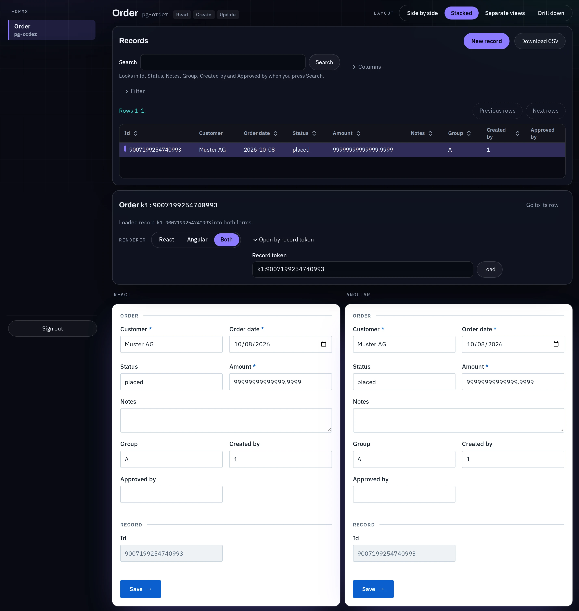

*`pg-order`, generated from `sales.order` on PostgreSQL as the order form's own account and published through the administrator plane, in the host page's workspace: the forms the person may read, the form's records in an AG Grid Community grid, and the open record drawn by `@formancy/react` and `@formancy/angular` from one definition through `@formancy/data-client` ([0047](./docs/decisions/0047-a-hosts-workspace-lists-opens-and-edits-records-in-linked-grids.md)). The order's id, “9007199254740993”, is 2^53+1, which a JavaScript number reads back as …992, and its amount, “99999999999999.9999”, is the largest `numeric(18,4)` holds. Both panes show both digit for digit, because exact values travel as strings ([0008](./docs/decisions/0008-exact-values-travel-as-strings.md)).*

Every picture in this README is taken by `pnpm pictures` from the built pages and the real data server, and the pictures job fails when one of them shows text the page no longer shows ([how, and what nothing checks](./docs/images/README.md)).

<!-- end generated -->

> **Status: 0.3.0, the third release.** Over 0.2.0 it adds the host
> token's verifier as a package of its own, `@formancy/data-identity`,
> which a product that verifies the same tokens installs without the
> server, Fastify or a driver
> ([0091](./docs/decisions/0091-the-host-identity-verifier-is-a-package-of-its-own-which-the-server-re-exports.md));
> a host page that drills down one level at a time, with a trail back
> ([0090](./docs/decisions/0090-a-hosts-workspace-can-drill-down-one-level-at-a-time-with-a-trail-back.md));
> and a release SBOM of what a consumer's install brings, held to that
> install
> ([0092](./docs/decisions/0092-the-sbom-describes-what-a-consumer-installs-and-is-held-to-that-install.md)).
> [`CHANGELOG.md`](./CHANGELOG.md)'s 0.3.0 section says what else changed,
> what to do when upgrading from 0.2.0, and what is knowingly missing; its
> *Unreleased* says what is on `main` since. The examples page at
> https://formancy.ai/data/examples/
> ([0069](./docs/decisions/0069-the-examples-page-is-served-at-formancy-ai-data-examples.md))
> and the [live demo](#live-demo) at https://formancy.ai/data/demo/
> ([0070](./docs/decisions/0070-the-live-demo-runs-the-real-server-and-postgresql-in-a-cloudflare-container-of-each-visitors-own.md))
> are deployed by Cloudflare from `main`, not from a release. Each line
> under *What it does* links the decision record whose **Verified by**
> names what fails when the line stops being true. Not yet: performance
> figures measured on this release -- [the performance page](./docs/performance.md)
> describes 0.1.0
> ([0084](./docs/decisions/0084-a-release-does-not-wait-for-the-performance-figures-to-be-measured-again.md))
> -- and any for a page of records, a file of them, the menu of forms or a
> delete; a host page that draws a field an update may not write as
> read-only
> ([filed](./docs/images/README.md#what-the-pictures-show-that-is-wrong));
> a host page on another origin run in a browser; a run through a real
> Cloudflare tunnel; anything that reads what Cloudflare sends at the
> examples page's address, which was read by hand once, on 2026-10-16, or
> a sign-in to the live demo on Cloudflare, which was read by hand on
> 2026-10-19, its start answering after 1778 ms
> ([0088](./docs/decisions/0088-the-demo-image-makes-postgresqls-socket-directory-at-every-start-and-the-gate-runs-it-with-run-empty.md));
> a test that logs in as an Entra principal; and a licence a lawyer has
> reviewed.

## Try it

From an empty machine with Docker and git, `docker compose --profile stack up`
runs both databases with the sample fixture, the server, and the studio and
the host page behind one proxy. [The getting-started guide](./docs/getting-started.md)
gives the exact command, mints the tokens and walks from there to a published
order form used on the host page, on both engines; CI runs it as written from
a clean checkout
([0032](./docs/decisions/0032-a-clean-install-is-the-composed-stack-and-ci-runs-its-guide.md)).
Starting the stack accepts the EULA of SQL Server's Developer edition, which
is not licensed for production.

With nothing installed, the [examples page](#examples) is served at
https://formancy.ai/data/examples/: forms generated in your browser from a
captured snapshot and drawn by both renderers, with no server and no
database behind them. Cloudflare deploys it from `main` on every push
([the Worker's settings](./.github/REPO-METADATA.md#the-demos-worker-on-cloudflare)),
and `pnpm demo` runs the same build from a clone
([0069](./docs/decisions/0069-the-examples-page-is-served-at-formancy-ai-data-examples.md)).

With nothing installed either, the [live demo](#live-demo) at
https://formancy.ai/data/demo/ is the product itself: the host page's
workspace over a data server and a PostgreSQL of your own, started on
Cloudflare when you sign in as one of the demo's people, with sample sales
data, and gone with everything you changed when it sleeps. Cloudflare
deploys it from `main` once its Worker is created
([the Worker's settings](./.github/REPO-METADATA.md#the-live-demos-worker-on-cloudflare));
until then the address is formancy.ai's 404
([0070](./docs/decisions/0070-the-live-demo-runs-the-real-server-and-postgresql-in-a-cloudflare-container-of-each-visitors-own.md)).

## What it does

**For the administrator, in the [studio](#studio):**

- **Sees what one account sees, and says what it cannot.** What the catalog
  hid from the account is a gap, "cannot tell", never taken as absence;
  every column says what the account may read, insert and update, and every
  table whether row-level security applies to it, whether the account may
  delete from it, and which foreign keys, from any schema, refer to it
  ([0004](./docs/decisions/0004-a-snapshot-says-what-it-could-not-see.md),
  [0007](./docs/decisions/0007-sqlserver-discovery-and-what-it-hides.md),
  [0027](./docs/decisions/0027-a-snapshot-says-what-its-account-may-do.md),
  [0049](./docs/decisions/0049-a-snapshot-says-whether-its-account-may-delete-and-what-refers-to-each-table.md)).
  Since 0.2.0, not in 0.1.0: a snapshot records which server it was read
  from -- the product, the major version and, on SQL Server, the database's
  compatibility level -- from which `@formancy/data-core` says whether this
  release was tested on that server, never taking Azure SQL Database for
  the SQL Server 2014 its major would be. Nothing refuses a server for
  being untested; a SQL Server older than 2019, whose catalog lacks a view
  discovery reads, is refused with its release named
  ([0068](./docs/decisions/0068-a-snapshot-records-the-server-it-was-read-from-and-nothing-refuses-a-server-discovery-can-read.md)).
  No test runs on Azure SQL Database or Azure SQL Managed Instance:
  neither has an image a test can start, and a snapshot of either is
  called not tested. Every SQL Server test runs the Developer edition on
  Linux in a container, and another edition or platform of a release the
  matrix runs, SQL Server on Azure Virtual Machines among them, is called
  tested on its strength
  ([0073](./docs/decisions/0073-azure-sql-is-not-tested-and-the-release-says-so.md)).
  A SQL Server connection may log in as an Entra managed identity or
  service principal instead of a SQL login, over TDS 8.0 with the server's
  certificate checked, which SQL Server 2019 and 2022 on Linux do not take,
  its credential built once for each connection and asked for Azure SQL's
  token alone. No test logs in as either: the server says so at start for
  each such connection, and [*What it is tested on*](#what-it-is-tested-on)
  says so in a row of its own ([0074](./docs/decisions/0074-a-sql-server-connection-may-log-in-as-an-entra-principal-and-no-test-logs-in-as-one.md)).
  Since 0.2.0, not in 0.1.0: a SQL login that asks for TLS keeps TDS 7's,
  which every image of the matrix takes, and is refused before its login
  is sent when the server's first answer says it will not encrypt, as
  MS-TDS says a client ends such a connection; a 0.1.0 server sends the
  login, its password in it, to whoever answered so
  ([0081](./docs/decisions/0081-a-sql-login-that-asks-for-tls-is-refused-when-the-server-answers-that-it-will-not-encrypt.md)).
- **Generates a form deterministically**, and says what it inferred, made
  read-only, excluded and blocked, and why
  ([0009](./docs/decisions/0009-generation-is-deterministic-and-says-what-it-chose.md)).
  A key the database numbers or fills -- an identity, or a column with a
  default that is all of the key the policy does not pin, such as a uuid
  from `gen_random_uuid()` or `newsequentialid()` alone or beside a pinned
  tenant -- is shown and never written
  ([0026](./docs/decisions/0026-name-every-column-fact-the-engines-disagree-on.md),
  [0056](./docs/decisions/0056-a-key-the-database-fills-is-never-written-and-a-uuid-is-ordered-as-each-engine-orders-it.md)).
- **Writes a policy the server asks on every request.** Who may read, create
  and update which fields; row filters taken from the signed-in person's
  trusted attributes, never from the form
  ([0011](./docs/decisions/0011-every-operation-carries-a-trusted-policy-context.md),
  [0022](./docs/decisions/0022-the-runtime-plane-asks-the-policy-every-time.md)).
  A child table with no tenant column of its own, an order's lines, can be
  kept to its parent's tenant: when its policy names the parent's lookup in
  `through`, a box the Policy step offers, a line of another tenant's order
  is not found on read or update. Nothing requires it: until then any of its
  rows is in reach of a guessed token, which the step notes and never
  refuses. A through is one hop and never over a text key, and on PostgreSQL
  an update racing a move of its parent to another tenant may be written
  ([0043](./docs/decisions/0043-a-child-forms-rows-are-reached-only-through-a-parent-its-policy-admits.md)).
  Who may delete is granted there too, and each foreign key a delete acts
  through -- for the fixture's order, the keys of its lines, its deliveries
  and, past them, their parcels -- is accepted by its own box, never all at
  once; a key that only refuses is listed, what no box can fix is said in
  the server's words, and triggers and rules are said not to be listed. The
  step checks a delete grant with the function the server's publish check
  refuses one by
  ([0052](./docs/decisions/0052-the-studio-says-before-publication-who-may-delete-and-what-a-delete-also-does.md)).
- **Keeps presentation as a patch over the generated form** -- labels,
  order, full width, and a field moved to another generated section --
  carried through a regeneration by what each field stands for
  ([0030](./docs/decisions/0030-presentation-is-a-patch-over-the-generated-base.md),
  [0075](./docs/decisions/0075-a-field-may-move-to-another-generated-section.md)).
  A key that now names another column keeps its grants only once somebody
  confirms it in the publish over the version they were written in,
  whichever client publishes over a version the server still serves; grants
  removed in one version and given back in the next are not asked about
  ([0039](./docs/decisions/0039-a-publish-says-what-happens-to-the-grants-of-reassigned-keys.md)).
- **Publishes without overwriting anyone.** Of two administrators publishing
  from one version exactly one wins, every version is kept and checked on
  every read, and an older one is restored only while the database still fits
  it
  ([0013](./docs/decisions/0013-published-configuration-is-files-with-link-based-swap.md),
  [0019](./docs/decisions/0019-a-published-form-is-checked-every-time-it-is-read.md),
  [0030](./docs/decisions/0030-presentation-is-a-patch-over-the-generated-base.md)).
- **Moves a version between deployments** as the file its store wrote: the
  import is checked as a publish is, against the target's allowlist by the
  same connection name, and refused when the target database's drift blocks
  it, as a restore is
  ([0062](./docs/decisions/0062-a-published-version-moves-between-deployments-as-its-version-file.md)).
- **Can have a second person approve publication**, since 0.2.0: not in
  0.1.0. With `FORMANCY_DATA_PUBLISHER_ROLES` set, nobody publishes or imports a
  version alone: an administrator submits a draft, which the server keeps,
  and a publisher who did not submit it approves it, which checks it again
  against the database and writes exactly what was submitted. Restoring a
  version is one publisher's, alone. Unset, as in the composed stack,
  every administrator publishes alone, as before
  ([0065](./docs/decisions/0065-with-publisher-roles-set-a-draft-is-published-only-when-a-publisher-who-did-not-submit-it-approves-it.md)).
- **Reviews drift** against what a published form's bindings and lookups rest
  on, and says which operations each change blocks
  ([0010](./docs/decisions/0010-drift-is-classified-against-the-bindings.md))
  and which of those the server still allows, where what blocks them is a
  change it does not compare when a request arrives
  ([0041](./docs/decisions/0041-the-runtime-refuses-what-drift-blocks.md)).
  When the database was read from a server this release was not tested
  on, every review says so, for review, and stops nothing, as the
  connection test and the studio's metadata pane say it before a form is
  generated
  ([0068](./docs/decisions/0068-a-snapshot-records-the-server-it-was-read-from-and-nothing-refuses-a-server-discovery-can-read.md)).

**For the person filling in the form, through any host:**

- **Exact values travel as strings**, as the picture above shows
  ([0008](./docs/decisions/0008-exact-values-travel-as-strings.md)).
- **A lookup offers only the rows the person may choose.** An option's token
  is a reference, not a permission, and the choice is checked again on save
  ([0012](./docs/decisions/0012-a-lookup-token-is-a-reference-not-a-permission.md),
  [0018](./docs/decisions/0018-one-planner-turns-answers-into-requests.md),
  [0028](./docs/decisions/0028-filters-labels-and-refusals-mean-the-same-on-both-engines.md)).
  A search the page abandons, or one that runs past the server's lookup
  deadline, is stopped in the database rather than left to finish for
  nobody; a search still reads every row the filter admits
  ([0061](./docs/decisions/0061-a-lookup-statement-stops-when-its-request-is-abandoned-or-its-deadline-passes.md)).
- **A lookup a person can search is a box to type into.** The generator
  draws it as a typeahead when the columns it shows include text or a whole
  number, which is what a search matches; a lookup that shows neither is a
  plain list of its first page, and the generator's note says so. One that
  would show a binary or unsupported column, which no label can spell, is
  refused before it is published
  ([0066](./docs/decisions/0066-a-lookup-a-person-can-search-is-generated-as-a-typeahead.md)).
  It says when its list goes on, never how long it is, and when matching
  rows cannot be chosen here: under a plain select, where it is seen, and
  from an open typeahead's status line, which formancy 0.6.0's themes draw
  the open list over, so a screen reader hears it and the eye does not
  ([0085](./docs/decisions/0085-a-lookup-says-when-its-list-goes-on-never-how-long-it-is.md)).
- **Every write is one guarded statement.** A stale save is refused instead
  of overwriting
  ([0015](./docs/decisions/0015-a-record-operation-is-one-guarded-statement.md));
  a save whose answer was lost says it may have been saved, and the page
  sends nothing again
  ([0031](./docs/decisions/0031-an-answer-lost-after-a-write-is-unknown.md)).
  Over HTTP/1.1, when a connection the browser reused closes after the server
  read a save and before any byte of an answer, Chromium and Firefox send it
  again on their own, and one server process answers that second sending
  with the first one's answer instead of applying it; WebKit on Linux sends
  every save on a new connection and never sends one twice, so its page says
  the save may have been saved
  ([0058](./docs/decisions/0058-the-browser-gates-run-in-chromium-firefox-and-webkit-and-each-fact-the-browsers-disagree-on-is-named-and-held.md)).
- **An instant or a time the person may read and did not change is never
  written back**
  ([0040](./docs/decisions/0040-instants-and-times-are-read-to-the-shape-and-an-unedited-one-is-never-written.md)).
- **The server refuses what drift blocks in the form's own table**: opening
  the form, reading and saving, each decided over the table as the catalog
  describes it in that request
  ([0041](./docs/decisions/0041-the-runtime-refuses-what-drift-blocks.md)).
- **Records can be listed a page at a time**, under the read policy and its
  throughs, through the runtime plane and `@formancy/data-client`; the
  [host page](#host-example) draws them in an AG Grid Community grid
  ([0044](./docs/decisions/0044-a-forms-records-are-listed-a-page-at-a-time-under-its-read-policy.md),
  [0047](./docs/decisions/0047-a-hosts-workspace-lists-opens-and-edits-records-in-linked-grids.md)).
  Ordered by a uuid key, a list comes in each engine's own order of uuid --
  PostgreSQL's bytes in turn, SQL Server's byte groups -- total and stable on
  both, and not the same
  ([0056](./docs/decisions/0056-a-key-the-database-fills-is-never-written-and-a-uuid-is-ordered-as-each-engine-orders-it.md)).
- **A person can download the records a list would show them as one CSV
  file**, for the same search, sort and parent and under the same read
  policy, with no right of its own, through the runtime plane and
  `@formancy/data-client`'s `exportRecords`. The server makes the whole
  file before it sends a byte, so a file is whole or refused with its own
  code, never cut short: refused past 16 MiB or 30 seconds, and while
  another file is being made through the same allowlisted connection.
  Each value is what a read holds, digit for digit, a lookup its label
  beside its key, and a cell a spreadsheet would read as a formula carries
  one apostrophe in front, which taking one off every cell that has one
  undoes. It is not the table at one moment: a record two pages would both
  show refuses the file, and a row deleted meanwhile can be missing
  ([0079](./docs/decisions/0079-a-person-downloads-the-records-a-list-shows-them-as-one-csv-file-made-whole-or-not-at-all.md)).
  The host page saves it from the grid that lists the records, with
  Download CSV ([0080](./docs/decisions/0080-a-host-downloads-the-records-its-grid-lists-and-the-browser-saves-the-servers-file.md)).
- **A record can be deleted, one at a time, by its token and the version its
  person read**, under the policy's `operations.delete`, granted only to
  roles that may read and scoped as an update is, in one guarded statement
  that deletes one row or none, through the runtime plane and
  `@formancy/data-client`; a deletion whose answer was lost is safe to send
  again with the same version. A form offers delete once regenerated from a
  snapshot this release took, where SQL Server's rowversion guards it or
  the database numbers its key: an identity, or a key of one column that
  `gen_random_uuid()` or `newsequentialid()` fills, as the snapshot spells
  the default, and that no foreign key includes -- so PostgreSQL's
  deliveries offer it, and its order lines, whose key people type, do
  not. Triggers that run on a delete are the database's, and on PostgreSQL
  a rule that acts on one makes every delete of its table refused. The host
  page deletes from the open record's detail and from each grid row, after
  a confirmation in place
  ([0050](./docs/decisions/0050-a-record-is-deleted-one-at-a-time-by-its-token-and-the-version-its-person-read.md),
  [0053](./docs/decisions/0053-a-host-deletes-a-record-from-its-detail-or-its-row-after-a-confirmation-in-place.md),
  [0057](./docs/decisions/0057-a-key-of-one-column-filled-by-a-never-repeating-default-counts-as-numbered.md)).
- **A delete reaches other tables only through the foreign keys its policy
  names**, each in `cascades` with what it does -- CASCADE, SET NULL or SET
  DEFAULT -- and only where the account may DELETE from every table it
  reaches: the fixture's deliveries are deleted with their parcels, on both
  engines, once a policy names `fk_parcel_delivery`, and its orders with
  their lines, deliveries and parcels once one names `fk_order_line_order`,
  `fk_delivery_order` and `fk_parcel_delivery`. A key nobody named, one
  whose action changed, a table outside the scope or a SET NULL another
  key follows ON UPDATE refuses the delete, at publish and in the
  database's own statement, and nothing is deleted; on PostgreSQL such a
  delete locks every table it reaches first. The rows a cascade reaches
  are the database's, asked of no form's policy
  ([0051](./docs/decisions/0051-a-delete-reaches-other-tables-only-through-foreign-keys-the-policy-names.md)).
- **A person is shown the forms they may read**, and nothing about any
  other, each with the forms whose rows a page may list below one of its
  records, derived from the published forms' foreign keys and types without
  a statement to any database; the host page draws them as its menu of
  forms, and an open record's child rows below it
  ([0045](./docs/decisions/0045-the-runtime-plane-lists-the-forms-a-person-may-read-and-nothing-about-the-others.md),
  [0047](./docs/decisions/0047-a-hosts-workspace-lists-opens-and-edits-records-in-linked-grids.md)).
- **One definition, both renderers**, through one client; the host page
  draws a record in React, Angular or both, as the person chooses
  ([0029](./docs/decisions/0029-a-host-renders-a-published-form-through-one-client.md),
  [0047](./docs/decisions/0047-a-hosts-workspace-lists-opens-and-edits-records-in-linked-grids.md)).
- **Unsaved work is asked about before the host page drops it**: anything
  on the page that would close a form holding unsaved changes asks first;
  a reload or a closed tab does not
  ([0047](./docs/decisions/0047-a-hosts-workspace-lists-opens-and-edits-records-in-linked-grids.md)).

**For the operator:**

- **The whole product from one command**, as [*Try it*](#try-it) says
  ([0032](./docs/decisions/0032-a-clean-install-is-the-composed-stack-and-ci-runs-its-guide.md)),
  and a guide that puts it behind a Cloudflare Tunnel and Access, through
  which nothing has run yet
  ([0037](./docs/decisions/0037-cloudflare-is-the-edge-not-the-runtime.md)):
  [*Deploying*](#deploying).
- **Audited and measured.** One audit event for each request that reaches a
  route of either plane, and never a value
  ([0023](./docs/decisions/0023-the-audit-trail-is-operational-not-evidence.md),
  [0033](./docs/decisions/0033-the-administrator-plane-is-audited.md)); a
  delete's only trace is the keyed hash of its token, and without an audit
  key there is none
  ([0050](./docs/decisions/0050-a-record-is-deleted-one-at-a-time-by-its-token-and-the-version-its-person-read.md));
  performance measured through the shipped server on both engines, for every
  runtime request but a page of records, the menu of forms and a delete, and held in CI by rows read and
  round trips, never a time
  ([0034](./docs/decisions/0034-performance-is-measured-through-the-shipped-server-and-held-without-a-clock.md)).
- **A host identity key rotates without a restart.** A JSON Web Key Set
  file, each key selected by the `kid` a token names and read again on
  SIGHUP; a bad file leaves the keys in force, and nothing is fetched
  ([0059](./docs/decisions/0059-the-host-identity-key-is-a-set-selected-by-kid-and-read-again-on-sighup.md)).
- **A host page on another origin is answered when its origin is listed
  exactly**; the administrator's plane answers no other origin, and a
  request riding a grant from before an origin was removed is refused in
  every browser that sends `Sec-Fetch-Site`
  ([0060](./docs/decisions/0060-the-runtime-plane-answers-the-origins-an-operator-lists-and-the-administrators-plane-none.md)).
- **Every CI run ends in a report** of what it was tested on, which a release
  signs and attaches
  ([0035](./docs/decisions/0035-a-release-report-is-derived-from-the-run-that-gated-it.md)),
  and since 0.2.0 it holds every shared case on every image of
  each engine's matrix, failing a run in which one is missing or failed on
  any of them
  ([0067](./docs/decisions/0067-the-adapter-suites-run-on-every-image-of-a-per-engine-matrix.md));
  the built studio and host page carry the licence and notice texts of
  what they bundle, but what Vite folds in as text
  ([0046](./docs/decisions/0046-a-built-app-carries-the-licence-and-notice-texts-of-everything-it-bundles.md)):
  [*Development*](#development).

## Licence, in one table

Source-available, **not** open source. The formancy engine, renderers, builder
and backend this module builds on stay Apache-2.0; this module does not.

| Use | Terms |
| --- | --- |
| Read the source and fork the repository | Free |
| Evaluate, develop and test — including in companies | Free |
| Run in production, internally or customer-facing | Paid licence |
| Redistribute inside another software product | Separate commercial agreement |
| Customer data and generated form definitions | Remain the customer's |

<!-- generated by scripts/licence-status.mjs from LICENSE.md; do not edit -->

[`LICENSE.md`](./LICENSE.md) has the terms. It is Version 1.1, in force from 11 October 2026, and says at the top that no lawyer has reviewed it. A production licence is requested from [info@formancy.ai](mailto:info@formancy.ai), as its section 9 says.

<!-- end generated -->

Why a paid module exists beside an Apache-2.0 project, and why in a
repository of its own, is decision
[0001](./docs/decisions/0001-a-paid-module-in-its-own-repository.md); the
decision to put the licence in force before a lawyer had read it, and what
that leaves open, is
[0048](./docs/decisions/0048-the-licence-is-in-force-before-a-lawyer-has-read-it.md);
Version 1.1, under which a redistribution agreement is requested at the same
address as a production licence, is
[0054](./docs/decisions/0054-version-1-1-names-the-address-for-a-redistribution-agreement-too.md).

The studio, the host page and the examples page bundle other people's
packages, React, Angular and upstream formancy among them: each build writes
`THIRD-PARTY-NOTICES.txt` beside its page with their licence and notice
texts, but for what
[0046](./docs/decisions/0046-a-built-app-carries-the-licence-and-notice-texts-of-everything-it-bundles.md)
names, and stops when a bundled package ships no licence text. The composed
stack serves them at `/studio/THIRD-PARTY-NOTICES.txt` and
`/host/THIRD-PARTY-NOTICES.txt`, and this repository's own `LICENSE.md` and
`NOTICE` are in the image. The examples page's are at
https://formancy.ai/data/examples/THIRD-PARTY-NOTICES.txt, and the page
links this repository for the rest
([0069](./docs/decisions/0069-the-examples-page-is-served-at-formancy-ai-data-examples.md)).

## Studio

`apps/studio` is the administrator's application, private and never
published: sign in with a host token, connect, choose a root table, generate,
write the policy, arrange labels, preview, publish, and review drift. It
speaks only to the server's administrator plane and `/v1/whoami`
([0024](./docs/decisions/0024-the-studio-speaks-only-the-admin-plane.md)).

<!-- generated by scripts/pictures/readme.mjs from scripts/pictures/scenes.json: studio; do not edit -->

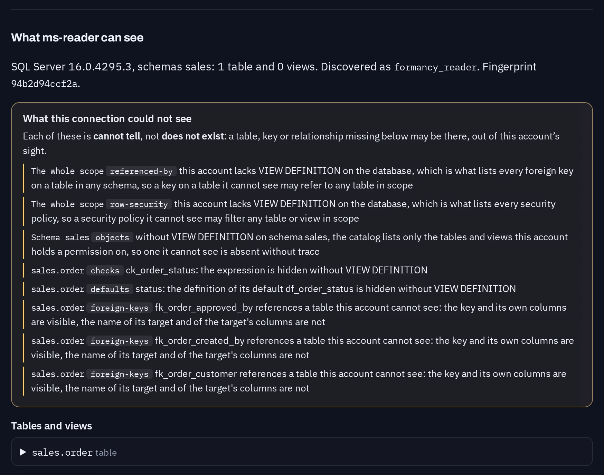

**Step 1, Connect.** *On SQL Server, as an account without VIEW DEFINITION. What the catalog hid from it comes first, each gap “cannot tell”, not “does not exist”, so a table or key missing below is never taken as absent ([0004](./docs/decisions/0004-a-snapshot-says-what-it-could-not-see.md), [0007](./docs/decisions/0007-sqlserver-discovery-and-what-it-hides.md)).*

<details>
<summary>More: Choose</summary>

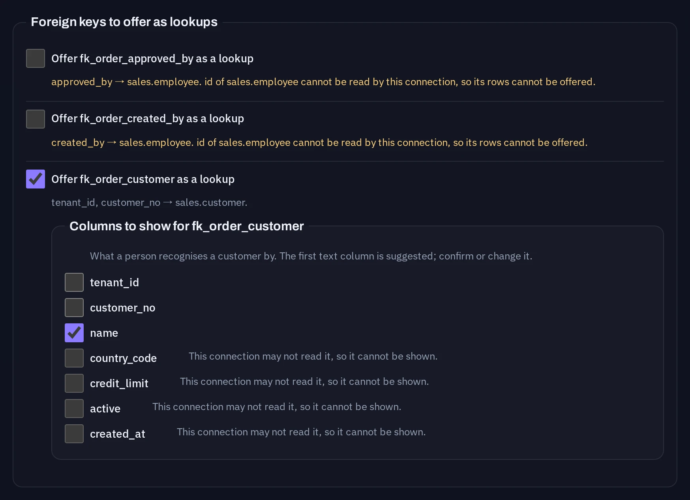

**Step 2, Choose.** *As the order form's own account. A foreign key is offered as a lookup only where this account may read its target: `approved_by` and `created_by` point at `sales.employee`, whose rows “cannot be offered”, and the customer columns it may not read “cannot be shown” ([0027](./docs/decisions/0027-a-snapshot-says-what-its-account-may-do.md)).*

</details>

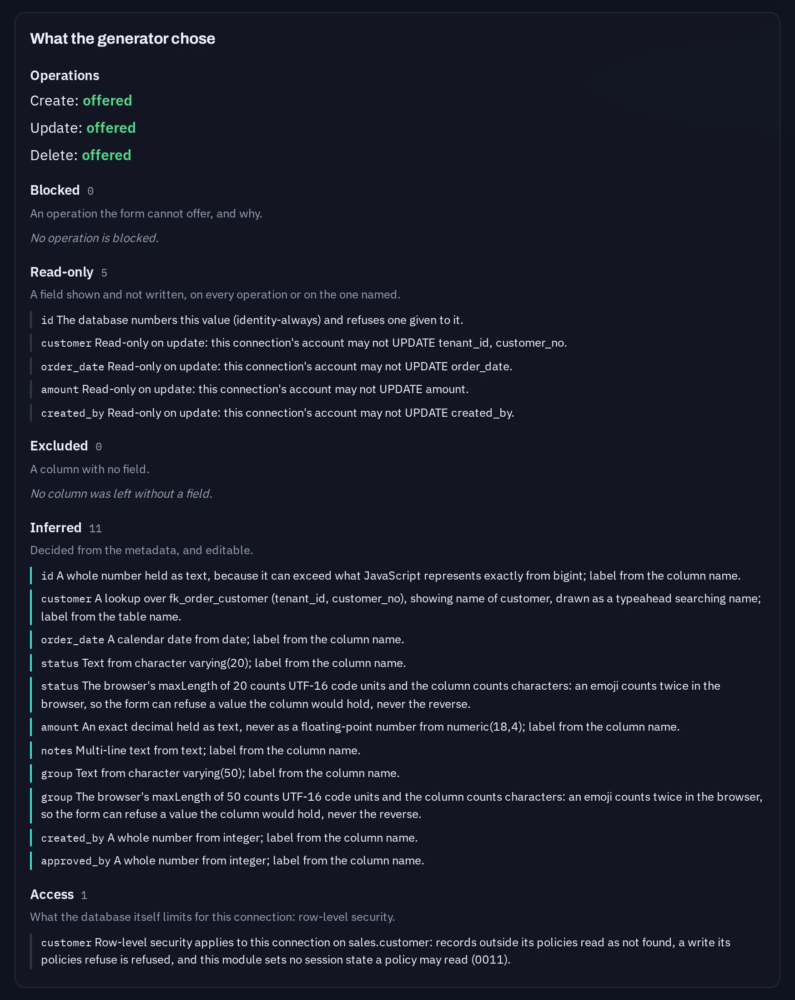

**Step 3, Generate.** *The generator says what it chose and what it refused, kind by kind, from what this account may do: a column it may not update is “Read-only on update”, and “Row-level security applies” to it on `sales.customer`, named as the database's own limit ([0009](./docs/decisions/0009-generation-is-deterministic-and-says-what-it-chose.md), [0027](./docs/decisions/0027-a-snapshot-says-what-its-account-may-do.md)).*

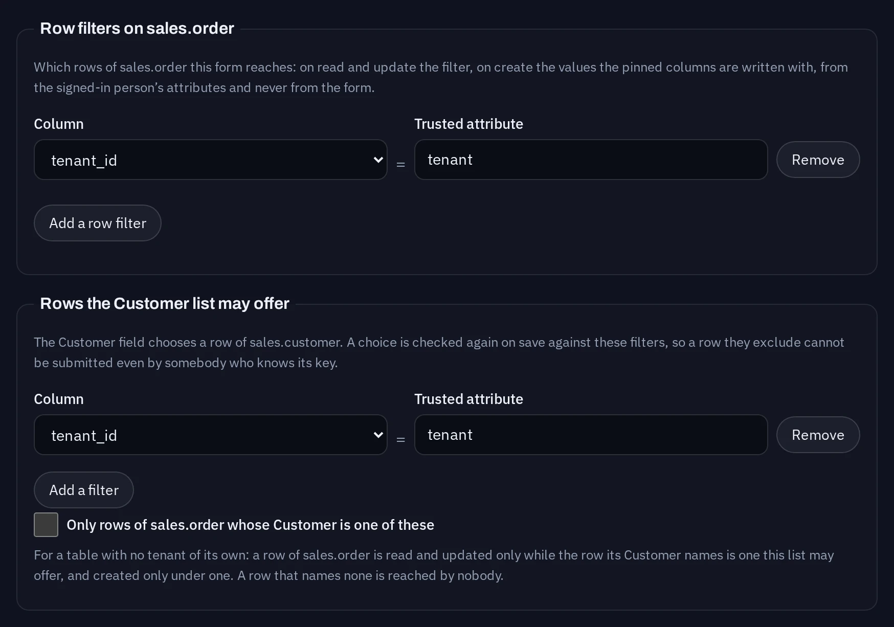

**Step 4, Policy.** *The tenant pin becomes a row filter on the orders this form reaches and on the customers its list may offer, taken from the signed-in person's attributes “and never from the form”; a customer outside the filter is refused on save “even by somebody who knows its key” ([0011](./docs/decisions/0011-every-operation-carries-a-trusted-policy-context.md)).*

<details>
<summary>More: Order lines through their order, Presentation, Preview</summary>

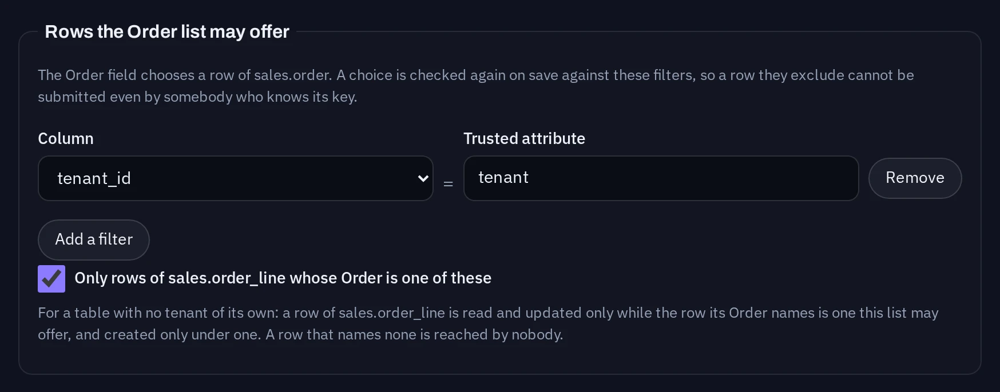

*A form over `sales.order_line`, which has no tenant column, discovered as the fixture's owner because the order form's own account may not read the lines. Its Order list is filtered to the person's tenant; ticked, the box “Only rows of sales.order_line whose Order is one of these” makes another tenant's line not found on read and update, and “A row that names none is reached by nobody.” Unticked, the step notes that nothing scopes the rows; nothing requires the box ([0043](./docs/decisions/0043-a-child-forms-rows-are-reached-only-through-a-parent-its-policy-admits.md)).*

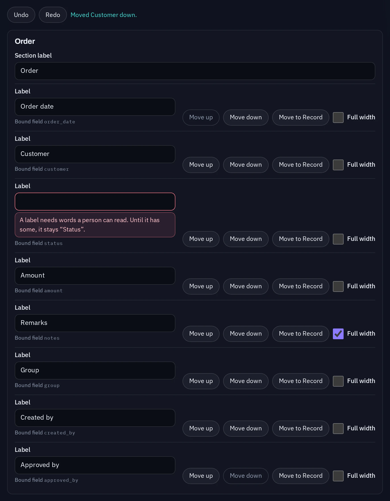

**Step 5, Presentation.** *Labels, order, section and width are a patch over the generated form: every row names the column it is bound to and may move to the other section, nothing here adds, removes or renames a field, and an empty label is refused: “A label needs words a person can read.” ([0030](./docs/decisions/0030-presentation-is-a-patch-over-the-generated-base.md), [0075](./docs/decisions/0075-a-field-may-move-to-another-generated-section.md)).*

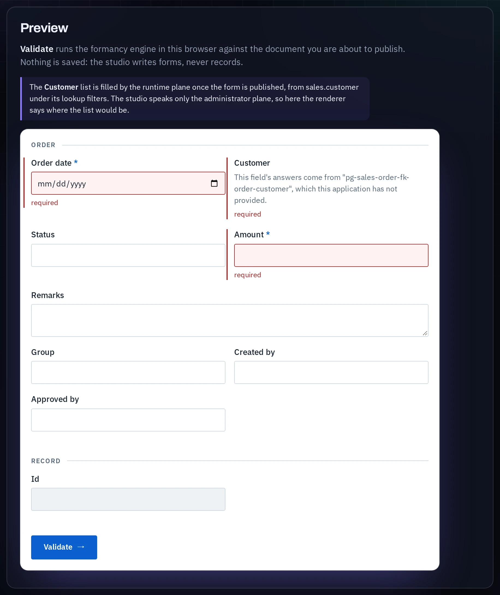

**Step 6, Preview.** *The form as the people filling it in will see it, with the labels and order chosen in Presentation, on white paper in the Blueprint theme, and checked by the released engine after Validate. The Customer list is filled only by the runtime plane, so “the renderer says where the list would be”.*

</details>

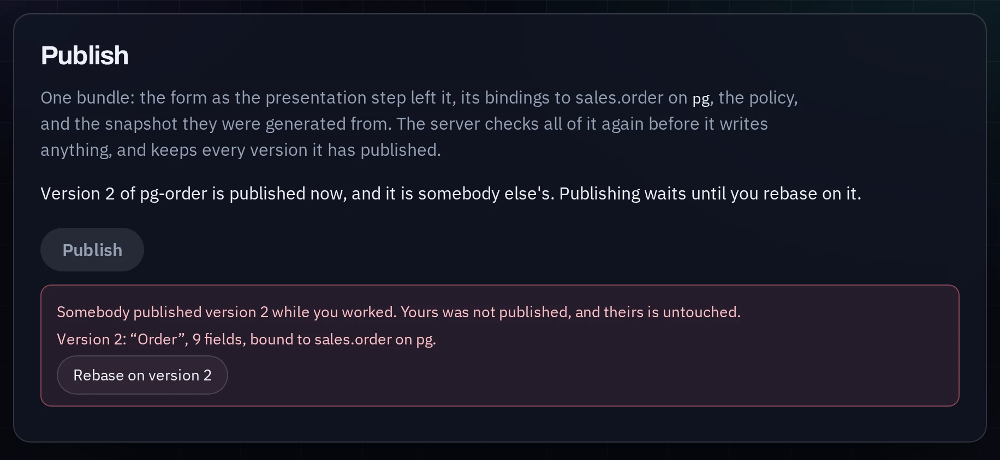

**Step 7, Publish.** *Another administrator, grace, published version 2 while ada worked; the capture script sends grace's request to the same server. Nothing is overwritten: “Yours was not published, and theirs is untouched.” The step says which version is published now, and “Publishing waits until you rebase on it.” ([0013](./docs/decisions/0013-published-configuration-is-files-with-link-based-swap.md)).*

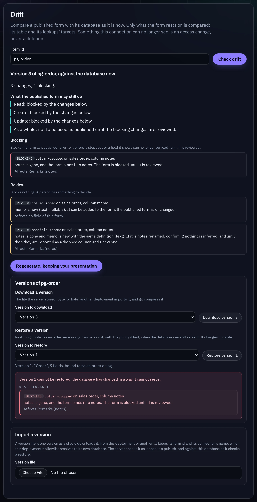

**Step 8, Drift.** *After the capture script renamed `notes` to `memo` in the captured snapshot, as discovery reports a real rename on both engines. The rename is a “possible-rename” for a person to confirm, not a guess, and restoring version 1, which still binds `notes`, is refused: “Version 1 cannot be restored: the database has changed in a way it cannot serve.” Against a database changed this way the server refuses what the report blocks ([0010](./docs/decisions/0010-drift-is-classified-against-the-bindings.md), [0030](./docs/decisions/0030-presentation-is-a-patch-over-the-generated-base.md), [0041](./docs/decisions/0041-the-runtime-refuses-what-drift-blocks.md)).*

<details>
<summary>More: Regenerated, Carried, Restored, A key that moved</summary>

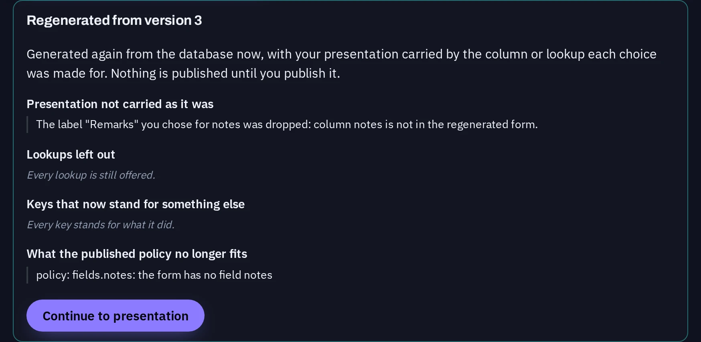

*Regenerated from the database as it is now, keeping the presentation, and saying before anything is published what it could not carry: the label chosen for `notes`, and the policy entry that names it. “Nothing is published until you publish it.”*

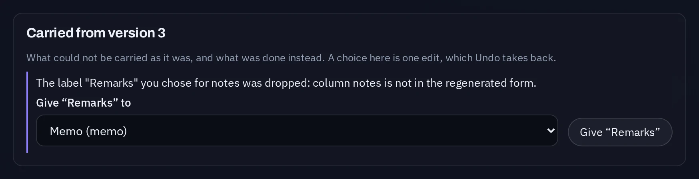

*Back in Presentation, the dropped label is offered to the new column as one edit, “which Undo takes back”; nothing carries it by guessing that `memo` is `notes`.*

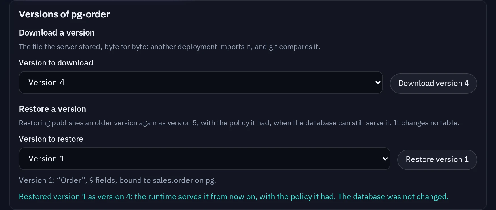

*After the capture script put the snapshot back without the rename, version 1 fits the database again and is restored as the next version, with the policy it had: “The database was not changed.”*

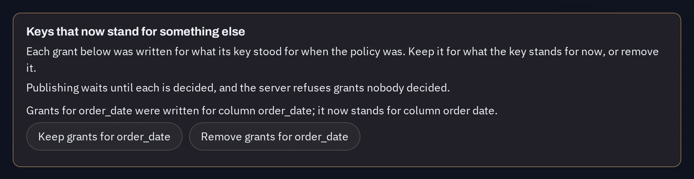

*The capture script renamed `order_date` to `order date` in the captured snapshot with the drift's function, which the adapters' suites compare with a real rename of `notes` only. Regenerated, the key `order_date` now names the column `order date`, and nothing can tell whether that is the same column, so its grants wait: “Keep grants for order_date”, or remove them. “Publishing waits until each is decided, and the server refuses grants nobody decided.” ([0039](./docs/decisions/0039-a-publish-says-what-happens-to-the-grants-of-reassigned-keys.md)).*

</details>

<!-- end generated -->

```bash
pnpm build
FORMANCY_DATA_SERVER=http://127.0.0.1:4390 pnpm --filter @formancy/data-studio dev   # http://localhost:4392
```

The administrator's plane answers no other origin
([0060](./docs/decisions/0060-the-runtime-plane-answers-the-origins-an-operator-lists-and-the-administrators-plane-none.md)), so the studio is served from the server's
origin: in development Vite proxies `/v1` to `FORMANCY_DATA_SERVER`, and in a
deployment one reverse proxy serves `apps/studio/dist` and `/v1` together, as
[*Deploying*](#deploying) says. The token is held in the tab's memory only;
reloading the page signs out. The server needs its administrator plane turned
on — a store, an allowlist and `FORMANCY_DATA_ADMIN_ROLES`, as
[its README](./packages/data-server/README.md) says; against a server without
one, the studio says so at sign-in. Against a server that reviews
publication, it submits a draft where it would publish or import, and a
Review step lists the drafts for a publisher to approve or reject
([0065](./docs/decisions/0065-with-publisher-roles-set-a-draft-is-published-only-when-a-publisher-who-did-not-submit-it-approves-it.md)).

Its suite runs the real server in the test — `createDataServer` with a fake
connection registry over snapshots captured from the shared fixture, as every
account `apps/studio/scripts/capture-snapshots.mjs` captures — behind a fake
`fetch`, so a change to a response shape fails the studio's tests.
`pnpm test:browser` walks the whole journey in Chromium against the same
server, and with `FORMANCY_BROWSERS=all` in Firefox and WebKit too, as CI's
legs do. After a change to the fixture, with Docker running:

```bash
pnpm build
pnpm --filter @formancy/data-studio snapshot
```

and commit the files under `apps/studio/src/fixtures/`.

## Host example

`apps/host` is a host application's page, private and never published: a
workspace over the server's runtime plane, through `@formancy/data-client`
and nothing else
([0029](./docs/decisions/0029-a-host-renders-a-published-form-through-one-client.md),
[0047](./docs/decisions/0047-a-hosts-workspace-lists-opens-and-edits-records-in-linked-grids.md)).

```bash
pnpm build
FORMANCY_DATA_SERVER=http://127.0.0.1:4390 pnpm --filter @formancy/data-host dev   # http://localhost:4393
```

Sign in with a host token, and Forms lists the published forms you may read
([0045](./docs/decisions/0045-the-runtime-plane-lists-the-forms-a-person-may-read-and-nothing-about-the-others.md)).
A form's records are a grid, AG Grid Community, a page at a time from the
server's list
([0044](./docs/decisions/0044-a-forms-records-are-listed-a-page-at-a-time-under-its-read-policy.md)),
searched when you press Search and sorted by any header the server says
sorts. Space opens a row beside the grid, Enter opens it and moves there;
the record is drawn by `@formancy/react`, `@formancy/angular` or both, as you
choose, and the choice is kept in this browser with where you left the
separator between the records and the record. Below the record, each form
whose rows reference it lists them -- an order's lines -- and each child row
opens in its own form; a new one is created under the open record. The
records and the record are side by side, stacked, or separate views, and
the address says which form and layout, never which record. Open by record
token loads one by its token.

Drill down, the fourth layout, shows one level at a time: the records, the
record, a child row of it with its own children, and so on as deep as the
forms go -- an employee, an order it approved, that order's line. Opening a
row goes down a level, and a trail above says where you are, each level
above a button back to it; Back and Forward move between the levels too.
A record is named in the trail by its first required plain text field, a
customer by its name, or else by its token. Going up keeps the levels
below as they were, typing included; going down elsewhere asks first when a
level below holds unsaved work. The levels are in the page's memory, so a
reload starts on the records
([0090](./docs/decisions/0090-a-hosts-workspace-can-drill-down-one-level-at-a-time-with-a-trail-back.md)).

Download CSV, beside New record in the Records panel and beside each child
section's New, saves one file of the records that grid lists, as the server
makes it: the search you submitted, not what the box holds, the grid's
sort and, in a child section, its record, whose column the file keeps
([0079](./docs/decisions/0079-a-person-downloads-the-records-a-list-shows-them-as-one-csv-file-made-whole-or-not-at-all.md),
[0080](./docs/decisions/0080-a-host-downloads-the-records-its-grid-lists-and-the-browser-saves-the-servers-file.md)). It is there wherever the form's records can be listed,
and not under a record not saved yet. While the file is made its line says
so and a press sends nothing; once it is made the line names it and the
browser saves it as `<form id>.csv`; a refusal is the server's sentence,
and pressing again asks again. Leaving the form or signing out stops a
file in the making without a word, and so does opening another record for
its child sections' files. The line names the file, not how many
records it holds, and says the page handed it over, not that the browser
kept it.

Where the server offers you delete, the open record's header has Delete
record, a child row's its own Delete, and each grid row a Delete button
named for its record, which the arrow keys reach without making the grid
more than one Tab stop; no key deletes. Each asks first, in place under
what you pressed, naming the record and saying what the delete also does
-- other records deleted with it, or the database keeping it while others
refer to it -- in the server's terms, never which tables or how many, and
listing any form of it that holds unsaved work; Keep it comes before Delete
it. A row's delete names the version the row was listed with, the open
record's the newest its forms heard. Once it is
deleted, the grid says so, with the keyboard on its heading; a record the
delete cannot find is closed, never called deleted; a refusal is said in
the server's words; and a deletion whose answer was lost may have been
done, is checked by reading the record, and is repeated only after asking
again
([0053](./docs/decisions/0053-a-host-deletes-a-record-from-its-detail-or-its-row-after-a-confirmation-in-place.md)).

Each form keeps its own draft and version, so loading one record into both
renderers, saving in one and then in the other is the stale case: the
second keeps what was typed, says so, and offers to load the saved record. A
selection the server refuses is said on the field.

The form stays editable while a save is out: what is typed meanwhile is kept
and said to be unsaved, a second press sends nothing and says so, and an
answer that arrives after the form was replaced is said on its line. An instant
or a time the person may read and did not change is never written back, so a
save keeps the fraction and the seconds the database holds, and a form whose
only change was such a field says it was not saved, because nothing changed
([0040](./docs/decisions/0040-instants-and-times-are-read-to-the-shape-and-an-unedited-one-is-never-written.md)).

Anything on the page that would drop a form holding unsaved changes, a save
still out or a save that may have been stored -- another row, New record,
Load, another form, Back, Sign out, a child row, hiding a renderer, or a
record created in one renderer, which the other then opens -- asks first,
and names what was typed while it waited before discarding it; a record
whose read answers after you have moved on is not opened over what you
typed since. A reload or a closed tab does not ask.

A save the server refuses because the table changed under the form is said in
the server's sentence, which names no column, and what was typed stays in the
form ([0041](./docs/decisions/0041-the-runtime-refuses-what-drift-blocks.md)).
Of the host page's suites and checks, only that picture's check below holds
the page to it, and on PostgreSQL alone
([0038](./docs/decisions/0038-readme-pictures-are-taken-by-a-script-and-held-to-the-text-they-show.md)).

What it does not do yet: no bulk delete and no undo, no file of a record
and all its children at once; and on a loaded
record it draws the fields an update may not write --
Customer, Order date, Amount and Created by for the order form's own
account -- as editable, and the server refuses a changed one, which is
[filed](./docs/images/README.md#what-the-pictures-show-that-is-wrong).

In a real host the application's own session supplies the token; the page asks
for one because it has none, holds it in memory only, and forgets it on a
reload. As with the studio, the page is served from the server's origin: in
development Vite proxies `/v1`, and in the composed stack the same
`deploy/web/nginx.conf` serves it at `/host/`, which the getting-started
guide's section 5 uses, under the studio's Content-Security-Policy with
inline styles allowed, for the style elements AG Grid creates, and
nothing else
([0083](./docs/decisions/0083-the-studio-and-the-host-page-are-served-under-a-content-security-policy-each.md)).

<!-- generated by scripts/pictures/readme.mjs from scripts/pictures/scenes.json: host; do not edit -->

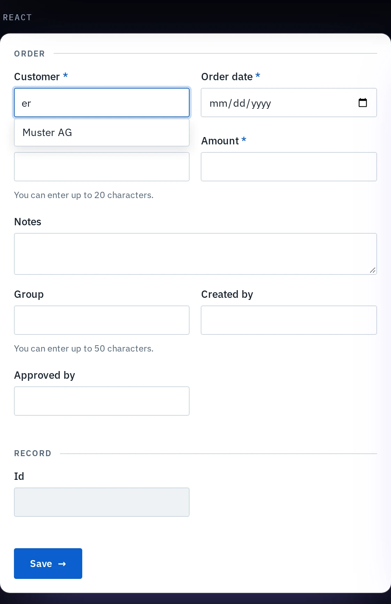

*The customer field is the published lookup, which the generator draws as a typeahead because its label can be searched ([0066](./docs/decisions/0066-a-lookup-a-person-can-search-is-generated-as-a-typeahead.md)). As clara, a clerk of tenant 1, types, the server answers as her with the rows she may choose: “Muster AG”, and not tenant 2's Other Tenant GmbH, which matches too and has the same customer number. Each option travels under a token that is a reference, not a permission ([0012](./docs/decisions/0012-a-lookup-token-is-a-reference-not-a-permission.md)).*

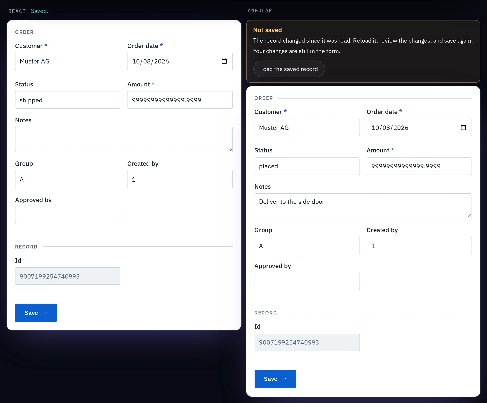

*Two drafts of one record. React saved first; Angular's save, made against the version it read, is refused as stale instead of overwriting it: “Your changes are still in the form.”, with a button to “Load the saved record” ([0015](./docs/decisions/0015-a-record-operation-is-one-guarded-statement.md)).*

<details>
<summary>More: A refused choice, A save whose answer was lost, Leaving unsaved work, Deleting a record, A save after the table changed, Another tenant's record</summary>

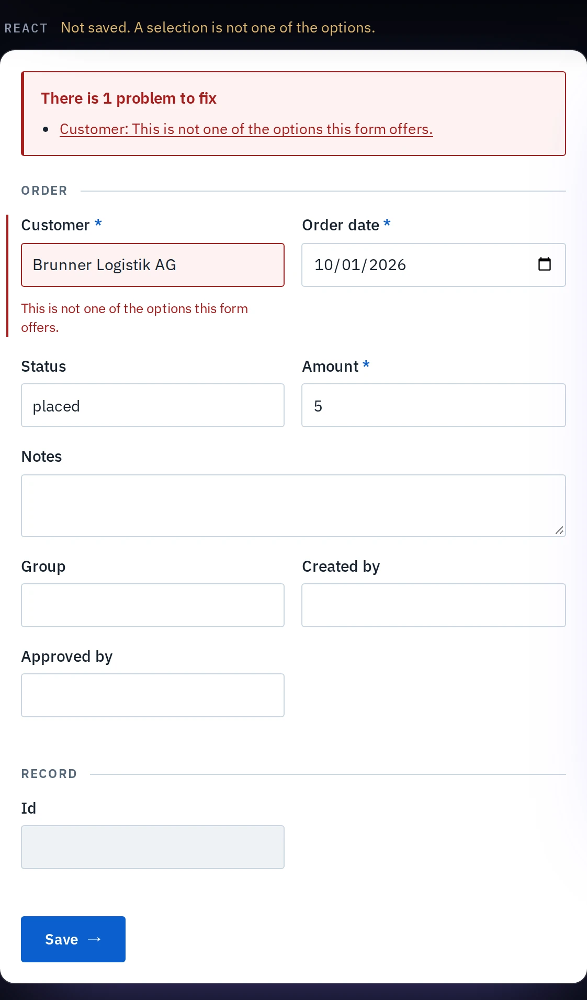

*A customer chosen from the list and deleted by somebody else before Save; the capture script inserts and deletes it through the database's owner. The server checks the choice again when the order is saved and refuses it on the field: “This is not one of the options this form offers.”*

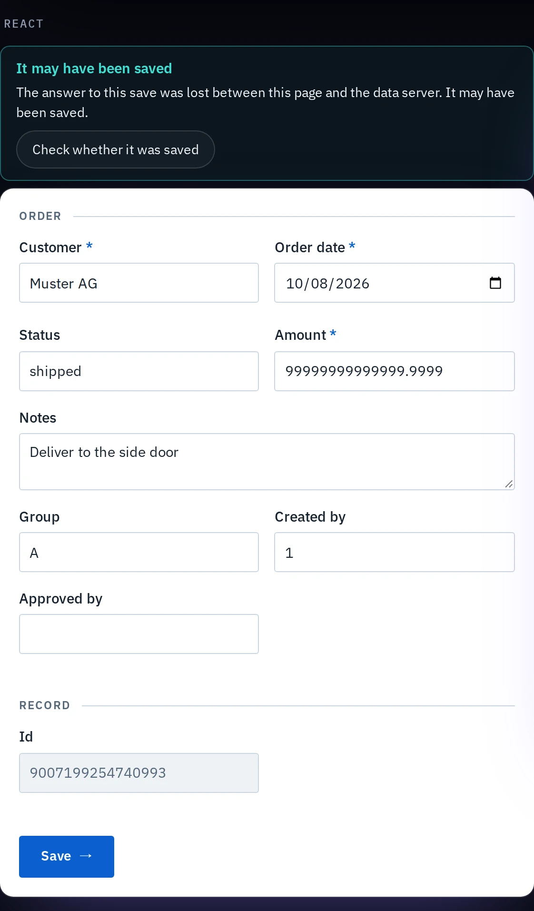

*A save whose answer was lost after the server stored it: the capture script lets the server store it and then tells the page the connection was reset. The page cannot know whether it was saved, so it says so, offers to check, and holds the save; the page sends nothing again ([0031](./docs/decisions/0031-an-answer-lost-after-a-write-is-unknown.md)).*

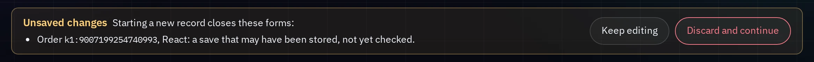

*The save whose answer was lost, above, is work a person could lose: New record would drop the form that holds it, so the workspace asks first. It names what was asked for and what each form holds, and waits: “Keep editing” changes nothing and gives the keyboard back, “Discard and continue” carries the request out. Every way of leaving a form asks the same -- another row, Load, another form, Back, Sign out, a child row and hiding a renderer ([0047](./docs/decisions/0047-a-hosts-workspace-lists-opens-and-edits-records-in-linked-grids.md)).*

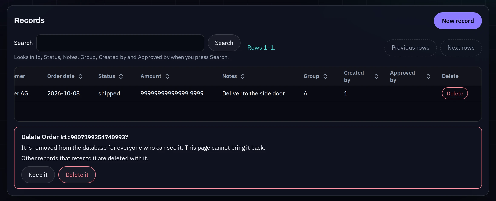

*`pg-order-delete`, the getting-started job's second order form, which the capture script publishes as the job does: it grants clerks delete and names each foreign key a delete of an order acts through ([0051](./docs/decisions/0051-a-delete-reaches-other-tables-only-through-foreign-keys-the-policy-names.md)). Each row of its grid has a Delete, a real button named for its record and reached by the arrow keys. Pressed, it asks in place, under the grid, with no overlay: the question names the record, and what the delete also does is said in the server's terms -- “Other records that refer to it are deleted with it.” -- never which tables or how many. “Keep it” comes first, so the keyboard is never put on the button that deletes ([0053](./docs/decisions/0053-a-host-deletes-a-record-from-its-detail-or-its-row-after-a-confirmation-in-place.md)).*

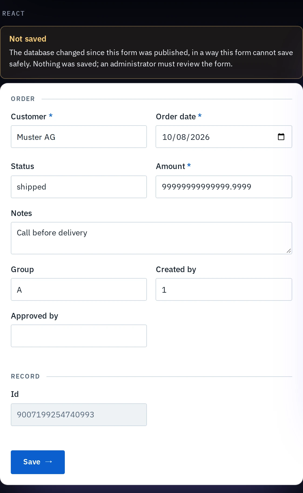

*After clara loaded the record, the capture script narrowed `status` from `varchar(20)` to `varchar(8)` through the database's owner, which drift review says stops create and update. Her save, which changes only the notes, is refused by the server in a sentence that names no column: “Nothing was saved; an administrator must review the form.” What she typed stays in the form, and the row is as it was ([0041](./docs/decisions/0041-the-runtime-refuses-what-drift-blocks.md)).*

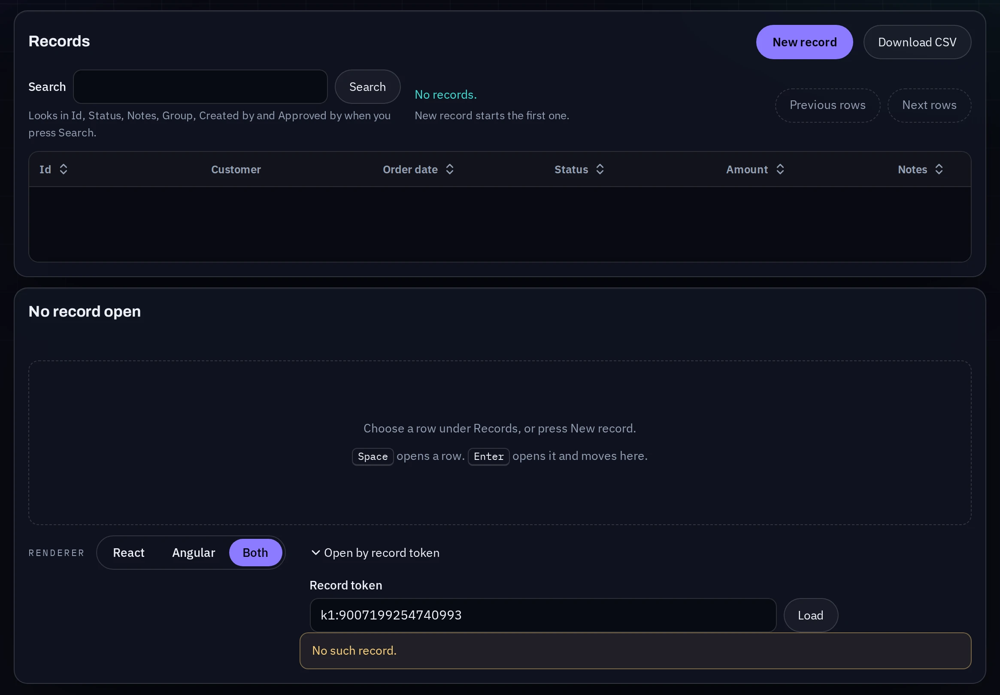

*otto, a clerk of tenant 2, may read records with this form, and his grid says “No records.”: tenant 1's orders are not listed for him. With tenant 1's record token he is told “No such record.”, the answer a token that names no record gets, so the page learns nothing about another tenant's orders ([0022](./docs/decisions/0022-the-runtime-plane-asks-the-policy-every-time.md)).*

</details>

<!-- end generated -->

Its suites run the real server against PostgreSQL and SQL Server through the
real drivers, with literal tokens and a `fetch` that goes through
`app.inject`. `pnpm test:browser` measures the page in Chromium, and with
`FORMANCY_BROWSERS=all` in Firefox and WebKit too, as CI's legs do, against
the real server on PostgreSQL, which needs Docker: the workspace in every
layout down to 320 pixels, the grids' keyboard and colours, the record's
journey, a delete's confirmations and answers, and a file downloaded, its
bytes the server's.

The page has a second build, for the [live demo](#live-demo):
`pnpm --filter @formancy/data-host build:demo` writes it to
`apps/host/dist-demo`. It is the same workspace, which asks the path it is
served from for the demo's people and signs a visitor in as one of them
where this build asks for a token, and reaches the runtime plane under that
path through data-client's `base`. This build leaves that branch out
([0070](./docs/decisions/0070-the-live-demo-runs-the-real-server-and-postgresql-in-a-cloudflare-container-of-each-visitors-own.md)).

## Examples

`apps/examples` is a page, never published to npm, that shows a generated
form the way the people filling it in will see it — under both renderers at
once. It is served at https://formancy.ai/data/examples/, and runs from a
clone:

```bash
pnpm demo                                        # builds, then serves the built page at http://localhost:4391
pnpm --filter @formancy/data-examples dev        # after pnpm build: the dev server, at http://localhost:4391
```

It reads a snapshot of the shared fixture, checks it against its fingerprint,
runs `generateForm` **in the browser** for `sales.order` and `sales.customer`,
and renders each with the released `@formancy/react` and `@formancy/angular`
side by side, on white paper in the Blueprint theme, with the generator's notes
— inferred, excluded, read-only, blocked — beside each. Its suite holds the two
renderers to the same fields by accessible name and the same error codes
([0021](./docs/decisions/0021-generated-forms-preview-in-both-frameworks.md)).

<!-- generated by scripts/pictures/readme.mjs from scripts/pictures/scenes.json: examples; do not edit -->

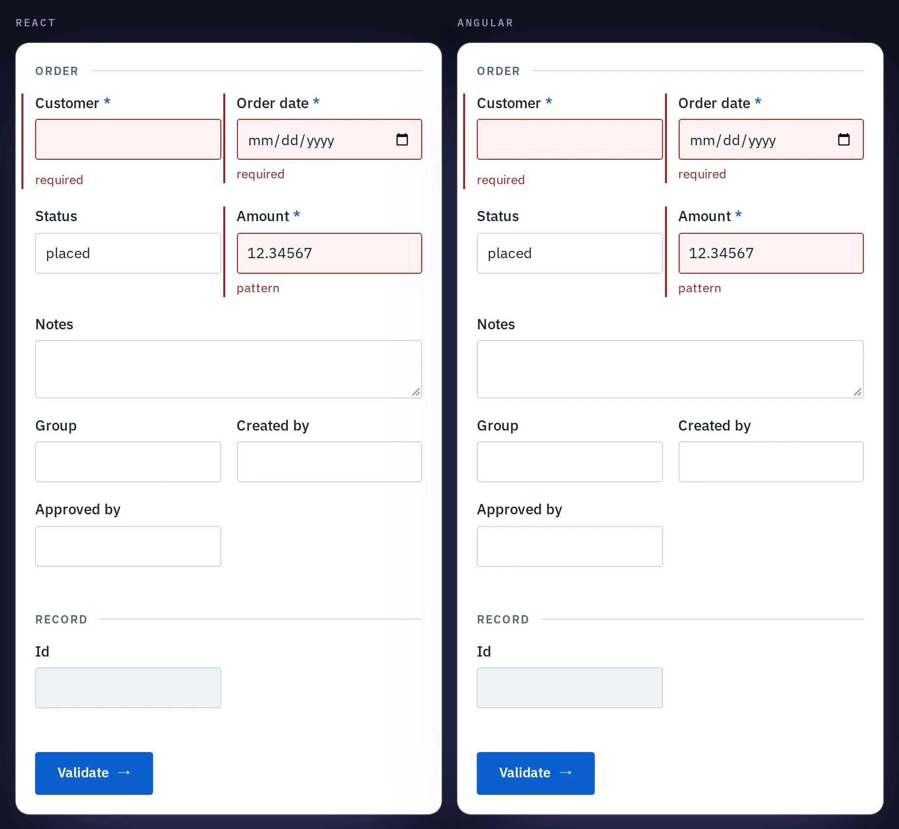

*The examples page runs the generator in the browser over a snapshot captured from PostgreSQL, with no server, and renders `sales.order` with both renderers. An amount with five decimals for a `numeric(18,4)` column is refused in both with the same code, “pattern”, and the empty required fields with “required” ([0021](./docs/decisions/0021-generated-forms-preview-in-both-frameworks.md)).*

<!-- end generated -->

The demo is a Cloudflare Worker of its own with static assets and no code,
routed at `/data/examples/` of formancy.ai and nowhere else, which
Cloudflare's Workers Builds deploys from `main` on every push; `/data`
itself is kept for the product's page on formancy.ai. Every file under the
path is sent with a Content-Security-Policy that allows nothing a directive
does not name, nothing inline and nothing evaluated, scripts, styles and
fetches from formancy.ai's own origin -- its whole site, not only this path
-- and from no other host, the page's fonts included, which are files of
its build
([0072](./docs/decisions/0072-the-apps-serve-their-own-fonts-and-no-page-asks-another-host-for-anything.md)),
and no form sent anywhere, with
`nosniff`, `no-referrer` and a Permissions-Policy that denies what the page
does not use; the hashed chunks are cached for a year, and the third-party
notices are sent as UTF-8 text
([0069](./docs/decisions/0069-the-examples-page-is-served-at-formancy-ai-data-examples.md)).
Cloudflare's bot detection puts an inline script into the page as it
serves it, which the policy refuses like any other: the browser's console
reports that refusal on every load, and nothing on the page needs the
script.
The Worker runs none of the product: no server, no database and neither
plane, which stay where the composed stack puts them, with Cloudflare at
most their edge
([0037](./docs/decisions/0037-cloudflare-is-the-edge-not-the-runtime.md)).
GitHub's workflows hold no Cloudflare token and never deploy. By hand,
`pnpm demo:deploy` deploys from a clean checkout of `main` after the
Wrangler login [RELEASING.md](./RELEASING.md#the-demo-on-formancyai)
names, and `node scripts/demo.mjs --dry-run`, after `pnpm build`, checks
the config and the build and uploads nothing.

What the suite cannot see, because jsdom performs no layout, a browser gate
measures, in CI in Chromium, Firefox and WebKit, with the built page served
under `/data/examples/` with the demo's headers: no sideways scroll down to
320 pixels, the keyboard path through the skip link into the first preview,
and colour contrast and target size, clean and after a failed submit; that
every web font the page asks for had loaded by the end of each pass, or, in
the one that refuses them, none had; that the page asked no other origin
for anything; that the browser refused nothing under the policy, the
console said no error, and an inline script put in the page was refused;
and that the notices were sent as UTF-8 text.

```bash
pnpm --filter @formancy/data-examples exec playwright install --with-deps chromium firefox webkit   # once per machine; the system libraries need sudo
pnpm test:browser                                       # builds the apps, then measures them in Chromium
FORMANCY_BROWSERS=all pnpm test:browser                 # in Chromium, Firefox and WebKit, as CI does
```

On a clean `ubuntu:24.04` container on 2026-10-13, `--with-deps webkit`
installed 372 packages through apt in 81 s and the examples gate then passed
in WebKit, with nothing else installed; Firefox's there was not measured.
WebKit is refused
off Linux: Playwright's WebKit on macOS and Windows is another port, with
another network stack, so there `FORMANCY_BROWSERS=chromium,firefox` runs
the other two.

The snapshot is captured from a real PostgreSQL container, never written by
hand. After a change to the fixture, with Docker running:

```bash
pnpm build
pnpm --filter @formancy/data-examples snapshot
```

and commit `apps/examples/src/fixture-snapshot.json` and
`fixture-customers.json`. The suite compares the committed snapshot with the
fixture model and fails where they disagree, and refuses a snapshot edited by
hand. The customer lookup, drawn as the typeahead the generator writes, is an
in-memory source over the captured customers, because this page has no
server, and the page says so; a host gets the customer options from the
runtime plane, as the host page above shows.

## Live demo

https://formancy.ai/data/demo/ is the product itself, live: the host page's
workspace over a data server and a PostgreSQL database of your own, main's,
started on Cloudflare when you sign in, with sample sales data. Until the
rightsholder creates its Worker, by the steps in
[REPO-METADATA.md](./.github/REPO-METADATA.md#creating-the-live-demos-worker),
the address is formancy.ai's 404
([0070](./docs/decisions/0070-the-live-demo-runs-the-real-server-and-postgresql-in-a-cloudflare-container-of-each-visitors-own.md)).

You sign in as one of three people, each sentence the page shows derived
from what the forms' policies grant:
- **Clara**, order clerk of tenant 1: reads tenant 1's customers, orders,
  order lines and deliveries, and nothing of tenant 2's; adds customers;
  adds, changes and deletes orders and deliveries; adds and changes order
  lines.
- **Otto**, the same for tenant 2.
- **Vera**, auditor of tenant 1: reads, and changes nothing.

Each tenant has 120 customers and 420 orders, with their lines and
deliveries, generated from a fixed seed and dated back from a fixed day, so
every build holds the same rows (`apps/live-demo/src/data/`). Search the
orders and page through them, open
one with its lines and deliveries in the linked grids, find a customer with
the typeahead, change an order, add one with a line and delete it again. As
Otto, tenant 1's orders are not there; as Vera, every write is refused. The
four forms are what the generator made from the demo account's grants,
published when the image is built through the real administrator's plane:
the customer form offers no change or delete and the order line no
delete, for the reasons the generator's notes give.

**What you meet.**
- Your first sign-in waits while your server starts: 5.7 to 11.7 s through
  the Worker at the instance's share of a CPU on a workstation, over four
  runs on 2026-10-17, and not yet measured on Cloudflare.
- Everything you change is gone when your server stops, a little over 10
  minutes after your last request, and on every deploy. Sign in again and the data is as
  generated.
- One cookie, `__Secure-formancy-data-demo`, holds a random name for your
  server and nothing else, and goes when the browser closes. Whoever holds
  it can sign in to your server: it is the only credential your changes
  have. Your token stays in the page's memory, as the host page always
  keeps it, and lasts an hour: a visit longer than that is refused "A
  valid host token is required." until you sign out and sign in again,
  which reaches the same server and what you changed while it runs.
- At most 10 servers run at once, and one visitor can hold them all; when
  none can start, the sign-in says so.
- PostgreSQL only. Cloudflare decrypts what you send, and holds what you
  type in your container until it stops: the data is synthetic, and what
  you type should be too.

**What it costs the rightsholder.** Cloudflare's Workers Paid plan, and for
each running server its memory and disk, and its CPU while busy. The cap
bounds it; 0070 does the sums at the prices read, and names every other
cost.

**How it runs.** One Worker, `formancy-data-demo`, routed at `/data/demo/`
of formancy.ai and nowhere else, serves the host page's demo build as static
files and answers two things itself: the people and a sign-in, at
`/data/demo/session`, and the runtime plane's routes under
`/data/demo/v1/forms`, exactly those 0037's runtime door forwards and none
of the administrator's beside them, which it forwards to your server
through a Durable Object of yours.
Only a sign-in from the page starts a server: no link, crawler or form on
another site does. Each start makes a new key, so a token from before a
restart is refused. The image, `deploy/demo/Dockerfile`, is PostgreSQL 17
with the demo's data, and the data server built from the checkout beside
it, with the runtime plane alone; its disk is the image's on every start.
The page's Content-Security-Policy is the examples page's with inline
styles allowed, which AG Grid's theme needs, and nothing else.

Cloudflare's Workers Builds deploys it from `main` on every push, with
`pnpm build` and `node scripts/live-demo.mjs`, as it deploys the examples
page; GitHub's workflows hold no Cloudflare token and never deploy. By
hand, `pnpm live-demo:deploy` deploys from a clean checkout of `main` with
Docker running, after the Wrangler login
[RELEASING.md](./RELEASING.md#the-live-demo-on-formancyai) names, and
`node scripts/live-demo.mjs --dry-run`, after `pnpm build`, checks the
config and the build and uploads nothing.

`pnpm test:live-demo`, which needs Docker, builds the image and runs the
Worker's own code in front of it, over a stand-in for Cloudflare's runtime
whose containers are `docker run`s at the instance's share of a CPU and its
memory, and walks a visitor's journey over HTTP and then in Chromium; CI
runs it in a job of its own. `wrangler dev` is not the gate: it runs no
container on Windows, nor against Docker Desktop's kernel in WSL, so the
Worker's Durable Object code on Cloudflare is held by review until the
first deploy is read.

## Packages

| Package | What it is |
| --- | --- |
| `@formancy/data-core` | The database-neutral core: the ports, the metadata contract and what discovery could not see, generation, policy, presentation, the record planner, drift review and the codecs. No driver, no HTTP, no Node. |
| `@formancy/data-postgres` | The PostgreSQL adapter, on the `postgres` driver. |
| `@formancy/data-sqlserver` | The SQL Server adapter, on `mssql` over `tedious` — pure JavaScript, no ODBC. |
| `@formancy/data-client` | The browser's side of the runtime plane: a `fetch`-based client for the forms a person may read, a published form's definition, its records -- one by its token or a page at a time, created, updated and deleted -- and its lookups, and the option sources both formancy renderers take. Source-available, framework-neutral, no Node. |
| `@formancy/data-identity` | The host's identity token, verified offline under a pinned algorithm against one key or a JSON Web Key Set read from a file and read again on demand, and the secret references a setting names. jose and Node alone, so a product that verifies the same tokens installs neither Fastify nor a driver; the server re-exports it. Published since 0.3.0 ([0091](./docs/decisions/0091-the-host-identity-verifier-is-a-package-of-its-own-which-the-server-re-exports.md)). |
| `@formancy/data-server` | The server: configuration store, host identity through `@formancy/data-identity` and the settings that choose its key, the administrator and runtime planes over HTTP, the audit trail, and the composition root that starts them from configuration. Fastify, like formancy's. |
| `@formancy/data-fixtures` | Private test support: one business model for both engines, a table keyed by a uuid the database fills among its edge cases, with its restricted reader and the order form's own account; the comparator both adapters' discovery answers to; the cases both engines share -- parity and drift -- each with one expectation; the sized table the performance harness reads; and `renamedColumn`, a snapshot as discovery reports it after a rename. Never published. |
| `@formancy/data-performance` | Private: the harness that measures the shipped server against both engines and renders `docs/performance.md` from what it measured. Never published. |

## How it relates to formancy.ai

This repository **depends on** the released `@formancy/*` packages and copies
none of their code ([0002](./docs/decisions/0002-depend-on-upstream-never-copy-it.md)).
Upstream versions are exact, and a guard refuses a range or a path. A release
can be adopted the day it is published: its packages, and nothing else, are
exempt from pnpm's one-day minimum release age, each by its exact version
([0055](./docs/decisions/0055-an-upstream-release-is-adopted-the-day-it-is-published.md)),
and the same guard refuses any other exemption. A generic improvement the
module needs — an exact-decimal field type, say, proposed as
[formancy.ai#258](https://github.com/sharkysan/formancy.ai/issues/258) — goes
upstream through formancy's own contribution rules rather than being patched
here.

Generated forms stay on formancy's spec 3 after spec 4's release, and the
server publishes and serves no other version
([0042](./docs/decisions/0042-generated-forms-stay-on-spec-3-after-spec-4-is-released.md)),
so a host whose renderer is still at 0.3.0 can keep reading them. That was
measured once, on 2026-10-10, in a scratch check; nothing here runs a 0.3.0
renderer, so nothing fails if it stops being true. A TypeScript host on that
renderer casts the published form to its own `FormSchema`, because the newer
type allows spec 4, or moves its renderer to 0.4.0 or later.

## Deploying

The composed stack of [*Try it*](#try-it) has one proxy,
[`deploy/web/nginx.conf`](./deploy/web/nginx.conf), which serves the studio
and the host page at `/studio/` and `/host/` beside `/v1/` and is the shape a
deployment's own proxy copies. CI runs [the getting-started guide](./docs/getting-started.md)
as written from a clean checkout, with the oldest Compose release it names and
with the runner's
([0032](./docs/decisions/0032-a-clean-install-is-the-composed-stack-and-ci-runs-its-guide.md)).

Each page is sent with a Content-Security-Policy of its own, the examples
page's
([0069](./docs/decisions/0069-the-examples-page-is-served-at-formancy-ai-data-examples.md)):
scripts, styles, fonts and fetches from the stack's origin alone, nothing
inline and nothing evaluated, `data:` images only, no plugin, `<base>` or
form target, and no framing; the host page's allows inline styles too, for
the style elements AG Grid creates, which its browser gate shows refused
without it. `nginx.conf` sends them from a map that
`node scripts/web-policies.mjs --write` writes from the module that
defines them; `pnpm test:repo` fails when the map is not the module's, a
location that serves files has no policy, another location could answer
with a page, or a location's own `add_header` or a redirect inside nginx
would send a page without it, the studio's and the host page's
browser gates serve each page under its policy and fail on anything a
browser refuses under it, and the getting-started gate fails when nginx
does not send it. A deployment's own proxy copies the header with the
page, and nothing here reads what it sends; an extension or a proxy that
writes a script element into a page is refused, and a host page moved to
an origin of its own (0060) needs a `connect-src` that names the server's
([0083](./docs/decisions/0083-the-studio-and-the-host-page-are-served-under-a-content-security-policy-each.md)).

[`docs/deploy/cloudflare.md`](./docs/deploy/cloudflare.md) puts that stack
behind a locally-managed Cloudflare Tunnel, with Access in front of the
studio and a second hostname on which nothing but the runtime plane's routes
reaches the server. Cloudflare is the edge here, not the runtime: nothing of
a deployment runs at Cloudflare, and the [live demo](#live-demo), whose
server and PostgreSQL run in a Cloudflare Container of each visitor's own,
is not a deployment of the product
([0070](./docs/decisions/0070-the-live-demo-runs-the-real-server-and-postgresql-in-a-cloudflare-container-of-each-visitors-own.md)).
The tunnel's configuration is generated from
the server's own routes and checked against the pinned cloudflared, offline;
nothing has been run through a real tunnel
([0037](./docs/decisions/0037-cloudflare-is-the-edge-not-the-runtime.md)).
Wherever it is deployed, the server answers `400` with `path-not-plain` to a
path holding a percent-escape that decodes, a backslash, an empty segment, a
`.` or `..` segment, or a character a path does not carry as itself, before
authentication: a proxy in front of it may read such a path differently, and
no name the server accepts needs one.

The host's tokens are verified offline, with a shared secret, a public key,
or a key set file the server reads again when it is sent SIGHUP: a provider's
document copied in as it is published, its keys that cannot verify the
pinned algorithm left out and named, a kid selecting its key. A file that
cannot be read, or is refused, leaves the set in force and is logged; the
image's `dist/identity-keys-cli.mjs` checks a file before it is renamed into
place, and converts the secret or public key in use into a set. The server
fetches no key from anywhere: a provider's set is the operator's own job to
copy ([0014](./docs/decisions/0014-host-identity-is-verified-offline.md),
[0059](./docs/decisions/0059-the-host-identity-key-is-a-set-selected-by-kid-and-read-again-on-sighup.md);
[the data server's README](./packages/data-server/README.md#rotating-the-identity-key)
says how).

A host page on an origin of its own calls the runtime plane directly once
`FORMANCY_DATA_CORS_ORIGINS` lists that origin exactly, as a browser sends
it: each runtime route grants its own preflight, no wildcard, pattern or
credentials can be configured, and the administrator's plane, `/v1/whoami`
and `/health` answer no other origin. A token-bearing request a browser
marks cross-site is refused before its token is read unless its origin is
listed, so a grant a browser cached before its origin was removed does
nothing in any browser that sends `Sec-Fetch-Site`; an older one can still
send requests the server runs, for up to ten minutes, without reading the
answers. The list is read at start, and the composed stack lists none
([0060](./docs/decisions/0060-the-runtime-plane-answers-the-origins-an-operator-lists-and-the-administrators-plane-none.md);
[the data server's README](./packages/data-server/README.md#across-origins)
says what is granted, refused and logged).

Behind a proxy, the server counts and logs each client by the address the
proxy forwarded only when `FORMANCY_DATA_TRUSTED_PROXIES` names that proxy,
by its address or its range; unset, as in 0.1.0, everybody behind it is one
client to the rate limit and the log names the proxy. `true`, `*`, a hop
count and a range written with an interface's address stop the server, and
a forwarded value that is not an address is not believed. The composed
stack names its nginx's fixed address and the one the Cloudflare overlay
gives cloudflared, never their networks, whose gateways are how a local
process reaches a container
([0071](./docs/decisions/0071-the-server-believes-the-forwarded-address-only-from-the-proxies-an-operator-names.md);
[the data server's README](./packages/data-server/README.md#behind-a-reverse-proxy)
says what a list too wide or too narrow does).

Publication can need a second person, from the release after 0.1.0: a
0.1.0 server ignores the setting, and every administrator there still
publishes alone. With `FORMANCY_DATA_PUBLISHER_ROLES` set, each role also
an administrator role, nobody publishes or imports a version alone, a
publisher who did not submit a draft approves it, and a restore is a
publisher's. The setting is read at start, and the composed stack sets
none, so its guide publishes as one administrator
([0065](./docs/decisions/0065-with-publisher-roles-set-a-draft-is-published-only-when-a-publisher-who-did-not-submit-it-approves-it.md);
[the data server's README](./packages/data-server/README.md#publication-under-review)
says what an author and a publisher may each do, and what it costs).

## What it is tested on

<!-- generated by scripts/release-report/readme.mjs; do not edit -->

| | Tested with | Declared as |
| --- | --- | --- |
| **PostgreSQL** | `postgres:17-alpine`; `@formancy/data-fixtures` and `@formancy/data-postgres` also on `postgres:15-alpine`, `postgres:16-alpine` and `postgres:18-alpine`; an image outside the matrix that one file names shows only what that file shows |  |
| **SQL Server** | `mcr.microsoft.com/mssql/server:2022-latest`; `@formancy/data-fixtures` and `@formancy/data-sqlserver` also on `mcr.microsoft.com/mssql/server:2019-latest` and `mcr.microsoft.com/mssql/server:2025-latest`; an image outside the matrix that one file names shows only what that file shows |  |
| **Recognised, not tested** | None: Azure SQL Database and Azure SQL Managed Instance are recognised by a snapshot and called not tested |  |
| **SQL Server logins** | SQL login; Entra managed identity and Entra service principal are accepted and not tested |  |
| `jose`, by `@formancy/data-identity` | 6.2.12 | `^6.2.12` |
| `postgres`, by `@formancy/data-postgres` | 3.4.9 | `^3.4.9` |
| `@fastify/rate-limit`, by `@formancy/data-server` | 11.2.0 | `^11.2.0` |
| `fastify`, by `@formancy/data-server` | 5.12.5 | `^5.12.5` |
| `jose`, by `@formancy/data-server` | 6.2.12 | `^6.2.12` |
| `@azure/identity`, by `@formancy/data-sqlserver` | 4.13.3 | `4.13.3` |
| `@types/mssql`, by `@formancy/data-sqlserver` | 12.3.0 | `^12.3.0` |
| `mssql`, by `@formancy/data-sqlserver` | 12.7.4 | `^12.0.0` |
| `tedious`, under `mssql` | 20.3.7 | `^19.2.2 \|\| ^20.0.0`, by `mssql` |
| `@formancy/angular` | 0.6.0 | `0.6.0` |
| `@formancy/builder-core` | 0.6.0 | `0.6.0` |
| `@formancy/conformance` | 0.6.0 | `0.6.0` |
| `@formancy/core` | 0.6.0 | `0.6.0` |
| `@formancy/expressions` (transitive) | 0.6.0 |  |
| `@formancy/react` | 0.6.0 | `0.6.0` |
| `@formancy/spec` | 0.6.0 | `0.6.0` |
| `@formancy/themes` | 0.6.0 | `0.6.0` |
| Node, the workspace |  | `>=22.12.0` |
| Node, the server image | `node:22.12-alpine`, every stage |  |
| Node, CI | 22 |  |
| pnpm | 12.4.2, through corepack | `pnpm@12.4.2`, the root's `packageManager` |
| Chromium | 153.0.8010.12, the chromium-headless-shell Playwright 1.63.0 pins (revision 1243) |  |
| Firefox | 155.0, the firefox Playwright 1.63.0 pins (revision 1543) |  |
| WebKit | 26.6, the webkit Playwright 1.63.0 pins (revision 2359) |  |
| `jsdom` | 30.1.2 |  |
| `react` | 19.3.0 |  |
| `@angular/core` | 22.2.1 |  |
| `ag-grid-community` | 36.2.0 |  |
| `axe-core` | 4.14.0 |  |
| `typescript` | 6.0.3 |  |
| `vitest` | 5.0.3 |  |
| `testcontainers` | 12.2.0 |  |

What a run actually answered — each server’s own version and image digest, every other image a test started, the Node and each browser it launched — is in the report every CI run produces and every release attaches, signed.

<!-- end generated -->

## Development

Node and pnpm at the versions *What it is tested on* names -- pnpm through
corepack, which runs the one the root's `packageManager` pins -- and Docker
for the tests, whose version each run's report names for every job.

```bash
corepack enable pnpm
pnpm install
pnpm build
pnpm test        # starts each engine's default image, through testcontainers
```

There is no mocked driver and no `--skip-db` flag. Database behaviour is proved
against real servers or it is not proved
([0003](./docs/decisions/0003-real-databases-in-every-test-run.md)). The first
run pulls both database images.

`docker compose up -d` gives you both databases on loopback for a shell or a
client; the tests do not use it. Their passwords are generated into a Docker
volume on the first start, not typed into a `.env`: read one with
`docker compose exec sqlserver cat /run/formancy-secrets/mssql-sa-password`
(or `postgres-owner-password` on `postgres`). `.env.example` lists the port
overrides, which are all a `.env` may still hold. A database volume made
before the secrets volume existed holds the old password and needs
`docker compose down -v`. `compose.yaml` needs the Compose release the
guide's section 0 names.

The gates are [`.github/workflows/gates.yml`](./.github/workflows/gates.yml),
which CI runs on every pull request and a release runs before it publishes:
`pnpm build`, `pnpm typecheck`, `pnpm check:pkg`,
`node scripts/verify-licenses.mjs` and `pnpm test:repo` in one job; each
package's `test:coverage` in a job of its own, and data-fixtures' and each
engine's adapter's again in the `test-images` job, once on every other image
of the engine's matrix; in jobs of their own
`pnpm test:e2e:install`, `pnpm test:browser` once per browser,
`pnpm test:pictures`, the server image, and
`pnpm test:getting-started`, which runs the guide from a clean checkout with
Node and Docker alone, with the runner's Compose and again with the oldest
the guide names, and `pnpm test:cloudflare`, which holds the Cloudflare
overlay to [its guide](./docs/deploy/cloudflare.md) offline, against the
pinned cloudflared and the built server, with the same two Compose
releases; it needs `pnpm build` first. The last job builds [the release report](./docs/release/README.md)
from what every other job found, and fails the run on anything wrong in it
([0035](./docs/decisions/0035-a-release-report-is-derived-from-the-run-that-gated-it.md)).
[`CLAUDE.md`](./CLAUDE.md) says what each is for and what the bar is.

`pnpm test` runs every suite on each engine's default image, but for a file
that names an image of its own. `FORMANCY_IMAGES` names other images of the
matrix for the adapter suites and data-fixtures', at most one per engine,
as `MATRIX_IMAGES` in
[`packages/data-fixtures`](./packages/data-fixtures/README.md#which-images)
lists them, and an engine it does not name keeps its default; an image
outside the matrix, two for one engine, or the variable set to nothing is
refused. Every other suite names the default at each start, so the
variable leaves it where it is:

```bash
FORMANCY_IMAGES=postgres:16-alpine,mcr.microsoft.com/mssql/server:2019-latest pnpm exec turbo run test --filter=@formancy/data-fixtures
```

CI runs data-fixtures and each engine's adapter suite in a leg of the
`test-images` job per image of the matrix but the default, and the report
fails a run in which an image of the matrix answered no test in a leg of
its own, or a shared case is missing or failed on one of them. Where the versions differ --
`transaction_timeout`, which PostgreSQL has from 17, what 17's planner drops
from a lookup's plan, a membership granted `WITH INHERIT`, which PostgreSQL
has from 16, the role 18 runs a cascaded table's AFTER trigger as, the
SQLSTATE 18 refuses an ON DELETE RESTRICT key with, the NOT NULLs 18 files
in `pg_constraint`, SQL Server 2022's `VIEW SECURITY DEFINITION` -- the
difference is a named fact in data-fixtures' `VERSION_FACTS`, asserted on each
version as it answers, and no test is skipped on one
([0067](./docs/decisions/0067-the-adapter-suites-run-on-every-image-of-a-per-engine-matrix.md)).

`pnpm test:browser` runs each app's browser gate once for each browser
`FORMANCY_BROWSERS` names, as a comma list or `all`, and each run leaves
`test-results/browser-<browser>.json` for the report. Unset, a machine runs
Chromium alone; CI runs one leg of the `browser` job per browser of
[`scripts/browsers.mjs`](./scripts/browsers.mjs) — Chromium, Firefox and
WebKit, the browsers [*What it is tested on*](#what-it-is-tested-on) names —
with every check in every one, and the report fails a run in which an app's
gate left no results in one of them, or made a check in one browser it did
not make in another. Where the browsers differ — Firefox's Tab after a click,
whether a lost save is sent again, what AG Grid takes WebKit for, when WebKit
says where a focus scrolled the page — the
difference is a named fact in that file, held by the checks it names, and
the report fails a run in which a gate did not make one of them in a browser
([0058](./docs/decisions/0058-the-browser-gates-run-in-chromium-firefox-and-webkit-and-each-fact-the-browsers-disagree-on-is-named-and-held.md)).

The pictures in this README are taken by `pnpm pictures` from the built pages
against the real data server, and `pnpm test:pictures`, in Chromium, in a CI
job of its own, walks the same states and fails when a pictured element says
something else
([0038](./docs/decisions/0038-readme-pictures-are-taken-by-a-script-and-held-to-the-text-they-show.md)).
[`docs/images/README.md`](./docs/images/README.md) says what taking them
needs, how to retake one, and what nothing checks.

`pnpm performance` measures the shipped server on a quiet Linux machine and
rewrites [`docs/performance.md`](./docs/performance.md); it refuses while any
other container runs. `node scripts/performance-stale.mjs` names what
changed since the figures were measured, and a release does not wait for it
([0084](./docs/decisions/0084-a-release-does-not-wait-for-the-performance-figures-to-be-measured-again.md)).

## Documents

- [`docs/README.md`](./docs/README.md) — where to start: the architecture, in arc42's twelve sections, and every other document below.
- [`docs/getting-started.md`](./docs/getting-started.md) — from an empty machine with Docker and git to a published form on both engines; CI runs it as written.
- [`docs/setup.md`](./docs/setup.md) — what is set up outside the repository's files, in order: GitHub's settings and secrets, the image's visibility, Cloudflare's plan and both demos' Workers, who does each step, and what was found done.
- [`docs/deploy/cloudflare.md`](./docs/deploy/cloudflare.md) — the composed stack behind a Cloudflare Tunnel and Access: every setting, what Cloudflare cannot do here, and what nobody has measured.
- [`docs/performance.md`](./docs/performance.md) — what each runtime request but a page of records and the menu of forms costs through the shipped server on both engines, with the database's size, the machine, the network path and the date, and what holds each claim.
- [`docs/decisions/`](./docs/decisions/README.md) — every decision somebody could helpfully undo, with what verifies it.
- [`docs/release/`](./docs/release/README.md) — the report every CI run and every release builds of what it was tested on, the register of the limitations the decisions state, and the release gates' evidence.
- [`docs/images/README.md`](./docs/images/README.md) — how the README's pictures are taken, and what holds them and what does not.
- [`CHANGELOG.md`](./CHANGELOG.md) — what changed and why.
- [`CONTRIBUTING.md`](./CONTRIBUTING.md) and [`CLA.md`](./CLA.md) — contributions are taken under a CLA, checked on every pull request.
- [`SECURITY.md`](./SECURITY.md) — how to report a vulnerability, and what this product considers highest risk.
- [`RELEASING.md`](./RELEASING.md) — releases are cut by the workflow, rehearsed first, with provenance, a signed SBOM and the signed report of the run that gated them.
