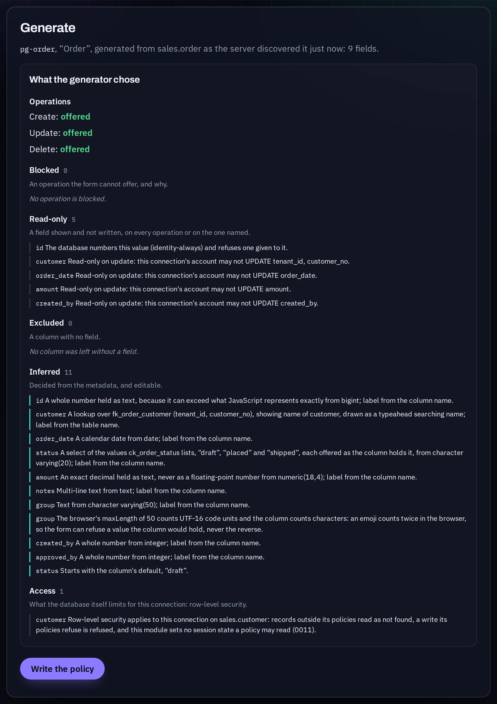
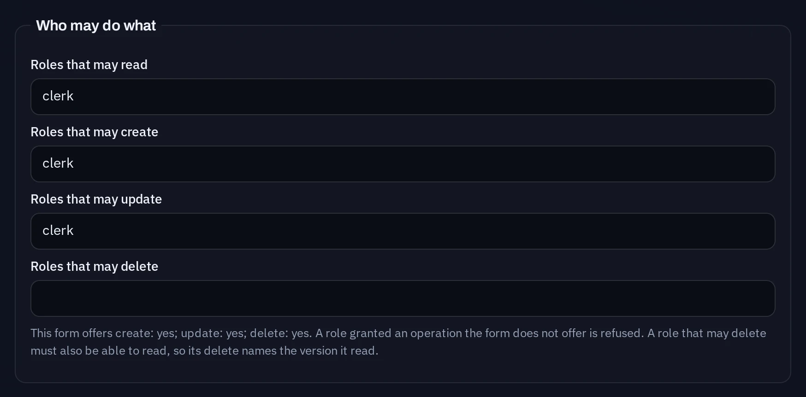

# Formancy Data

**Your existing database, as forms in your own application, under your own rules.**

Formancy Data turns an existing PostgreSQL or Microsoft SQL Server database
into forms in your own React or Angular application. It reads the database
as the account you connect it with, generates each form from what that
account may do, and serves the form's records -- a page at a time, filtered,
with lookups and child records -- under access rules the server asks on
every request, with the identity your application already has. It is
self-hosted, source-available and
[paid for production use](#licence-in-one-table), and built on the
Apache-2.0 [formancy](https://github.com/sharkysan/formancy.ai) engine.

<!-- generated by scripts/pictures/readme.mjs from scripts/pictures/scenes.json: hero; do not edit -->

*The host page, an example of your application's own page, as clara, a clerk of tenant 1, sees it: the forms she may read; the orders of `sales.order` a page at a time in an AG Grid Community grid, opened on “Online orders”, a list view an administrator named; and the open order's deliveries in a tab beside it, a form of their own over `sales.delivery`, with their own id and the tenant hidden in its Columns. Every row is what the server answered her through `@formancy/data-client`, under the form's policy ([0047](./docs/decisions/0047-a-hosts-workspace-lists-opens-and-edits-records-in-linked-grids.md), [0105](./docs/decisions/0105-a-forms-list-offers-views-its-administrator-named.md), [0142](./docs/decisions/0142-a-records-child-forms-are-tabs-beside-it.md)). The order's own tab draws its form, as Run in [How it works](#how-it-works) shows. The orders, the deliveries and three of the customers are invented, and the capture script inserts them through the database's owner; Muster AG is the test fixture's.*

Every picture in this README is taken by `pnpm pictures` from the built pages and the real data server, and the pictures job fails when one of them shows text the page no longer shows ([how, and what nothing checks](./docs/images/README.md)).

<!-- end generated -->

## Try it

Nothing to install for either.

- **[The live demo](https://formancy.ai/data/demo/)** is the product
  itself: sign in as one of the demo's people, and the host page's workspace
  runs over a data server and a PostgreSQL of your own on Cloudflare, with
  sample sales data to search, open, change, add to and delete from;
  everything you changed is gone when your server sleeps
  ([how it runs](./docs/guide/live-demo.md),
  [0070](./docs/decisions/0070-the-live-demo-runs-the-real-server-and-postgresql-in-a-cloudflare-container-of-each-visitors-own.md)).
- **[The examples page](https://formancy.ai/data/examples/)** generates
  forms in your browser from a captured snapshot and draws each with both
  renderers side by side, with no server and no database behind them
  ([what it shows](./docs/guide/examples.md),
  [0069](./docs/decisions/0069-the-examples-page-is-served-at-formancy-ai-data-examples.md)).

## Why

This page describes `main`, which has more than
[the latest release](#status); [`CHANGELOG.md`](./CHANGELOG.md)'s
*Unreleased* says what.

**Your database as it is.** No schema of its own: what it publishes is
files beside the server
([0013](./docs/decisions/0013-published-configuration-is-files-with-link-based-swap.md)).
The server reads the catalog as the account you connect it with, and
generates a form from what that account may read, insert, update and
delete. What the catalog hid from the account is said as "cannot tell",
never taken as absent
([0004](./docs/decisions/0004-a-snapshot-says-what-it-could-not-see.md),
[0027](./docs/decisions/0027-a-snapshot-says-what-its-account-may-do.md)).
A form offers update and delete only where a stale save can be told: by
SQL Server's rowversion, or by a version column an administrator confirms
every writer of the table increments, which is what a PostgreSQL table,
having no rowversion, needs to be editable. Without either, the form reads
and creates, and the generator's note says why
([0009](./docs/decisions/0009-generation-is-deterministic-and-says-what-it-chose.md),
[0015](./docs/decisions/0015-a-record-operation-is-one-guarded-statement.md)).

**Your rules, on every request.** A policy says who may read, create,
update and delete which fields and which rows, its row filters taken from
the signed-in person's trusted attributes and never from the form. The
server asks it on every request, and verifies your application's own token
offline: no users, passwords or sessions of its own
([0011](./docs/decisions/0011-every-operation-carries-a-trusted-policy-context.md),
[0014](./docs/decisions/0014-host-identity-is-verified-offline.md),
[0022](./docs/decisions/0022-the-runtime-plane-asks-the-policy-every-time.md)).

**A schema change is checked against each published form.** Your
migrations stay with the tool you already use. Each change is classified
against what a published form rests on, the server refuses what it blocks
in the form's own table rather than writing past it, a deploy pipeline can
check it after its migrations with a command that fails on a blocking
change, and a form an administrator generates again keeps its layout
([0010](./docs/decisions/0010-drift-is-classified-against-the-bindings.md),
[0030](./docs/decisions/0030-presentation-is-a-patch-over-the-generated-base.md),
[0041](./docs/decisions/0041-the-runtime-refuses-what-drift-blocks.md),
[0111](./docs/decisions/0111-a-deploy-pipeline-checks-drift-with-a-command-that-fails-on-a-blocking-change.md)).

**Proved on real servers.** There is no mocked driver. Every adapter
behaviour is tested against real PostgreSQL and SQL Server servers in
containers in every CI run, and the adapters' suites run on every image of
each engine's matrix. [*What it is tested on*](./docs/guide/tested-on.md)
names the images, and what no test runs on
([0003](./docs/decisions/0003-real-databases-in-every-test-run.md),
[0067](./docs/decisions/0067-the-adapter-suites-run-on-every-image-of-a-per-engine-matrix.md)).

## How it works

1. **Connect.** An operator allowlists a connection -- a database, the
   account to reach it as, the schemas it approves -- and the studio
   discovers it as that account
   ([0019](./docs/decisions/0019-a-published-form-is-checked-every-time-it-is-read.md)).

<!-- generated by scripts/pictures/readme.mjs from scripts/pictures/scenes.json: how-it-works-1; do not edit -->

*`pg`, discovered in the studio as the order form's own account, inside the schemas its connection approves: “No gap was reported: everything in the approved schemas was visible to this connection.” What an account cannot see is said as a gap, never taken as absent ([0004](./docs/decisions/0004-a-snapshot-says-what-it-could-not-see.md), [0027](./docs/decisions/0027-a-snapshot-says-what-its-account-may-do.md)).*

<!-- end generated -->

2. **Generate.** An administrator chooses a root table and the lookups to
   offer, and the generator makes the form, saying what it inferred, made
   read-only and refused
   ([0009](./docs/decisions/0009-generation-is-deterministic-and-says-what-it-chose.md)).

<!-- generated by scripts/pictures/readme.mjs from scripts/pictures/scenes.json: how-it-works-2; do not edit -->

*`sales.order` as the root, and its customer key as a lookup. The generator says what it made of them from what this account may do: a column it may not update is “Read-only on update”, and the lookup is “drawn as a typeahead searching name” ([0009](./docs/decisions/0009-generation-is-deterministic-and-says-what-it-chose.md), [0027](./docs/decisions/0027-a-snapshot-says-what-its-account-may-do.md)).*

<!-- end generated -->

3. **Govern and arrange.** The policy says who may do what with which fields
   and rows; labels, help text, order, starting values and list views are a
   patch over the generated form
   ([0011](./docs/decisions/0011-every-operation-carries-a-trusted-policy-context.md),
   [0030](./docs/decisions/0030-presentation-is-a-patch-over-the-generated-base.md)).

<!-- generated by scripts/pictures/readme.mjs from scripts/pictures/scenes.json: how-it-works-3; do not edit -->

*By the roles your application's tokens already carry: here `clerk` reads, creates and updates, and nobody deletes. “A role granted an operation the form does not offer is refused.” Its row filters are taken from the signed-in person's trusted attributes, never from the form ([0011](./docs/decisions/0011-every-operation-carries-a-trusted-policy-context.md)).*

<!-- end generated -->

4. **Publish.** Every version is kept, two administrators publishing at once
   cannot overwrite each other, and a second person can be required to
   approve
   ([0013](./docs/decisions/0013-published-configuration-is-files-with-link-based-swap.md),
   [0065](./docs/decisions/0065-with-publisher-roles-set-a-draft-is-published-only-when-a-publisher-who-did-not-submit-it-approves-it.md)).

<!-- generated by scripts/pictures/readme.mjs from scripts/pictures/scenes.json: how-it-works-4; do not edit -->

*One bundle -- the form, its bindings, the policy and the snapshot -- which the server checks again before it writes anything: “Published version 1 of pg-order.” This server was started without publisher roles, so its studio publishes alone; with them, a draft is published only when a publisher who did not submit it approves it ([0013](./docs/decisions/0013-published-configuration-is-files-with-link-based-swap.md), [0065](./docs/decisions/0065-with-publisher-roles-set-a-draft-is-published-only-when-a-publisher-who-did-not-submit-it-approves-it.md)).*

<!-- end generated -->

5. **Run.** Your application's pages ask the server's runtime plane through
   `@formancy/data-client`, with the token they already hold, and draw each
   published form with `@formancy/react` or `@formancy/angular`
   ([0029](./docs/decisions/0029-a-host-renders-a-published-form-through-one-client.md)).

<!-- generated by scripts/pictures/readme.mjs from scripts/pictures/scenes.json: how-it-works-5; do not edit -->

*The order open in the workspace at the top of this page, on its own tab, drawn by React for its update: the fields written on create only are disabled, and its deliveries are the tab beside it, “Delivery” ([0122](./docs/decisions/0122-a-host-page-draws-a-saved-record-for-the-update-and-a-new-one-for-the-create.md), [0142](./docs/decisions/0142-a-records-child-forms-are-tabs-beside-it.md)).*

<!-- end generated -->

[The studio's page](./docs/guide/studio.md) pictures its steps from Connect
to Drift, and [the host page's](./docs/guide/host.md) a published form at
work, as the product draws them.

## What you get

What `main` does; [*What it does*](./docs/guide/capabilities.md) says
more, each line with its record, and [`CHANGELOG.md`](./CHANGELOG.md) says
which release carries what.

**Working with records**, through the runtime plane and
`@formancy/data-client`, as [the host page](./docs/guide/host.md) draws
them. The host page is an example this repository builds and does not
release; your application's own pages draw records their own way:

- **Lists** a page at a time, searched, sorted and filtered by a person's
  own conditions, inside the read policy and never widening it
  ([0044](./docs/decisions/0044-a-forms-records-are-listed-a-page-at-a-time-under-its-read-policy.md),
  [0104](./docs/decisions/0104-a-list-and-a-browse-are-filtered-by-conditions-on-their-columns.md)).
- **List views** an administrator names, and views a person keeps for
  themselves on the server
  ([0105](./docs/decisions/0105-a-forms-list-offers-views-its-administrator-named.md),
  [0126](./docs/decisions/0126-a-person-keeps-their-own-list-views-on-the-server-for-themselves-alone.md)).
- **Lookups** that offer only the rows the person may choose, as a
  typeahead where they can be searched, and checked again on save
  ([0012](./docs/decisions/0012-a-lookup-token-is-a-reference-not-a-permission.md),
  [0066](./docs/decisions/0066-a-lookup-a-person-can-search-is-generated-as-a-typeahead.md)).
- **Child records** in tabs beside their parent, a form that is its own
  child as a tree, and drill down one level at a time with a trail back
  ([0090](./docs/decisions/0090-a-hosts-workspace-can-drill-down-one-level-at-a-time-with-a-trail-back.md),
  [0110](./docs/decisions/0110-a-form-that-is-its-own-child-is-shown-as-a-tree-of-its-records.md),
  [0142](./docs/decisions/0142-a-records-child-forms-are-tabs-beside-it.md)).
- **Saves that overwrite nobody**: one guarded statement, a stale save
  refused, an answer lost on the way said rather than sent again, and exact
  values digit for digit
  ([0008](./docs/decisions/0008-exact-values-travel-as-strings.md),
  [0015](./docs/decisions/0015-a-record-operation-is-one-guarded-statement.md),
  [0031](./docs/decisions/0031-an-answer-lost-after-a-write-is-unknown.md)).
- **A record saved with its rows**, an order with its lines, in one
  transaction on both engines and held to a bound an administrator
  chooses in the studio, which says before anything is sent what the
  server would refuse of it: on the host page, the rows held in a tab
  beside the record, each change said in words, until the record's own
  Save sends them with it; through `@formancy/data-client`, one call of the runtime plane
  ([0155](./docs/decisions/0155-a-records-rows-may-be-saved-with-it-in-one-transaction-guarded-by-its-version-and-checked-as-a-whole.md)).
- **Actions an administrator names**: a routine your database already
  keeps, run over the open record in one transaction on both engines --
  the record locked under the person's policy at the version they read,
  its version moved, the routine called only as it was published -- once
  per write id, under a deadline: bound in the studio, each parameter
  given only what the generator binds and the grant made after a note of
  what the routine does that nothing here binds; run on the host page
  from the open record's header, after its dialog and a confirmation in
  place, the record read again once it ran; and through
  `@formancy/data-client`, one call of the runtime plane. An action may
  also run over a selection of up to a page of records, all locked in key
  order in one transaction and all kept or none: offered so in the
  studio, and on the host page over the records a person chooses by the
  boxes of the Records grid, from a bar above it, told how many it ran
  over or which records refused it
  ([0159](./docs/decisions/0159-a-form-binds-a-database-routine-as-an-action-over-the-open-record.md),
  [0160](./docs/decisions/0160-an-action-runs-in-one-transaction-that-locks-the-record-moves-its-version-and-calls-the-routine-guarded-and-never-retried.md),
  [0161](./docs/decisions/0161-the-runtime-plane-runs-an-action-once-per-write-id-under-a-deadline-and-never-queues-it.md),
  [0162](./docs/decisions/0162-the-host-page-runs-an-action-from-the-open-records-header-after-its-dialog-and-a-confirmation-in-place-and-reads-the-record-again.md),
  [0163](./docs/decisions/0163-the-studio-binds-a-routine-as-an-action-offering-each-parameter-only-what-the-generator-binds-and-says-what-it-does-before-it-is-granted.md),
  [0165](./docs/decisions/0165-an-action-runs-over-a-selection-of-up-to-a-page-of-records-in-one-transaction-locked-in-key-order-all-or-nothing.md),
  [0166](./docs/decisions/0166-a-person-chooses-a-pages-records-by-a-column-of-boxes-and-runs-an-action-over-them-from-a-bar-above-the-grid.md)).
- **Deletes, copies and files**: a record deleted one at a time, reaching
  other tables only through the foreign keys its policy names; duplicated
  into a new one; and the records a list shows downloaded as one CSV file
  ([0050](./docs/decisions/0050-a-record-is-deleted-one-at-a-time-by-its-token-and-the-version-its-person-read.md),
  [0051](./docs/decisions/0051-a-delete-reaches-other-tables-only-through-foreign-keys-the-policy-names.md),
  [0079](./docs/decisions/0079-a-person-downloads-the-records-a-list-shows-them-as-one-csv-file-made-whole-or-not-at-all.md),
  [0107](./docs/decisions/0107-a-record-is-duplicated-into-a-new-one-of-the-fields-the-server-names.md)).
- **Rules a record keeps**: a status field held to the moves the policy
  lists for each role, a table of versions changed from a date, the
  open version ended and the next inserted in one write, and the triggers
  your database already has refusing a save or a delete in words the
  person reads, once their message starts `formancy: refused: `
  ([0112](./docs/decisions/0112-a-policy-holds-a-state-field-to-the-moves-it-lists.md),
  [0113](./docs/decisions/0113-a-form-over-versions-changes-the-open-one-from-a-date.md),
  [0156](./docs/decisions/0156-a-trigger-can-refuse-a-write-in-words-the-person-reads.md)).

**Administration**, in [the studio](./docs/guide/studio.md), which is
built from this repository and not published as a package:

- **Every step in one application** -- connect, choose, generate, policy,
  presentation, preview, publish, drift -- over the server's administrator
  plane, and a Browse step in which a browse role reads any
  table or view's rows as the connection's account does
  ([0024](./docs/decisions/0024-the-studio-speaks-only-the-admin-plane.md),
  [0099](./docs/decisions/0099-a-browse-role-reads-any-table-or-views-rows-as-the-connections-account-does.md)).
- **Publication that overwrites nobody**, approved by a second person when
  publisher roles are set, and a version moved between deployments as its
  file
  ([0013](./docs/decisions/0013-published-configuration-is-files-with-link-based-swap.md),
  [0062](./docs/decisions/0062-a-published-version-moves-between-deployments-as-its-version-file.md),
  [0065](./docs/decisions/0065-with-publisher-roles-set-a-draft-is-published-only-when-a-publisher-who-did-not-submit-it-approves-it.md)).
- **Drift review** of each published form, saying which operations each
  change blocks, and the command a deploy pipeline runs after its
  migrations
  ([0010](./docs/decisions/0010-drift-is-classified-against-the-bindings.md),
  [0111](./docs/decisions/0111-a-deploy-pipeline-checks-drift-with-a-command-that-fails-on-a-blocking-change.md)).

**Operations**, as [*Deploying*](./docs/guide/deploying.md) says:

- **One server image, and the whole stack from one Docker Compose
  command**: both databases, the server, and the studio and the host page
  behind one proxy, each page under a Content-Security-Policy of its own;
  CI runs its guide as written from a clean checkout
  ([0032](./docs/decisions/0032-a-clean-install-is-the-composed-stack-and-ci-runs-its-guide.md),
  [0083](./docs/decisions/0083-the-studio-and-the-host-page-are-served-under-a-content-security-policy-each.md)).
- **Audited, and rekeyed without a restart**: one audit event for each
  request that reaches a route of either plane, never a value, and a host
  identity key set read again on SIGHUP
  ([0023](./docs/decisions/0023-the-audit-trail-is-operational-not-evidence.md),
  [0033](./docs/decisions/0033-the-administrator-plane-is-audited.md),
  [0059](./docs/decisions/0059-the-host-identity-key-is-a-set-selected-by-kid-and-read-again-on-sighup.md)).

## What it does not do yet

- No bulk delete and no undo; no file of a record with all its children,
  and no copy of a record with its children.
- Two people saving lines of one order at once makes the second stale,
  which Keep my line changes and Save then store, line by line, refusing
  a line both changed
  ([0155](./docs/decisions/0155-a-records-rows-may-be-saved-with-it-in-one-transaction-guarded-by-its-version-and-checked-as-a-whole.md)).
- The host page runs an action over the open record from its detail
  and nowhere below it, and over the records chosen from the Records
  grid alone: a choice is of the page shown, which another page, a
  search, a filter, a sort or a view clears, so more than a page is run
  a page at a time, and a child section or a Drill down level offers no
  choice
  ([0162](./docs/decisions/0162-the-host-page-runs-an-action-from-the-open-records-header-after-its-dialog-and-a-confirmation-in-place-and-reads-the-record-again.md),
  [0165](./docs/decisions/0165-an-action-runs-over-a-selection-of-up-to-a-page-of-records-in-one-transaction-locked-in-key-order-all-or-nothing.md),
  [0166](./docs/decisions/0166-a-person-chooses-a-pages-records-by-a-column-of-boxes-and-runs-an-action-over-them-from-a-bar-above-the-grid.md)).
- On a record just created, a field written on create only stays writable
  until the record is opened again, and the server refuses a changed one
  ([0122](./docs/decisions/0122-a-host-page-draws-a-saved-record-for-the-update-and-a-new-one-for-the-create.md)).
- Drill down's levels are in the page's memory, so a reload starts at the
  records
  ([0090](./docs/decisions/0090-a-hosts-workspace-can-drill-down-one-level-at-a-time-with-a-trail-back.md)).
- A SQL Server older than 2019 cannot be discovered: its catalog lacks a
  view discovery reads, and discovery is refused with its release named
  ([0068](./docs/decisions/0068-a-snapshot-records-the-server-it-was-read-from-and-nothing-refuses-a-server-discovery-can-read.md)).
- No test runs on Azure SQL Database or Azure SQL Managed Instance, and none
  logs in as an Entra principal
  ([0073](./docs/decisions/0073-azure-sql-is-not-tested-and-the-release-says-so.md),
  [0074](./docs/decisions/0074-a-sql-server-connection-may-log-in-as-an-entra-principal-and-no-test-logs-in-as-one.md)).
- No host page on another origin has been run in a browser, and nothing has
  run through a real Cloudflare Tunnel
  ([0060](./docs/decisions/0060-the-runtime-plane-answers-the-origins-an-operator-lists-and-the-administrators-plane-none.md),
  [0037](./docs/decisions/0037-cloudflare-is-the-edge-not-the-runtime.md)).
- The performance figures were measured on 0.1.0, and there are none for a
  page of records, a file of them, the menu of forms or a delete
  ([0084](./docs/decisions/0084-a-release-does-not-wait-for-the-performance-figures-to-be-measured-again.md)).
- No lawyer has reviewed the licence
  ([0048](./docs/decisions/0048-the-licence-is-in-force-before-a-lawyer-has-read-it.md)).

[The status page](./docs/guide/status.md) says what else is not yet
measured or read by hand, and each release's notes in
[`CHANGELOG.md`](./CHANGELOG.md) list its known gaps.

## Get started

**On your machine.** From an empty machine with Docker and git,
`docker compose --profile stack up` runs both databases with the sample
fixture, the server, and the studio and the host page behind one proxy.
[The getting-started guide](./docs/getting-started.md) gives the exact
command, mints the tokens and walks from there to a published order form
used on the host page, on both engines; CI runs it as written from a clean
checkout
([0032](./docs/decisions/0032-a-clean-install-is-the-composed-stack-and-ci-runs-its-guide.md)).
Starting the stack accepts the EULA of SQL Server's Developer edition, which
is not licensed for production.

**In an application you already have.** Run the server -- the signed image
`ghcr.io/sharkysan/formancy-data-server`, tagged with each release's
version, or `@formancy/data-server` from npm -- with an allowlist of
connections, a configuration store and the key that verifies your
application's tokens, as [the data server's README](./packages/data-server/README.md)
says. In your pages, `@formancy/data-client` speaks to its runtime plane
with the token your application already holds, and formancy's
`@formancy/react` or `@formancy/angular`, with a theme of
`@formancy/themes`, draws each published form
([the packages](./docs/guide/packages.md)). The studio, in which an
administrator makes and publishes the forms, is not published as a
package: build it from this repository, as the composed stack builds it
([*Studio*](./docs/guide/studio.md) says how).

## Status

**0.3.0, released on 2026-10-21, is the latest release.** `main` has more
since -- among it the studio's Browse step, list views named by an
administrator and kept by a person, a grid's filter typed as a line, a
record's child forms in tabs, state moves, versions changed from a date,
starting values, a select of the values a check lists, the server's
stamps of who wrote a record and when, a record saved with its rows
in one request of the runtime plane, chosen in the studio and sent from
the host page's own Save, and an action an administrator binds in the
studio, run over the open record from the host page's header or over
the records a person chose of its grid's page -- each a
line of [`CHANGELOG.md`](./CHANGELOG.md)'s
*Unreleased*, and the examples page and the live demo are deployed from
`main`. [The status page](./docs/guide/status.md) says what 0.3.0 added
over 0.2.0, and what is not yet measured or read by hand.

## Licence, in one table

Source-available, **not** open source. The formancy engine, renderers, builder
and backend this module builds on stay Apache-2.0; this module does not.

| Use | Terms |
| --- | --- |
| Read the source and fork the repository | Free |
| Evaluate, develop and test — including in companies | Free |
| Run in production, internally or customer-facing | Paid licence |
| Redistribute inside another software product | Separate commercial agreement |
| Customer data and generated form definitions | Remain the customer's |

<!-- generated by scripts/licence-status.mjs from LICENSE.md; do not edit -->

[`LICENSE.md`](./LICENSE.md) has the terms. It is Version 1.1, in force from 11 October 2026, and says at the top that no lawyer has reviewed it. A production licence is requested from [info@formancy.ai](mailto:info@formancy.ai), as its section 9 says.

<!-- end generated -->

Why a paid module exists beside an Apache-2.0 project, and why in a
repository of its own, is decision
[0001](./docs/decisions/0001-a-paid-module-in-its-own-repository.md); the
decision to put the licence in force before a lawyer had read it, and what
that leaves open, is
[0048](./docs/decisions/0048-the-licence-is-in-force-before-a-lawyer-has-read-it.md);
Version 1.1, under which a redistribution agreement is requested at the same
address as a production licence, is
[0054](./docs/decisions/0054-version-1-1-names-the-address-for-a-redistribution-agreement-too.md).

The studio, the host page and the examples page bundle other people's
packages, React, Angular and upstream formancy among them: each build writes
`THIRD-PARTY-NOTICES.txt` beside its page with their licence and notice
texts, but for what
[0046](./docs/decisions/0046-a-built-app-carries-the-licence-and-notice-texts-of-everything-it-bundles.md)
names, and stops when a bundled package ships no licence text. The composed
stack serves them at `/studio/THIRD-PARTY-NOTICES.txt` and
`/host/THIRD-PARTY-NOTICES.txt`, and this repository's own `LICENSE.md` and
`NOTICE` are in the image. The examples page's are at
https://formancy.ai/data/examples/THIRD-PARTY-NOTICES.txt, and the page
links this repository for the rest
([0069](./docs/decisions/0069-the-examples-page-is-served-at-formancy-ai-data-examples.md)).

## Learn more

- [*What it does*](./docs/guide/capabilities.md) — what the module does, by who meets it, each line with the decision record that holds it.
- [*Status*](./docs/guide/status.md) — the release, where `main`'s changes since are listed, and what is not yet measured or read by hand.
- [*Studio*](./docs/guide/studio.md), [*Host example*](./docs/guide/host.md), [*Examples*](./docs/guide/examples.md) and [*Live demo*](./docs/guide/live-demo.md) — each app, pictured as the product draws it, how to run it, and what its suites hold.
- [*Packages*](./docs/guide/packages.md) — what is published, and how it relates to formancy.ai.
- [*Deploying*](./docs/guide/deploying.md) — the proxy, Cloudflare as the edge, keys, origins, proxies, review and browsing, and what follows when the schema changes.
- [*What it is tested on*](./docs/guide/tested-on.md) and [*Development*](./docs/guide/development.md) — the images and versions, and how to build and test this repository.
- [`docs/getting-started.md`](./docs/getting-started.md) — from an empty machine with Docker and git to a published form on both engines; CI runs it as written.
- [`docs/setup.md`](./docs/setup.md) — what is set up outside the repository's files, in order: GitHub's settings and secrets, the image's visibility, Cloudflare's plan and both demos' Workers, who does each step, and what was found done.
- [`docs/deploy/cloudflare.md`](./docs/deploy/cloudflare.md) — the composed stack behind a Cloudflare Tunnel and Access: every setting, what Cloudflare cannot do here, and what nobody has measured.
- [`docs/performance.md`](./docs/performance.md) — what each runtime request but a page of records, a file of them, the menu of forms and a delete costs through the shipped server on both engines, with the database's size, the machine, the network path and the date, and what holds each claim.
- [`docs/README.md`](./docs/README.md) — the architecture, in arc42's twelve sections, and every other document.
- [`docs/decisions/`](./docs/decisions/README.md) — every decision somebody could helpfully undo, with what verifies it.
- [`docs/release/`](./docs/release/README.md) — the report every CI run and every release builds of what it was tested on, the register of the limitations the decisions state, and the release gates' evidence.
- [`docs/images/README.md`](./docs/images/README.md) — how the pictures are taken, and what holds them and what does not.
- [`CHANGELOG.md`](./CHANGELOG.md) — what changed and why.
- [`CONTRIBUTING.md`](./CONTRIBUTING.md) and [`CLA.md`](./CLA.md) — contributions are taken under a CLA, checked on every pull request.
- [`SECURITY.md`](./SECURITY.md) — how to report a vulnerability, and what this product considers highest risk.
- [`RELEASING.md`](./RELEASING.md) — releases are cut by the workflow, rehearsed first, with provenance, a signed SBOM and the signed report of the run that gated them.
