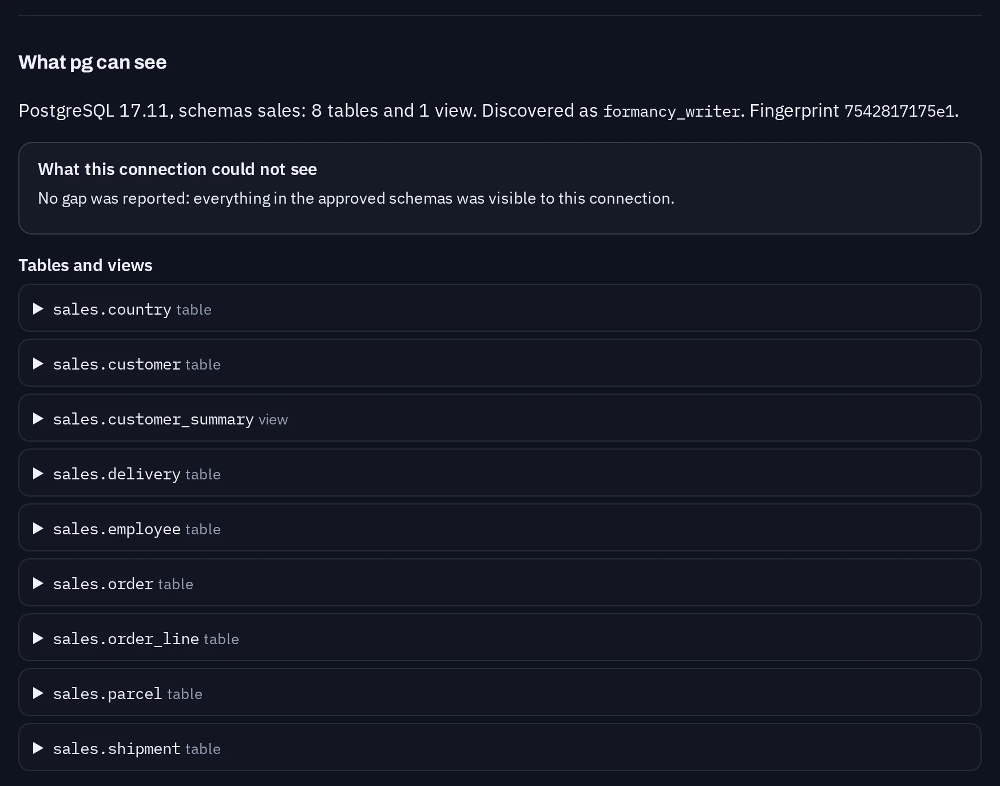
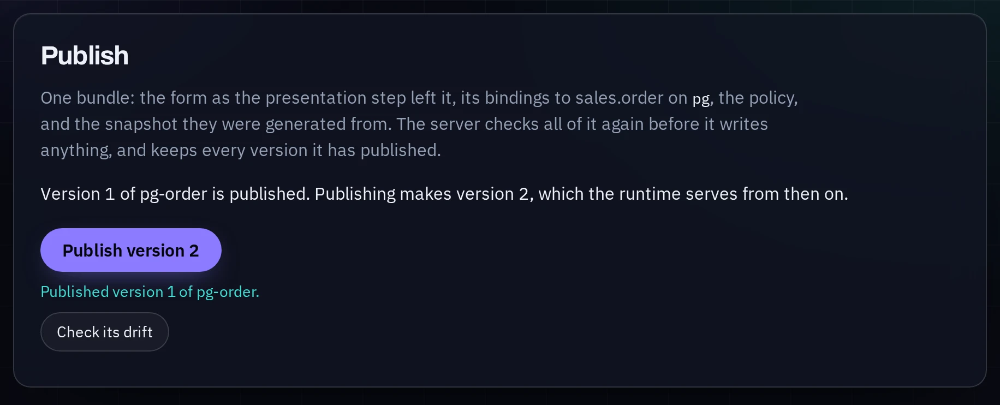
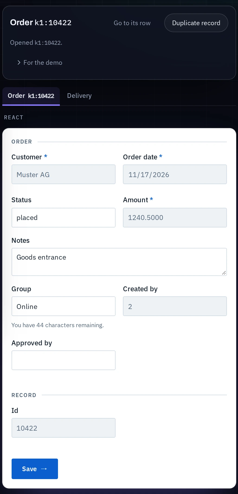

# Formancy Data

**Your existing database, as forms in your own application, under your own rules.**

Formancy Data turns an existing PostgreSQL or Microsoft SQL Server database
into forms in your own React or Angular application. It reads the database
as the account you connect it with, generates each form from what that
account may do, and serves the form's records under rules the server asks
on every request, with the identity your application already has. It is
self-hosted, source-available and
[paid for production use](#licence-in-one-table), and built on the
Apache-2.0 [formancy](https://github.com/sharkysan/formancy.ai) engine.

- **Your database as it is.** No schema of its own, and what the account
  cannot see is said, never taken as absent. A form updates and deletes
  only where a stale save can be told: by SQL Server's rowversion, or by a
  version column every writer increments, which a PostgreSQL table needs.
- **Your rules, on every request**, with your application's own token,
  verified offline: no users, passwords or sessions of its own.
- **A schema change is checked** against each published form, and the
  server refuses what it blocks rather than writing past it.
- **Proved on real servers.** No mocked driver: every adapter behaviour is
  tested against real PostgreSQL and SQL Server in every CI run.

<!-- generated by scripts/pictures/readme.mjs from scripts/pictures/scenes.json: hero; do not edit -->

*The host page, an example of your application's own page, as clara, a clerk of tenant 1, sees it: the orders on “Online orders”, a list view an administrator named, and the open order's deliveries in a tab beside it, each row what the server answered her under the form's policy ([0047](./docs/decisions/0047-a-hosts-workspace-lists-opens-and-edits-records-in-linked-grids.md)). The orders, the deliveries and three of the customers are invented, inserted by the capture script; Muster AG is the test fixture's.*

The screenshots in this README are taken by `pnpm pictures` from the built pages and the real data server, and the pictures job fails when one of them shows text the page no longer shows; the sketch in *How it works* is drawn by hand ([how, and what nothing checks](./docs/images/README.md)).

<!-- end generated -->

## Try it

- **[The live demo](https://formancy.ai/data/demo/)**: the host page over a
  server and a PostgreSQL of your own, with sample data; what you change is
  gone when your server stops ([how it runs](./docs/guide/live-demo.md)).
- **[The examples page](https://formancy.ai/data/examples/)**: forms
  generated in your browser and drawn by both renderers, with no server
  ([what it shows](./docs/guide/examples.md)).

## How it works

*What each package holds, and may import, is in [the building blocks](./docs/architecture/05-building-blocks.md).*

1. **Connect.** The studio discovers an allowlisted database as the account
   its connection names.

<!-- generated by scripts/pictures/readme.mjs from scripts/pictures/scenes.json: how-it-works-1; do not edit -->

*`pg`, discovered as the order form's own account. What an account cannot see is said as a gap, never taken as absent, and here there was none ([0004](./docs/decisions/0004-a-snapshot-says-what-it-could-not-see.md)).*

<!-- end generated -->

2. **Generate.** The generator makes a form of a root table and its
   lookups, and says what it chose.

<!-- generated by scripts/pictures/readme.mjs from scripts/pictures/scenes.json: how-it-works-2; do not edit -->

*`sales.order` as the root and its customer key as a lookup. The generator says what it made of each from what this account may do ([0009](./docs/decisions/0009-generation-is-deterministic-and-says-what-it-chose.md)).*

<!-- end generated -->

3. **Govern and arrange.** A policy says who may do what; labels, order and
   views are a patch over the form.

<!-- generated by scripts/pictures/readme.mjs from scripts/pictures/scenes.json: how-it-works-3; do not edit -->

*By the roles your application's tokens already carry: `clerk` reads, creates and updates, and nobody deletes ([0011](./docs/decisions/0011-every-operation-carries-a-trusted-policy-context.md)): “A role granted an operation the form does not offer is refused.”*

<!-- end generated -->

4. **Publish.** Every version is kept, nobody overwrites anybody, and a
   second person's approval can be required.

<!-- generated by scripts/pictures/readme.mjs from scripts/pictures/scenes.json: how-it-works-4; do not edit -->

*One bundle, which the server checks again before it writes: “Published version 1 of pg-order.” This server has no publisher roles; with them, a second person approves each draft ([0065](./docs/decisions/0065-with-publisher-roles-set-a-draft-is-published-only-when-a-publisher-who-did-not-submit-it-approves-it.md)).*

<!-- end generated -->

5. **Run.** Your pages ask the runtime plane through `@formancy/data-client`
   and draw each form with `@formancy/react` or `@formancy/angular`.

<!-- generated by scripts/pictures/readme.mjs from scripts/pictures/scenes.json: how-it-works-5; do not edit -->

*The order from the top of this page, drawn by React for its update: the fields written on create only are disabled, and its deliveries are the tab beside it ([0122](./docs/decisions/0122-a-host-page-draws-a-saved-record-for-the-update-and-a-new-one-for-the-create.md)).*

<!-- end generated -->

## What you get

What `main` does, in short; [*What it does*](./docs/guide/capabilities.md)
says each with the record that holds it, and the [studio's](./docs/guide/studio.md)
and [host page's](./docs/guide/host.md) pages picture them.

- **Lists**, searched, sorted and filtered inside the read policy, with
  views an administrator names and views a person keeps.
- **Lookups** offering only the rows a person may choose, checked again on
  save.
- **Child records** in tabs beside their parent, as a tree, or a level at
  a time.
- **Saves that overwrite nobody**: exact values digit for digit, a record
  and its rows in one transaction, and a lost answer said, never sent again.
- **Actions**: a routine your database keeps, run over the open record or
  the records a person chose, in one transaction.
- **Deletes, copies and CSV files**, and **rules a record keeps**: status
  moves by role, versions from a date, and your triggers' own refusals.
- **The studio**, for every step from connecting to drift, with review by a
  second person where you want it.
- **Operations**: one signed image, the whole stack from one command, an
  audit event per request, and keys rotated without a restart.

## What it does not do yet

- No bulk delete, no undo, and no file or copy of a record with its
  children.
- An action runs over at most one page of chosen records at a time.
- A SQL Server older than 2019 cannot be discovered; no test runs on Azure
  SQL or logs in as an Entra principal.
- No host page on another origin has run in a browser, and nothing through
  a real Cloudflare Tunnel.
- The performance figures are 0.1.0's, and there are none for a page of
  records, a file of them, the menu of forms, a delete, a save or an action.
- No lawyer has reviewed the licence.

[The host page's guide](./docs/guide/host.md) says what else its page does
not do, and [the status page](./docs/guide/status.md) what is not yet measured.

## Get started

**On your machine**, with Docker and git: `docker compose --profile stack up`
runs both databases with sample data, the server, the studio and the host
page, and [the getting-started guide](./docs/getting-started.md), which CI
runs as written, goes on to a published form. Starting it accepts the EULA
of SQL Server's Developer edition, which is not licensed for production.

**In your application**: run the server, the signed image
`ghcr.io/sharkysan/formancy-data-server` or `@formancy/data-server` from
npm, as [its README](./packages/data-server/README.md) says; draw its forms
with `@formancy/data-client` and `@formancy/react` or `@formancy/angular`
([*Packages*](./docs/guide/packages.md)); and build the studio from this
repository, which does not publish it ([*Studio*](./docs/guide/studio.md)).

## Status

**0.4.0, released on 2026-11-20, is the latest release.** This page
describes `main`, which the examples page and the live demo are deployed
from; [the status page](./docs/guide/status.md) says what 0.4.0 added and
what is not yet measured, and [`CHANGELOG.md`](./CHANGELOG.md)'s
*Unreleased* what `main` has added since.

## Licence, in one table

Source-available, **not** open source. The formancy engine, renderers, builder
and backend this module builds on stay Apache-2.0; this module does not.

| Use | Terms |
| --- | --- |
| Read the source and fork the repository | Free |
| Evaluate, develop and test — including in companies | Free |
| Run in production, internally or customer-facing | Paid licence |
| Redistribute inside another software product | Separate commercial agreement |
| Customer data and generated form definitions | Remain the customer's |

<!-- generated by scripts/licence-status.mjs from LICENSE.md; do not edit -->

[`LICENSE.md`](./LICENSE.md) has the terms. It is Version 1.1, in force from 11 October 2026, and says at the top that no lawyer has reviewed it. A production licence is requested from [info@formancy.ai](mailto:info@formancy.ai), as its section 9 says.

<!-- end generated -->

Why a paid module sits beside an Apache-2.0 project is
[0001](./docs/decisions/0001-a-paid-module-in-its-own-repository.md);
[*Packages*](./docs/guide/packages.md#the-licence-and-what-the-apps-bundle)
says how the licence came into force and what the built apps carry.

## Learn more

- [*What it does*](./docs/guide/capabilities.md), [*Status*](./docs/guide/status.md), [*Packages*](./docs/guide/packages.md), [*Deploying*](./docs/guide/deploying.md), [*What it is tested on*](./docs/guide/tested-on.md) and [*Development*](./docs/guide/development.md) — the guide.
- [*Studio*](./docs/guide/studio.md), [*Host example*](./docs/guide/host.md), [*Examples*](./docs/guide/examples.md) and [*Live demo*](./docs/guide/live-demo.md) — each app, pictured, and how to run it.
- [`docs/getting-started.md`](./docs/getting-started.md), [`docs/setup.md`](./docs/setup.md), [`docs/deploy/cloudflare.md`](./docs/deploy/cloudflare.md) and [`docs/performance.md`](./docs/performance.md) — running it, setting it up, behind Cloudflare, and what it costs.
- [`docs/README.md`](./docs/README.md) — the architecture in arc42's twelve sections, [the decisions](./docs/decisions/README.md), [the release report](./docs/release/README.md) and [the pictures](./docs/images/README.md).
- [`CHANGELOG.md`](./CHANGELOG.md), [`CONTRIBUTING.md`](./CONTRIBUTING.md) and [`CLA.md`](./CLA.md), [`SECURITY.md`](./SECURITY.md) and [`RELEASING.md`](./RELEASING.md).
