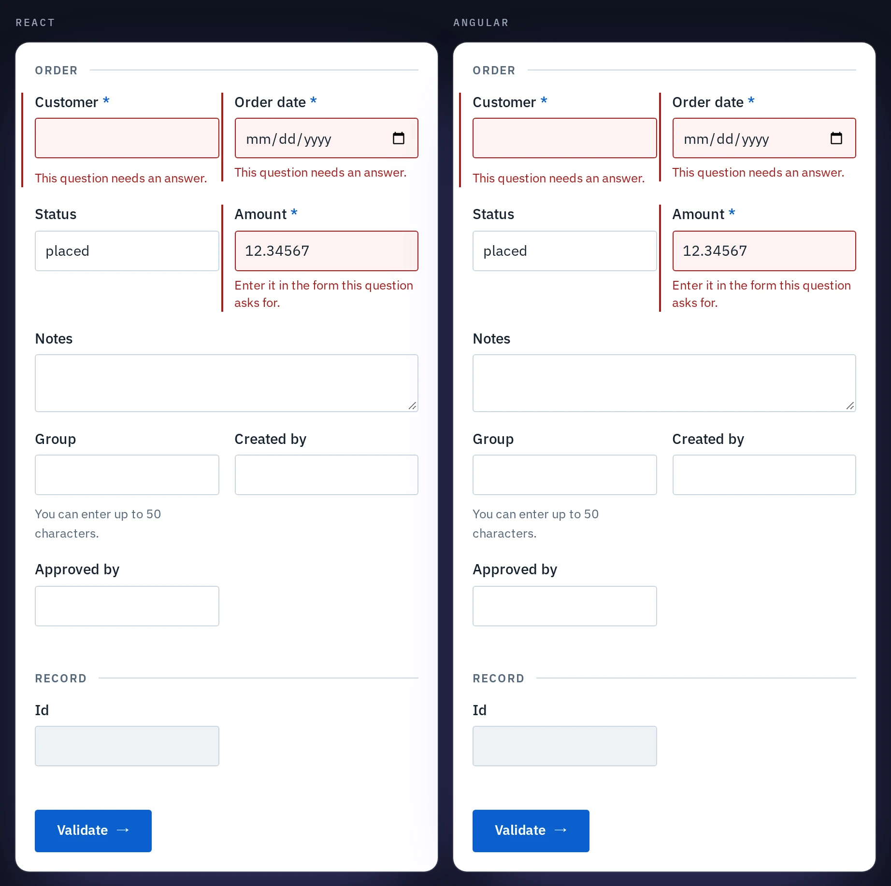

# Examples

The examples page, which shows generated forms under both renderers with no
server behind them: how it runs from a clone, how formancy.ai serves it, and
what its browser gate measures.

`apps/examples` is a page, never published to npm, that shows a generated
form the way the people filling it in will see it — under both renderers at
once. It is served at https://formancy.ai/data/examples/, and runs from a
clone:

```bash
pnpm demo                                        # builds, then serves the built page at http://localhost:4391
pnpm --filter @formancy/data-examples dev        # after pnpm build: the dev server, at http://localhost:4391
```

It reads a snapshot of the shared fixture, checks it against its fingerprint,
runs `generateForm` **in the browser** for `sales.order` and `sales.customer`,
and renders each with the released `@formancy/react` and `@formancy/angular`
side by side, on white paper in the Blueprint theme, with the generator's notes
— inferred, excluded, read-only, blocked — beside each. Its suite holds the two
renderers to the same fields by accessible name and the same error codes
([0021](../decisions/0021-generated-forms-preview-in-both-frameworks.md)).

<!-- generated by scripts/pictures/readme.mjs from scripts/pictures/scenes.json: examples; do not edit -->



*The examples page runs the generator in the browser over a snapshot captured from PostgreSQL, with no server, and renders `sales.order` with both renderers. An amount with five decimals for a `numeric(18,4)` column is refused in both with the same sentence, “Enter it in the form this question asks for.”, and the empty required fields with “This question needs an answer.” ([0021](../decisions/0021-generated-forms-preview-in-both-frameworks.md)).*

<!-- end generated -->

The demo is a Cloudflare Worker of its own with static assets and no code,
routed at `/data/examples/` of formancy.ai and nowhere else, which
Cloudflare's Workers Builds deploys from `main` on every push
([the Worker's settings](../../.github/REPO-METADATA.md#the-demos-worker-on-cloudflare)); `/data`
itself is kept for the product's page on formancy.ai. Every file under the
path is sent with a Content-Security-Policy that allows nothing a directive
does not name, nothing inline and nothing evaluated, scripts, styles and
fetches from formancy.ai's own origin -- its whole site, not only this path
-- and from no other host, the page's fonts included, which are files of
its build
([0072](../decisions/0072-the-apps-serve-their-own-fonts-and-no-page-asks-another-host-for-anything.md)),
and no form sent anywhere, with
`nosniff`, `no-referrer` and a Permissions-Policy that denies what the page
does not use; the hashed chunks are cached for a year, and the third-party
notices are sent as UTF-8 text
([0069](../decisions/0069-the-examples-page-is-served-at-formancy-ai-data-examples.md)).
Cloudflare's bot detection puts an inline script into the page as it
serves it, which the policy refuses like any other: the browser's console
reports that refusal on every load, and nothing on the page needs the
script.
The Worker runs none of the product: no server, no database and neither
plane, which stay where the composed stack puts them, with Cloudflare at
most their edge
([0037](../decisions/0037-cloudflare-is-the-edge-not-the-runtime.md)).
GitHub's workflows hold no Cloudflare token and never deploy. By hand,
`pnpm demo:deploy` deploys from a clean checkout of `main` after the
Wrangler login [RELEASING.md](../../RELEASING.md#the-demo-on-formancyai)
names, and `node scripts/demo.mjs --dry-run`, after `pnpm build`, checks
the config and the build and uploads nothing.

What the suite cannot see, because jsdom performs no layout, a browser gate
measures, in CI in Chromium, Firefox and WebKit, with the built page served
under `/data/examples/` with the demo's headers: no sideways scroll down to
320 pixels, the keyboard path through the skip link into the first preview,
and colour contrast and target size, clean and after a failed submit; that
every web font the page asks for had loaded by the end of each pass, or, in
the one that refuses them, none had; that the page asked no other origin
for anything; that the browser refused nothing under the policy, the
console said no error, and an inline script put in the page was refused;
and that the notices were sent as UTF-8 text.

```bash
pnpm --filter @formancy/data-examples exec playwright install --with-deps chromium firefox webkit   # once per machine; the system libraries need sudo
pnpm test:browser                                       # builds the apps, then measures them in Chromium
FORMANCY_BROWSERS=all pnpm test:browser                 # in Chromium, Firefox and WebKit, as CI does
```

On a clean `ubuntu:24.04` container on 2026-10-13, `--with-deps webkit`
installed 372 packages through apt in 81 s and the examples gate then passed
in WebKit, with nothing else installed; Firefox's there was not measured.
WebKit is refused
off Linux: Playwright's WebKit on macOS and Windows is another port, with
another network stack, so there `FORMANCY_BROWSERS=chromium,firefox` runs
the other two.

The snapshot is captured from a real PostgreSQL container, never written by
hand. After a change to the fixture, with Docker running:

```bash
pnpm build
pnpm --filter @formancy/data-examples snapshot
```

and commit `apps/examples/src/fixture-snapshot.json` and
`fixture-customers.json`. The suite compares the committed snapshot with the
fixture model and fails where they disagree, and refuses a snapshot edited by
hand. The customer lookup, drawn as the typeahead the generator writes, is an
in-memory source over the captured customers, because this page has no
server, and the page says so; a host gets the customer options from the
runtime plane, as [the host page](host.md) shows.
