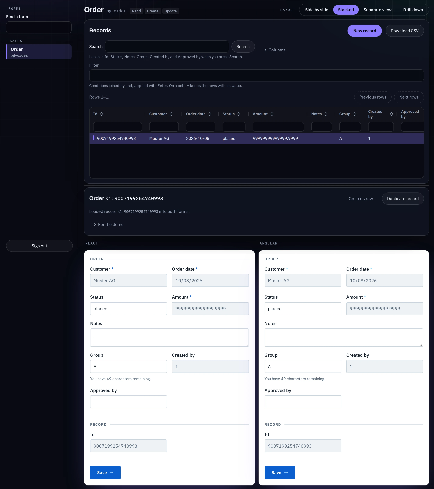
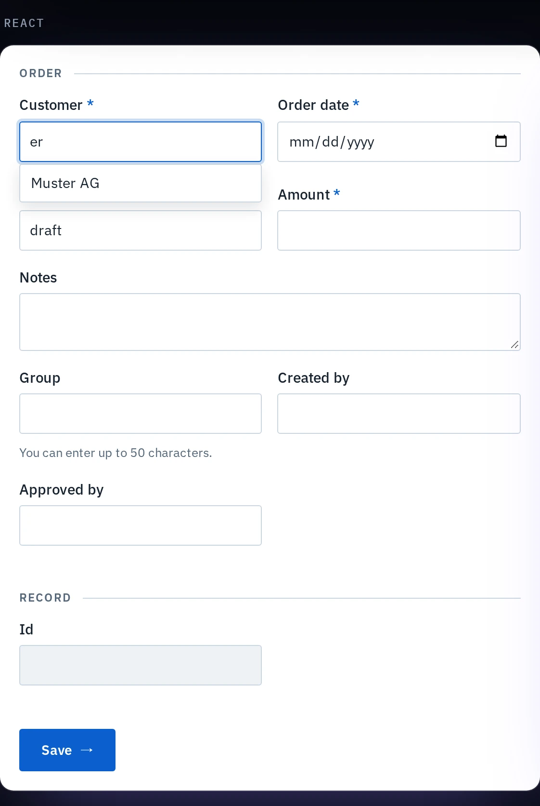
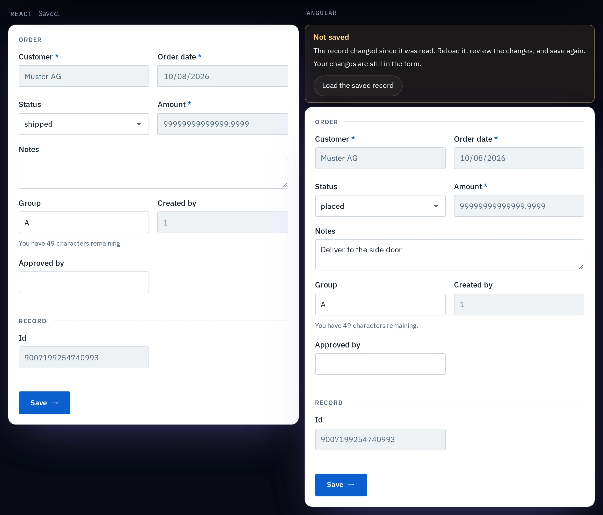
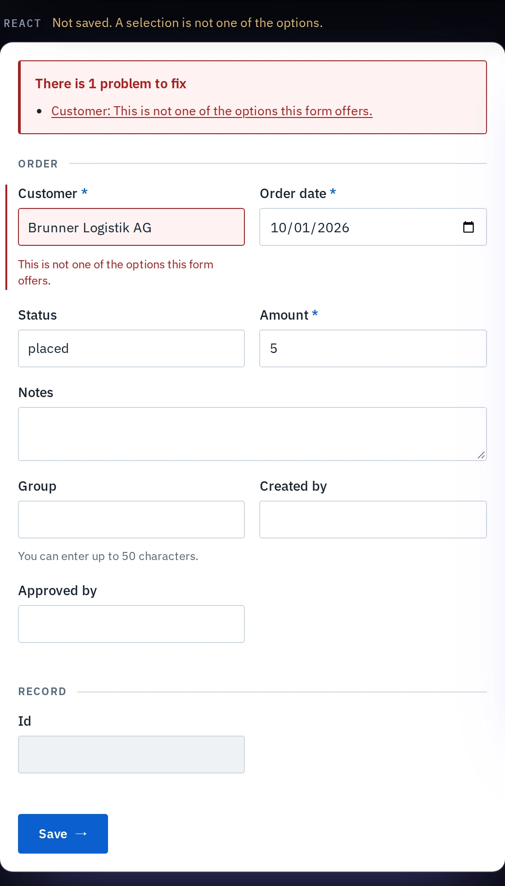
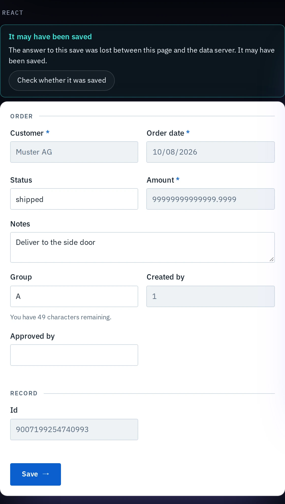
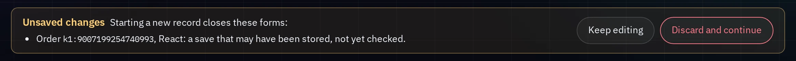
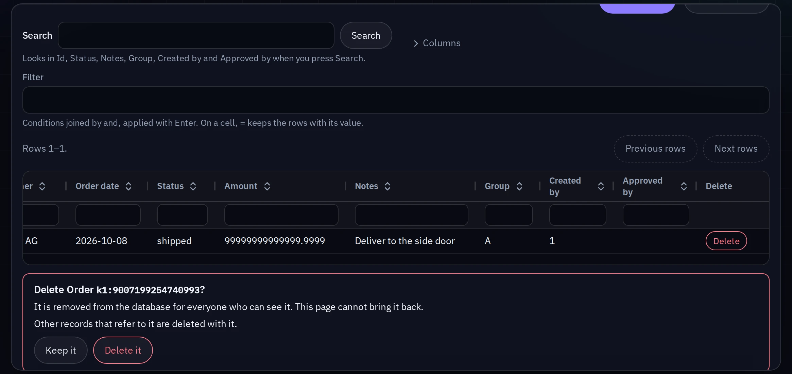
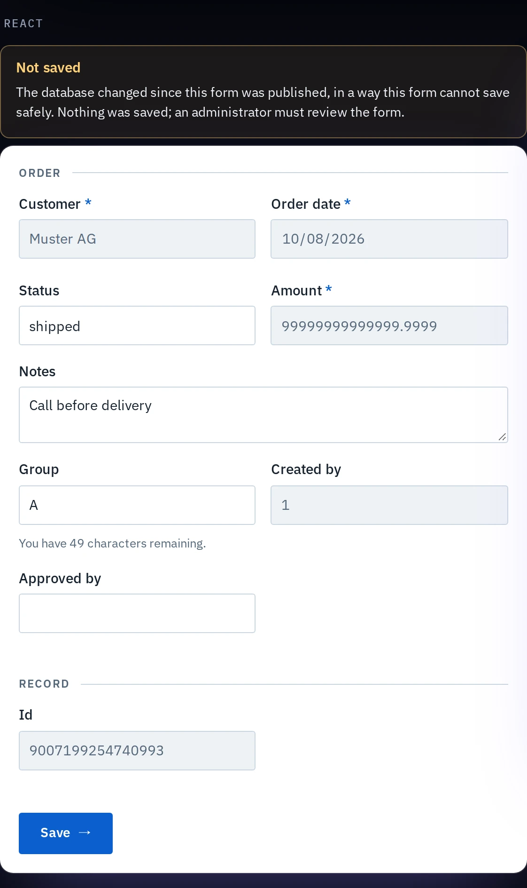
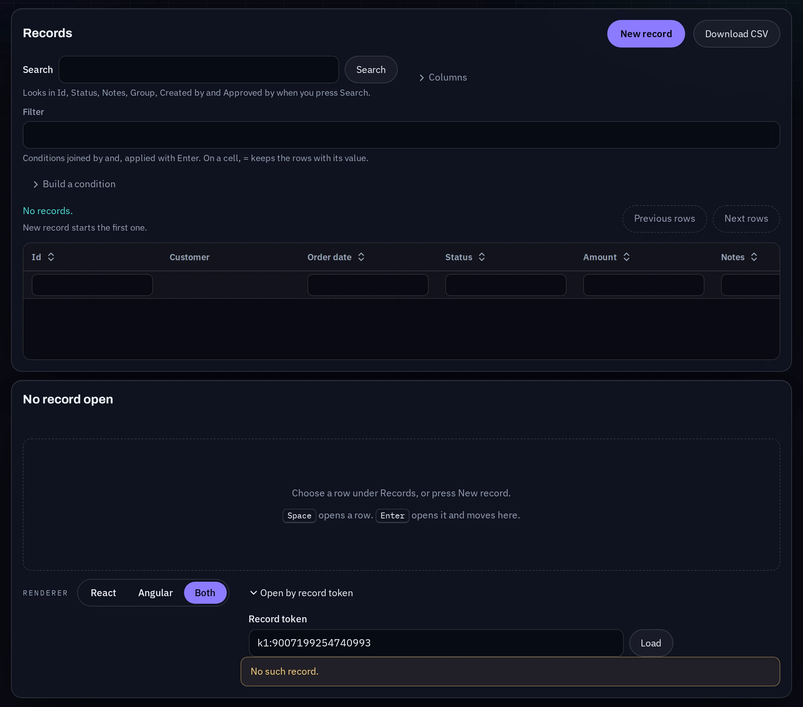

# Host example

The host page, a host application's workspace over the runtime plane: what a
person does there with a published form's records, pictured as the product
draws it, how to run it from a clone, what its suites hold, and the build
the live demo serves.

`apps/host` is a host application's page, private and never published: a
workspace over the server's runtime plane, through `@formancy/data-client`
and nothing else
([0029](../decisions/0029-a-host-renders-a-published-form-through-one-client.md),
[0047](../decisions/0047-a-hosts-workspace-lists-opens-and-edits-records-in-linked-grids.md)).

```bash
pnpm build
FORMANCY_DATA_SERVER=http://127.0.0.1:4390 pnpm --filter @formancy/data-host dev   # http://localhost:4393
```

Sign in with a host token, and Forms lists the published forms you may read
([0045](../decisions/0045-the-runtime-plane-lists-the-forms-a-person-may-read-and-nothing-about-the-others.md)),
under their groups' headings in alphabetical order, the forms in no group
last under "Forms", and no headings where no form is in a group
([0143](../decisions/0143-a-form-is-listed-in-a-group.md)).
A form's definition names, under each lookup, the forms you may read its
record in
([0140](../decisions/0140-a-form-names-the-forms-each-lookups-record-opens-in.md)).
Find a form, at the top of the list, narrows it as you type, to the forms
whose title or id holds what you typed in any case, a letter's marks kept,
and says how many match; Enter opens the one that matches, Escape empties
the box, and Down moves into the list, where Down and Up go on and Up from
the first comes back; while an input method composes, its keys are its
own. Under the groups, "Linked to" the open form names the forms its
fields lead to and those whose rows refer to it, each once, in words that
name it beside an arrow -- "Customer pg-customer where Order’s fields
lead", "Order line pg-order-line rows that refer to Order" -- and never
the open form itself; choosing one keeps the keyboard on that form in its
group until the form opens
([0144](../decisions/0144-the-host-lists-its-forms-by-group.md)).
A form's records are a grid, AG Grid Community, a page at a time from the
server's list
([0044](../decisions/0044-a-forms-records-are-listed-a-page-at-a-time-under-its-read-policy.md)),
searched when you press Search and sorted by any header the server says
sorts. While the next page, a sort or a search is asked for, the rows on
screen stay, dimmed, and a refusal leaves them there with the server's
sentence, Previous rows and Next rows waiting for a refused search,
filter or sort; the grid's line says what the server answered in the room's teal
for a moment, as a form's "Saved." does, and is muted after
([0146](../decisions/0146-the-page-says-what-the-server-did.md)).
Space opens a row under the grid, or beside it, Enter opens it and
moves there; the record is drawn by `@formancy/react`, `@formancy/angular`
or both, as you choose with the renderer switch under For the demo, and
the choice is kept in this browser with where
you left the line between the records and the record. Beside the record, each form
whose rows reference it is a tab -- an order's lines, its deliveries --
after the record's own, which holds its form; Left and Right move between
the tabs, and Tab goes on into the one shown. A child's tab lists its rows
the first time it is shown and keeps them, a row open and what you typed in
it, while you look at another; another record opens on its own tab
([0142](../decisions/0142-a-records-child-forms-are-tabs-beside-it.md)).
Each child row opens in its own form; a new one is created under the open
record. A form generated as a section of the record -- a table whose key
is its foreign key onto the record's, holding at most one row of it -- is
its one row in its own form instead, in the record's own tab, or Add,
shown while the record as stored holds the value its generation names
([0109](../decisions/0109-a-form-whose-key-is-its-parents-is-a-section-of-the-parents-record.md)).

A child an administrator chose to save with its record -- an order's
lines, one to twenty of them, say -- is a tab whose rows are held on the
page until the record's own Save, which sends the record and every changed
row together, all stored or none ([0155](../decisions/0155-a-records-rows-may-be-saved-with-it-in-one-transaction-guarded-by-its-version-and-checked-as-a-whole.md)). Its tab is there at once, a new
record's too, and lists the record's rows as the record opens. Each row's
change is said in its own column -- New, Changed, To be deleted, Changed by
someone else -- and a line under the heading says how many rows there are,
the fewest and the most the record holds, why Add or Remove is not there,
and what is held, with Go to Save beside it, which shows the record's tab
and puts the keyboard on its Save and sends nothing. Add starts a new row
on a rail below the grid with the keyboard in its first field; a row opens
there by a click, Space or Enter -- in Drill down too, on the record's own
level rather than a level below -- in its own form without the field
naming the record, which the save fills in; Done closes it, sends nothing,
and gives the keyboard back to its row. Remove marks a row to be deleted
and becomes Undo remove, the keyboard left on it; nothing asks first,
because nothing is deleted until Save. There is no Add at the most rows
the record may hold, no Remove at the fewest and no Undo remove at the
most, and none of them where the server says you may not -- you may take
off a row you added and not yet saved where you may not delete a saved
one -- which the line says. A row whose form refuses its answers is
opened with its problems and nothing is sent; a refusal about a row opens
that row with the server's words, and one about the rows' count is said
on the tab, the keyboard there. While the save is out you can go on
typing in any row, but a row in that save has no Remove until it is
answered, and the other renderer's Save sends nothing. Every save moves
the record's version, so saving lines of an order someone else saved
since is stale even where the two of you changed different lines: where
you changed only lines, Keep my line changes reads the order again and
keeps each change at the version it was read at -- asking first if you
typed into the order itself since, which it drops -- and Save stores them;
but a line the other person changed too, said Changed by someone else, is
refused at that line until Load this line takes it as stored, or takes it
off the page where it was deleted. Load the saved record asks first where
the rows hold changes. Such a form opened on its own says its rows are
added and removed with their record, and that a change made there is
saved by itself, and offers no New and no Delete.

A form that is its own child -- an employee and their manager -- shows its
records as a grid or as a tree: the records with no parent, and under each
record, once it is expanded, those naming it
([0110](../decisions/0110-a-form-that-is-its-own-child-is-shown-as-a-tree-of-its-records.md)). The
records and the record are stacked, the records above, side by side, or
separate views, and the address says which form and layout, never which
record. Stacked is where a page opens with no layout in its address and
none kept -- Separate views on a phone -- and in it a line between the
records and the record shares the window's height, as Side by side's
shares the width: drag it, or press Down and Up a step and Home and End
to its limits, the Records panel as tall as it says; in a window about
30.5rem tall or less there is no line, and the panel is as tall as what
it holds. The layout you choose
is kept in this browser, and a page whose address names no layout opens in
it; one that names a layout opens that one and keeps nothing, and Drill
down reached by a lookup's Open is not kept
([0145](../decisions/0145-the-layout-is-the-persons.md)). For the
demo, one closed button at the end of the record's header, holds the
renderer switch and Record token, which loads a record by its token; it
stays as you left it in this browser (0146).

Drill down, the fourth layout, shows one level at a time: the records, the
record, a child row of it with its own children in tabs beside it, and so
on as deep as the forms go -- an employee, an order it approved, that order's line. Opening a
row goes down a level, and a trail above says where you are, each level
above a button back to it; Back and Forward move between the levels too.
A record is named in the trail by its first required plain text field, a
customer by its name, or else by its token. Going up keeps the levels
below as they were, typing included; going down elsewhere asks first when a
level below holds unsaved work, and deleting a row a level below holds
names that work in the delete's own confirmation, dropping nothing unless
you delete it
([0094](../decisions/0094-a-held-rows-delete-names-the-levels-it-drops-in-its-confirmation.md)).
The levels are in the page's memory, so a reload starts on the records
([0090](../decisions/0090-a-hosts-workspace-can-drill-down-one-level-at-a-time-with-a-trail-back.md)).
Under each lookup of a record that names a record, the paper offers one
Open per form you may read it in -- "Open in Order (pg-order)" says the id
where two forms share a title, and "Open Approved by in Employee" the
lookup where two lookups open in forms of one title -- on the answer the
field holds now, saved or not, and nothing under an empty one. Open shows that record a level
below, in that form, from any layout, which becomes Drill down; a record
the form does not show you leaves you where you were, saying so
([0141](../decisions/0141-a-lookups-record-opens-below-the-record.md)).
In every layout Back goes on past the open form's earlier views and
levels, one press each, to the form before
([0097](../decisions/0097-back-goes-on-past-the-open-forms-own-entries-in-every-layout.md)).

Filter, under the search and in each child section, is a line you type
the grid's filter in -- `status = placed and amount > 1000` -- over the
fields the server offers a filter on, each named by its label as you
would type it (`order_date`), or by its key where two labels would say
one name. A condition is a name, `=`, `>`, `>=`, `<`, `<=` or `contains`
and a value, quoted where it holds a space, or a name and `is empty` or
`is not empty`, and conditions are joined by `and`; two comparisons on one
field are one range. As you type, a list under the line offers what may
come next: the fields with their labels, a field's operators, a state's
labels, yes or no. Enter applies the line and lists the grid again from
its first row, and a line the page cannot read keeps what you typed,
marks what it is about and says why -- `1'000` is written `1000`; an
edit you leave unapplied is dropped when the filter changes elsewhere. `/`
puts the keyboard on the Records line, and Esc twice gives it back to the
grid
([0131](../decisions/0131-a-person-types-a-grids-filter-as-a-line-and-sees-each-condition-as-a-chip.md)).
Under each column's header a box takes the line's condition on that
column without its name -- `> 1000`, or a bare value, found anywhere in
text and equal to anything else -- applied with Enter or on leaving it,
and a select of its values for a state or a yes-or-no column; the
keyboard reaches it from the header with Down and Enter
([0132](../decisions/0132-each-column-header-filters-its-column.md)).
`=` on a cell keeps the rows with its value, and the keyboard comes back
to that cell to point at the next
([0133](../decisions/0133-a-cell-filters-by-its-value.md)).
Each condition applied is a chip in words -- "Amount is over 1000" -- with
its own Remove, and Clear filter removes them all; either offers Undo
until the filter changes some other way, and a list nothing matches
offers to try it without its last condition. A lookup's column searches
its lookup in its box, and the line names a record by the label the grid
shows (`approved_by = grace`) or by whether there is one (`approved_by is
empty`); `=` on a lookup's cell takes its record
([0135](../decisions/0135-a-lookup-field-filters-by-the-record-it-refers-to.md)),
and its header sorts by what it shows, its first display column
([0136](../decisions/0136-a-lookup-field-sorts-by-what-it-shows.md)).
The line also takes a condition on a column a lookup shows,
`customer.name contains muster`, which keeps the rows whose customer's
name holds it among the customers the lookup may show the person, its
chip saying "Customer › Name contains “muster”"; a column of the
customer the form does not show is no field, `is empty` is never asked
through a lookup, and a published view cannot name one yet
([0139](../decisions/0139-a-lookups-shown-columns-filter-its-records.md)).
The line and the boxes offer
every field the server offers a filter on, less any the form's
administrator left out in the studio's List views, though a view may
still filter on one, which is then a chip and not in the line
([0123](../decisions/0123-an-administrator-chooses-the-fields-a-forms-filter-panel-offers.md));
a timestamp's range is whole days, in UTC for an instant, as the grid
shows times, and its chip says so. The grid's line says which fields
filter it. A value the server cannot hold is its sentence on the grid's
line, with what you typed still in the line or its box. The panel that
built one condition from menus is retired
([0134](../decisions/0134-the-build-a-condition-panel-is-retired.md)). A child section's
filter is its own, and opening another parent starts without one; the
filter is in no address, so a reload or another form starts without the
conditions you typed
([0104](../decisions/0104-a-list-and-a-browse-are-filtered-by-conditions-on-their-columns.md)).

Where the form's administrator named list views, View, after the search
and first in a child section, offers All records and each view the server
offers you by its name -- those for one of your roles and those for
everyone, which the administrator decides per view in the studio
([0124](../decisions/0124-a-list-view-may-be-offered-to-some-roles-and-open-their-grids.md)). Choosing one sends nothing; Show view sets the
grid's filter and sort at once, in one request, and keeps the keyboard on
the button: the chips and the line show its conditions and the headers show its
order. Any condition you add or header you press makes it
Your own filter and sort, and the view's own conditions and order show the
view again. A grid opens on the view marked to open it, and on every record
where that view names a field you may not read, which is then not offered
to you at all. A view counted from today is today's when you open the
form, and one that is yours compares with what your sign-in carries
([0125](../decisions/0125-a-list-view-may-count-days-from-today-and-compare-with-the-signed-in-persons-attribute.md)).
No view is kept in the address
([0105](../decisions/0105-a-forms-list-offers-views-its-administrator-named.md)).

While the filter and the sort are your own, "Name of your view" and Save
your view keep them as a view of yours, which View then names under "Your
views" at once in every grid of that form on the page
([0128](../decisions/0128-the-grids-of-an-open-form-share-a-persons-own-views.md)), and in every one you open from then on, on
any device you sign in from; while one of yours is shown, Remove your view
lets it go, from every grid of the form. The
server keeps them for you alone, and only what your own list could run: a
view the form already offers, or one you already keep, is refused in a
sentence on the picker's line, and you keep at most twenty of a form.
Your browser keeps none of them
([0126](../decisions/0126-a-person-keeps-their-own-list-views-on-the-server-for-themselves-alone.md)).

Columns, beside View and Filter, lists the grid's columns: Show one or not,
move it up or down, all by keyboard, or Reset columns for the form's
order; the last one shown stays, since a row opens through its cells. Your
browser keeps, for each form, the columns you arranged, the view you
showed by its name or else your sort -- All records included, over the
form's default -- and opens the grid on them next time. It keeps no value
you typed into a condition of your own, so your sort comes back without
them; it is this browser's, not yours on another device, and anyone else
signed in on it shares it. A hidden column is still in Download CSV
([0106](../decisions/0106-a-hosts-grid-keeps-its-columns-sort-and-view-in-the-viewers-browser.md)).

A column is as wide as you make it. Drag its header's edge, press Alt and
an arrow on its header, or, in Columns, press its minus or plus, a step
a press, which the panel's line says in pixels, and Fit to size it to
the rows shown; Reset columns gives every column back to its content. A
column is never narrower than its header's longest word, and has a
widest. Your browser keeps the widths with the columns, so the next page,
a reload and Drill down open at them, and the grid never sizes them away.
Like the rest, they are this browser's, not yours on another device; a
click or a double click on an edge changes nothing
([0151](../decisions/0151-a-person-sets-a-grid-columns-width-and-the-browser-keeps-it.md)).

Download CSV, beside New record in the Records panel and beside each child
section's New, saves one file of the records that grid lists, as the server
makes it: the search you submitted, not what the box holds, the grid's
filter and sort and, in a child section, its record, whose column the file
keeps
([0079](../decisions/0079-a-person-downloads-the-records-a-list-shows-them-as-one-csv-file-made-whole-or-not-at-all.md),
[0080](../decisions/0080-a-host-downloads-the-records-its-grid-lists-and-the-browser-saves-the-servers-file.md)). It is there wherever the form's records can be listed,
and not under a record not saved yet. While the file is made its line says
so and a press sends nothing; once it is made the line names it and the
browser saves it as `<form id>.csv`; a refusal is the server's sentence,
and pressing again asks again. Leaving the form or signing out stops a
file in the making without a word, and so does opening another record for
its child sections' files. The line names the file, not how many
records it holds, and says the page handed it over, not that the browser
kept it.

Where the server offers you delete, the open record's header has Delete
record, a child row's its own Delete, and each grid row a Delete button
named for its record, which the arrow keys reach without making the grid
more than one Tab stop; no key deletes. Each asks first, in place under
what you pressed, naming the record and saying what the delete also does
-- other records deleted with it, or the database keeping it while others
refer to it -- in the server's terms, never which tables or how many, and
listing any form of it that holds unsaved work; Keep it comes before Delete
it. A row's delete names the version the row was listed with, the open
record's the newest its forms heard. Once it is
deleted, the grid says so, with the keyboard on its heading; a record the
delete cannot find is closed, never called deleted; a refusal is said in
the server's words; and a deletion whose answer was lost may have been
done, is checked by reading the record, and is repeated only after asking
again
([0053](../decisions/0053-a-host-deletes-a-record-from-its-detail-or-its-row-after-a-confirmation-in-place.md)).

Each action the server offers you on the form over the open record -- a
routine the database keeps, which an administrator bound to it -- is a
button in the open record's header, named by its label, and only there:
a child row and a Drill down level offer none, and an action over the
records you choose is above the grid, below
([0165](../decisions/0165-an-action-runs-over-a-selection-of-up-to-a-page-of-records-in-one-transaction-locked-in-key-order-all-or-nothing.md)). Pressed, it asks in place under the header,
with no overlay: first its dialog, where it has one, drawn by the
renderer you chose -- React where both are shown -- on its own paper,
with Continue; then a confirmation, which names the action and the
record, says the sentence its administrator wrote or that it runs in the
database and this page cannot take it back, and lists any form of the
record holding unsaved work, which the record read again after the run
replaces. Keep it comes before Run it, and Escape is Keep it. While a
save of the record is out, Run it says so and sends nothing, and while
the run is out the record's Save says it sent nothing. Once it ran, it
says the administrator's sentence or "Done." in teal for a moment, and
the record is read again, with its row, and the grids of its sections
where the action names them, so the next Save names the version the run
moved. The forms the confirmation listed are read again without asking
you a second time; a form you typed into while the run was out is asked
about first, and until the record is read again its Save sends nothing
and says so. If the page is asking you about something else as the run
answers -- another record you asked for meanwhile -- that question keeps
the keyboard, and the record is read again once you answer it, unless
your answer moved on. A read that is refused is said, with the saved
record offered. A refusal
is said in the server's words, one the database's rules worded for you
followed by "This reason is the database's own.", and a stale one offers
the saved record; an answer it refused by a dialog's field goes back to
the dialog. A run whose answer was lost may have run: Check whether it
ran reads the record, and only where it is still at the version the run
sent does it offer Run it again, which sends that version -- so if the
first ran after all, the second is refused as changed
([0162](../decisions/0162-the-host-page-runs-an-action-from-the-open-records-header-after-its-dialog-and-a-confirmation-in-place-and-reads-the-record-again.md)).

Where the form offers you an action over the records you choose, the
Records grid's first column, Choose, holds a box on each row you could
run it over -- "Choose Order `k1:7`", named as the row's Delete names its
record -- and a bar above the grid holds a button for each such action,
a line that says how many are chosen, Choose every record on this page
and Clear the choice. The arrow keys reach a row's box as they reach any
cell, and as they arrive the grid says that Space ticks or unticks it --
on a row's Delete, that Space or Enter asks to delete it. Space ticks it
and opens nothing, and Tab leaves the grid in one stop, as from any
cell; Space on another cell still opens the record. A choice is of the
page shown: another page, a search, a filter, a sort or a view clears
it, and the bar's line says so; the same page read again, after a save,
keeps it at the versions read then, and a save of the open record moves
the version it is sent at. An action pressed with nothing chosen says
what to do first and sends nothing, and Clear the choice that there is
nothing to clear, each again at every press. Pressed with records
chosen, it asks as the header's does, under the bar: its dialog, then a
confirmation that counts the records and, where the administrator wrote
no sentence of their own, says that if one is refused, none of them is
changed. Either stands only while the choice does: tick or untick a
box, clear the choice or show another page, and it closes, nothing run.
Once it ran, "Done. It ran over 3 records.", the page read again and
the choice cleared -- and the open record read again, where it was one
of them. A refusal about some of the records names them and says
nothing was done to any, all of it said as the keyboard lands there,
and offers Read the page again, never a run again past it; a run whose
answer was lost is checked by reading each record, and run again only
where none moved. Only the Records grid offers a choice -- a child section
and a Drill down level offer none -- so more than a page of records is run
a page at a time
([0166](../decisions/0166-a-person-chooses-a-pages-records-by-a-column-of-boxes-and-runs-an-action-over-them-from-a-bar-above-the-grid.md)).

New record, and a child's new row, start each field at its column's
constant default where the form has one -- an order at `draft` -- and a
save that leaves it sends it. New record starts a field at the starting
value the form's administrator chose over its column's instead
([0150](../decisions/0150-an-administrator-gives-a-field-another-starting-value.md)). A record you open, a Duplicate and a form
discarded back to start as they were handed in, never at a default; a field
you may not give on create, and a state a create may not start the record
in, start empty, and the database fills them as before
([0149](../decisions/0149-a-new-record-starts-with-its-columns-constant-default.md)).

Where the server offers you create, the open record's header also has
Duplicate record. It reads the record again and opens a new record in every
form holding its answers, but for its key and whatever the database fills
or you may not give, with the keyboard on the new record's heading, and the
line names the values that were not copied. It asks first, as New record
does, when a form holds unsaved work, and copies what is stored, not what
you typed. Nothing is saved until you save; the copy's child sections list
rows once it is, and a child row has no Duplicate of its own
([0107](../decisions/0107-a-record-is-duplicated-into-a-new-one-of-the-fields-the-server-names.md)).

Each form keeps its own draft and version, so loading one record into both
renderers, saving in one and then in the other is the stale case: the
second keeps what was typed, says so, and offers to load the saved record. A
selection the server refuses is said on the field.

The form stays editable while a save is out: what is typed meanwhile is kept
and said to be unsaved, a second press sends nothing and says so, and an
answer that arrives after the form was replaced is said on its line. An instant
or a time the person may read and did not change is never written back, so a
save keeps the fraction and the seconds the database holds, and a form whose
only change was such a field says it was not saved, because nothing changed
([0040](../decisions/0040-instants-and-times-are-read-to-the-shape-and-an-unedited-one-is-never-written.md)).

Anything on the page that would drop a form holding unsaved changes, a save
still out or a save that may have been stored -- another row, New record,
Load, Duplicate record, another form, Back, Sign out, a child row, hiding a renderer, or a
record created in one renderer, which the other then opens -- asks first,
naming a record whose rows hold changes with them -- "Order k1:7 with 2
Order line rows added and 1 to be deleted" --
and names what was typed while it waited before discarding it; a record
whose read answers after you have moved on is not opened over what you
typed since. A reload or a closed tab does not ask.

A save the server refuses because the table changed under the form is said in
the server's sentence, which names no column, and what was typed stays in the
form ([0041](../decisions/0041-the-runtime-refuses-what-drift-blocks.md)).
Of the host page's suites and checks, only that picture's check below holds
the page to it, and on PostgreSQL alone
([0038](../decisions/0038-readme-pictures-are-taken-by-a-script-and-held-to-the-text-they-show.md)).

A save or a delete the database's own rules refuse in words written for you
-- a trigger whose error starts `formancy: refused: ` -- says that reason
exactly as the trigger wrote it, under "Not saved" or "Not deleted", then
"This reason is the database's own.", since it is the one sentence there
the server did not write; the keyboard goes to it, as to any refusal, and
what was typed stays in the form. A reason that names a column is said on
the field bound to it instead, as any field's refusal is, and the form's
line says "Not saved.", the reason and "This reason is the database's
own." Any other refusal a trigger raises is said in the server's
sentence, as before
([0156](../decisions/0156-a-trigger-can-refuse-a-write-in-words-the-person-reads.md)).

A field its person may write in no operation -- a tenant pinned to the
token, a field the policy lets them read and not write -- is drawn
disabled and is in no save the page sends
([0117](../decisions/0117-a-form-names-what-each-write-accepts-and-a-host-page-sends-nothing-none-accepts.md)).
A loaded record is drawn for its update: a field written on create only
-- Customer, Order date, Amount and Created by for the order form's own
account -- is disabled there, and writable on a new record
([0122](../decisions/0122-a-host-page-draws-a-saved-record-for-the-update-and-a-new-one-for-the-create.md)).

What it does not do yet: no bulk delete and no undo, no file of a record
and all its children at once, no copy of a record with its children; and
on a record just created in the form, a field written on create only stays
writable until the record is opened again, and the server refuses a
changed one.

In a real host the application's own session supplies the token; the page asks
for one because it has none, holds it in memory only, and forgets it on a
reload. As with the studio, the page is served from the server's origin: in
development Vite proxies `/v1`, and in the composed stack the same
`deploy/web/nginx.conf` serves it at `/host/`, which the getting-started
guide's section 5 uses, under the studio's Content-Security-Policy with
inline styles allowed, for the style elements AG Grid creates, and
nothing else
([0083](../decisions/0083-the-studio-and-the-host-page-are-served-under-a-content-security-policy-each.md)).

The pictures below begin with the exact values, the fixture's order whose
id is 2^53+1 and whose amount is the largest `numeric(18,4)` holds, under
both renderers, which was the README's first picture; the README now opens
on this page's workspace over invented orders, and its *How it works*
pictures one of them open, drawn by React
([0168](../decisions/0168-the-readme-pictures-the-workspace-a-buyer-meets-and-each-step-of-how-it-works.md)).

<!-- generated by scripts/pictures/readme.mjs from scripts/pictures/scenes.json: host; do not edit -->



*`pg-order` as the getting-started guide publishes it, generated from `sales.order` on PostgreSQL as the order form's own account, with the fixture's edge-case order open under both renderers, `@formancy/react` and `@formancy/angular`, drawn from one definition ([0047](../decisions/0047-a-hosts-workspace-lists-opens-and-edits-records-in-linked-grids.md)). Its id, “9007199254740993”, is 2^53+1, which a JavaScript number reads back as …992, and its amount, “99999999999999.9999”, is the largest `numeric(18,4)` holds. Both panes show both digit for digit, because exact values travel as strings ([0008](../decisions/0008-exact-values-travel-as-strings.md)).*



*The customer field is the published lookup, which the generator draws as a typeahead because its label can be searched ([0066](../decisions/0066-a-lookup-a-person-can-search-is-generated-as-a-typeahead.md)). As clara, a clerk of tenant 1, types, the server answers as her with the rows she may choose: “Muster AG”, and not tenant 2's Other Tenant GmbH, which matches too and has the same customer number. Each option travels under a token that is a reference, not a permission ([0012](../decisions/0012-a-lookup-token-is-a-reference-not-a-permission.md)).*



*Two drafts of one record. React saved first; Angular's save, made against the version it read, is refused as stale instead of overwriting it: “Your changes are still in the form.”, with a button to “Load the saved record” ([0015](../decisions/0015-a-record-operation-is-one-guarded-statement.md)).*

<details>
<summary>More: A refused choice, A save whose answer was lost, Leaving unsaved work, Deleting a record, A save after the table changed, Another tenant's record</summary>



*A customer chosen from the list and deleted by somebody else before Save; the capture script inserts and deletes it through the database's owner. The server checks the choice again when the order is saved and refuses it on the field: “This is not one of the options this form offers.”*



*A save whose answer was lost after the server stored it: the capture script lets the server store it and then tells the page the connection was reset. The page cannot know whether it was saved, so it says so, offers to check, and holds the save; the page sends nothing again ([0031](../decisions/0031-an-answer-lost-after-a-write-is-unknown.md)).*



*The save whose answer was lost, above, is work a person could lose: New record would drop the form that holds it, so the workspace asks first. It names what was asked for and what each form holds, and waits: “Keep editing” changes nothing and gives the keyboard back, “Discard and continue” carries the request out. Every way of leaving a form asks the same -- another row, Load, another form, Back, Sign out, a child row and hiding a renderer ([0047](../decisions/0047-a-hosts-workspace-lists-opens-and-edits-records-in-linked-grids.md)).*



*`pg-order-delete`, the getting-started job's second order form, which the capture script publishes as the job does: it grants clerks delete and names each foreign key a delete of an order acts through ([0051](../decisions/0051-a-delete-reaches-other-tables-only-through-foreign-keys-the-policy-names.md)). Each row of its grid has a Delete, a real button named for its record and reached by the arrow keys. Pressed, it asks in place, under the grid, with no overlay: the question names the record, and what the delete also does is said in the server's terms -- “Other records that refer to it are deleted with it.” -- never which tables or how many. “Keep it” comes first, so the keyboard is never put on the button that deletes ([0053](../decisions/0053-a-host-deletes-a-record-from-its-detail-or-its-row-after-a-confirmation-in-place.md)).*



*After clara loaded the record, the capture script narrowed `status` from `varchar(20)` to `varchar(8)` through the database's owner, which drift review says stops create and update. Her save, which changes only the notes, is refused by the server in a sentence that names no column: “Nothing was saved; an administrator must review the form.” What she typed stays in the form, and the row is as it was ([0041](../decisions/0041-the-runtime-refuses-what-drift-blocks.md)).*



*otto, a clerk of tenant 2, may read records with this form, and his grid says “No records.”: tenant 1's orders are not listed for him. With tenant 1's record token he is told “No such record.”, the answer a token that names no record gets, so the page learns nothing about another tenant's orders ([0022](../decisions/0022-the-runtime-plane-asks-the-policy-every-time.md)).*

</details>

<!-- end generated -->

Its suites run the real server against PostgreSQL and SQL Server through the
real drivers, with literal tokens and a `fetch` that goes through
`app.inject`. `pnpm test:browser` measures the page in Chromium, and with
`FORMANCY_BROWSERS=all` in Firefox and WebKit too, as CI's legs do, against
the real server on PostgreSQL, which needs Docker: the workspace in every
layout down to 320 pixels, Stacked's line moved by its keys and a pointer,
the grids' keyboard and colours, the record's
journey, a delete's confirmations and answers, an action's dialog,
confirmation and answers, the records chosen and an action over them,
and a file downloaded, its bytes the server's.

The page has a second build, for the [live demo](live-demo.md):
`pnpm --filter @formancy/data-host build:demo` writes it to
`apps/host/dist-demo`. It is the same workspace, which asks the path it is
served from for the demo's people and signs a visitor in as one of them
where this build asks for a token, and reaches the runtime plane under that
path through data-client's `base`. This build leaves that branch out
([0070](../decisions/0070-the-live-demo-runs-the-real-server-and-postgresql-in-a-cloudflare-container-of-each-visitors-own.md)).
