# Studio

The administrator's application, step by step from connecting a database to
reviewing drift and browsing rows, with pictures of the steps from Connect
to Drift as the product draws them, how to run it from a clone, and what its
suites hold.

`apps/studio` is the administrator's application, private and never
published: sign in with a host token, connect, choose a root table -- every
foreign key it can offer and show ticked as a lookup, to untick what you do not want
([0138](../decisions/0138-the-studio-offers-every-lookup-it-can-by-default.md))
-- generate,
write the policy, arrange labels, preview, publish, and review drift. It
speaks only to the server's administrator plane and `/v1/whoami`
([0024](../decisions/0024-the-studio-speaks-only-the-admin-plane.md)).

<!-- generated by scripts/pictures/readme.mjs from scripts/pictures/scenes.json: studio; do not edit -->

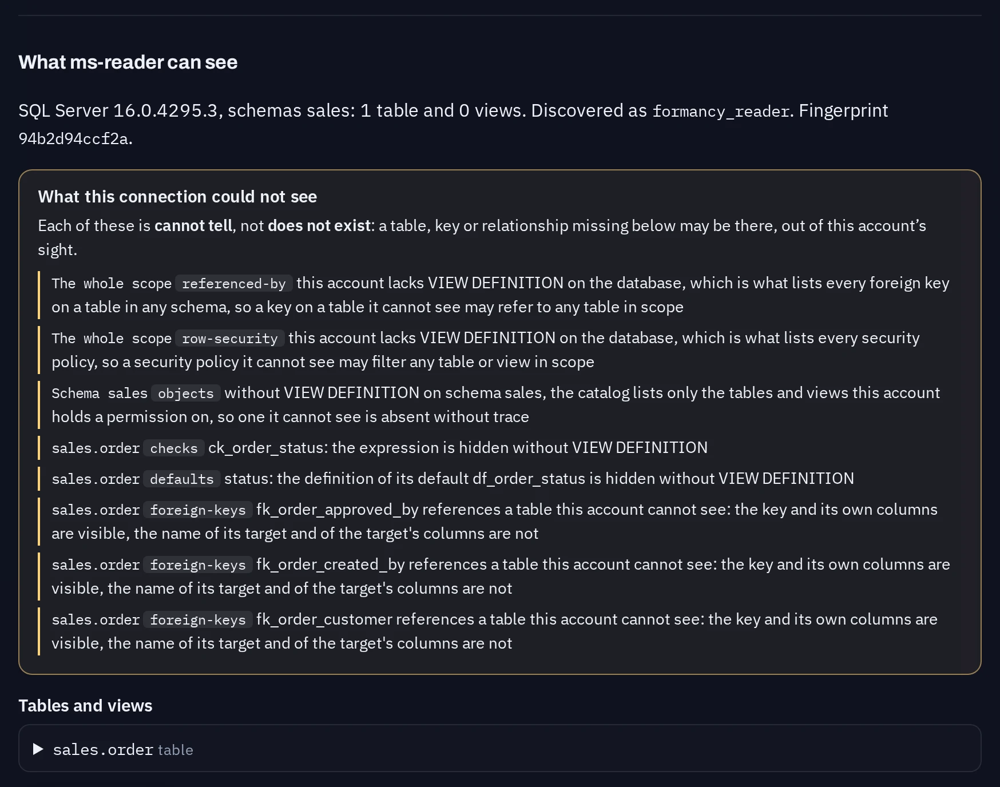

**Step 1, Connect.** *On SQL Server, as an account without VIEW DEFINITION. What the catalog hid from it comes first, each gap “cannot tell”, not “does not exist”, so a table or key missing below is never taken as absent ([0004](../decisions/0004-a-snapshot-says-what-it-could-not-see.md), [0007](../decisions/0007-sqlserver-discovery-and-what-it-hides.md)).*

<details>
<summary>More: Choose</summary>

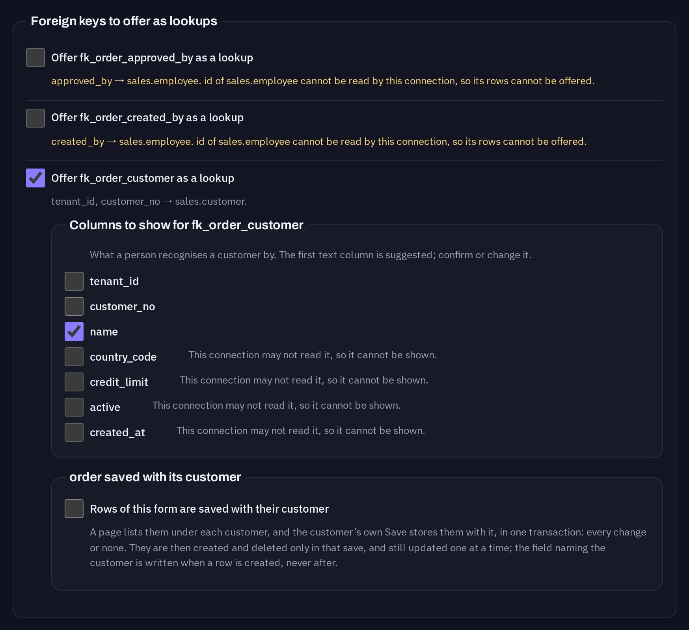

**Step 2, Choose.** *As the order form's own account. A foreign key is offered as a lookup only where this account may read its target: `approved_by` and `created_by` point at `sales.employee`, whose rows “cannot be offered”, and the customer columns it may not read “cannot be shown” ([0027](../decisions/0027-a-snapshot-says-what-its-account-may-do.md)).*

</details>

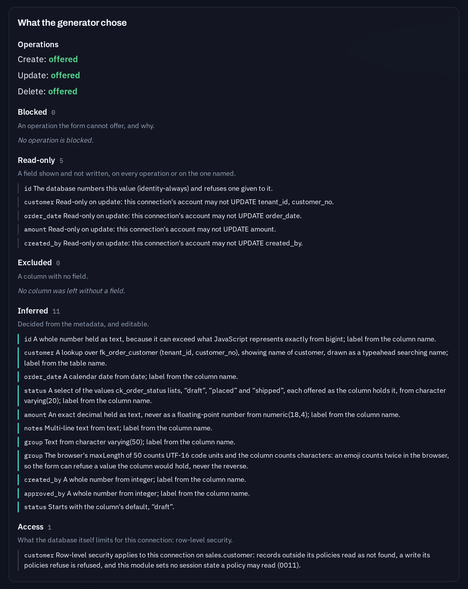

**Step 3, Generate.** *The generator says what it chose and what it refused, kind by kind, from what this account may do: a column it may not update is “Read-only on update”, and “Row-level security applies” to it on `sales.customer`, named as the database's own limit ([0009](../decisions/0009-generation-is-deterministic-and-says-what-it-chose.md), [0027](../decisions/0027-a-snapshot-says-what-its-account-may-do.md)).*

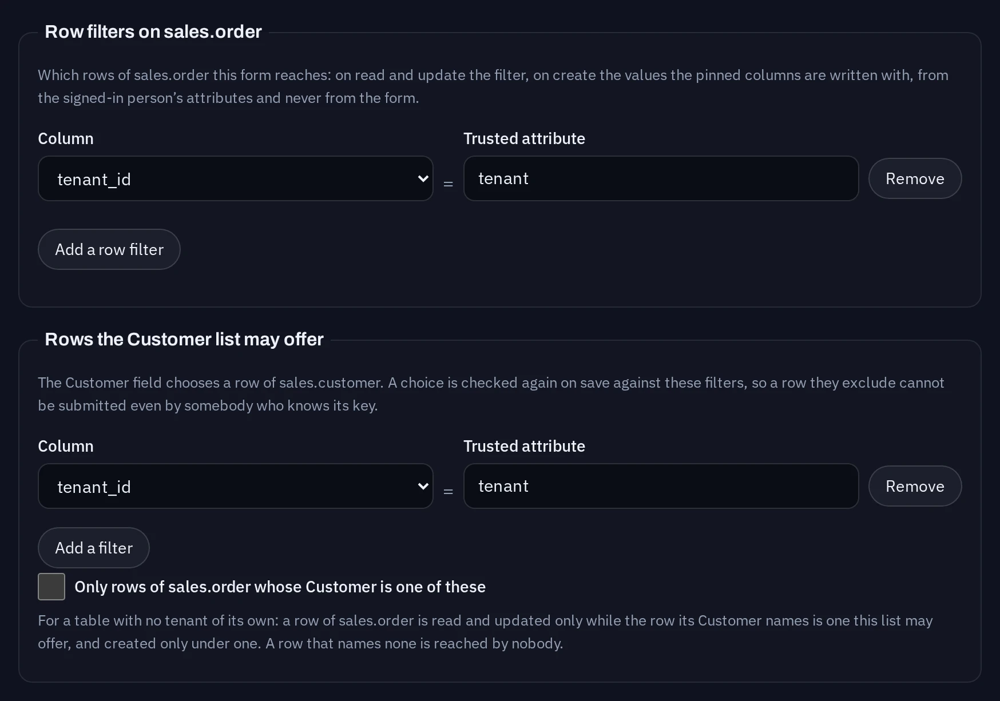

**Step 4, Policy.** *The tenant pin becomes a row filter on the orders this form reaches and on the customers its list may offer, taken from the signed-in person's attributes “and never from the form”; a customer outside the filter is refused on save “even by somebody who knows its key” ([0011](../decisions/0011-every-operation-carries-a-trusted-policy-context.md)).*

<details>
<summary>More: Order lines through their order, Presentation, Preview</summary>

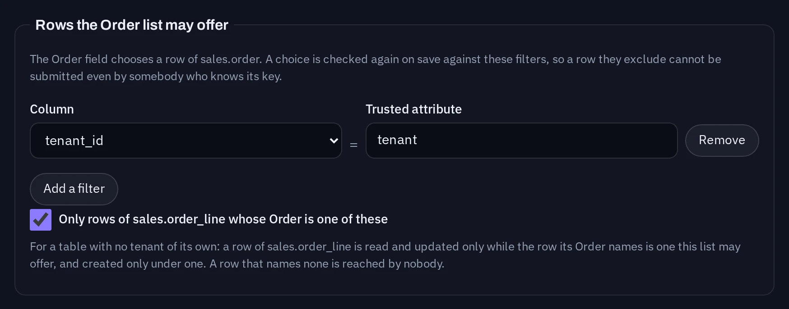

*A form over `sales.order_line`, which has no tenant column, discovered as the fixture's owner because the order form's own account may not read the lines. Its Order list is filtered to the person's tenant; ticked, the box “Only rows of sales.order_line whose Order is one of these” makes another tenant's line not found on read and update, and “A row that names none is reached by nobody.” Unticked, the step notes that nothing scopes the rows; nothing requires the box ([0043](../decisions/0043-a-child-forms-rows-are-reached-only-through-a-parent-its-policy-admits.md)).*


**Step 5, Presentation.** *Labels, help text, starting values, order, section and width are a patch over the generated form: every row names the column it is bound to and may move to the other section, nothing here adds, removes or renames a field, and an empty label is refused: “A label needs words a person can read.” ([0030](../decisions/0030-presentation-is-a-patch-over-the-generated-base.md), [0075](../decisions/0075-a-field-may-move-to-another-generated-section.md), [0150](../decisions/0150-an-administrator-gives-a-field-another-starting-value.md)).*

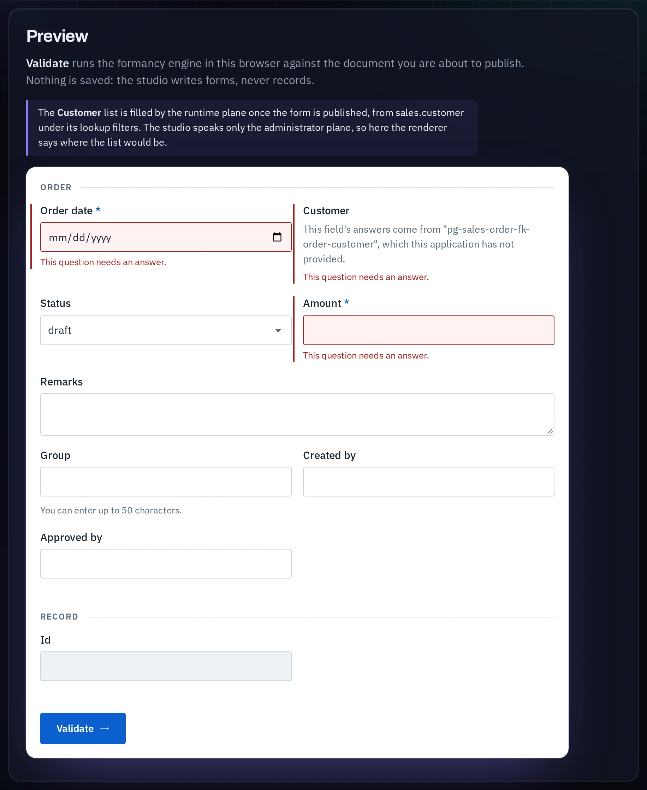

**Step 6, Preview.** *The form as the people filling it in will see it, with the labels and order chosen in Presentation, on white paper in the Blueprint theme, and checked by the released engine after Validate. The Customer list is filled only by the runtime plane, so “the renderer says where the list would be”.*

</details>

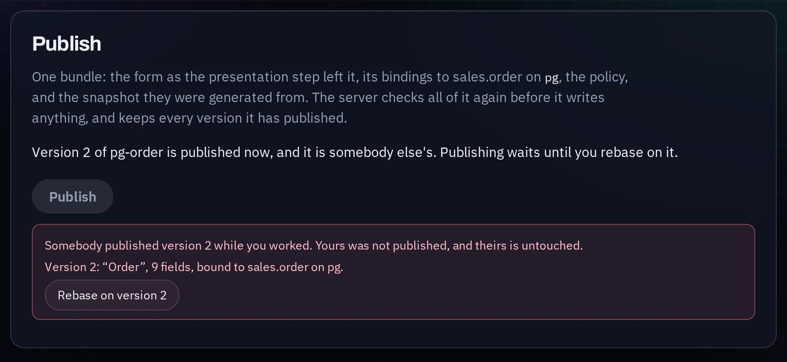

**Step 7, Publish.** *Another administrator, grace, published version 2 while ada worked; the capture script sends grace's request to the same server. Nothing is overwritten: “Yours was not published, and theirs is untouched.” The step says which version is published now, and “Publishing waits until you rebase on it.” ([0013](../decisions/0013-published-configuration-is-files-with-link-based-swap.md)).*

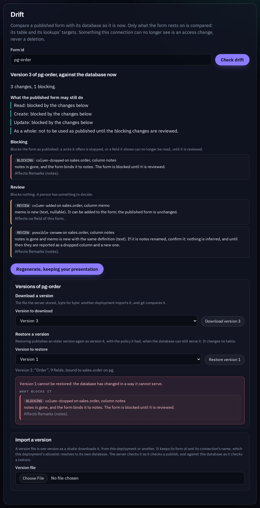

**Step 8, Drift.** *After the capture script renamed `notes` to `memo` in the captured snapshot, as discovery reports a real rename on both engines. The rename is a “possible-rename” for a person to confirm, not a guess, and restoring version 1, which still binds `notes`, is refused: “Version 1 cannot be restored: the database has changed in a way it cannot serve.” Against a database changed this way the server refuses what the report blocks ([0010](../decisions/0010-drift-is-classified-against-the-bindings.md), [0030](../decisions/0030-presentation-is-a-patch-over-the-generated-base.md), [0041](../decisions/0041-the-runtime-refuses-what-drift-blocks.md)).*

<details>
<summary>More: Regenerated, Carried, Restored, A key that moved</summary>

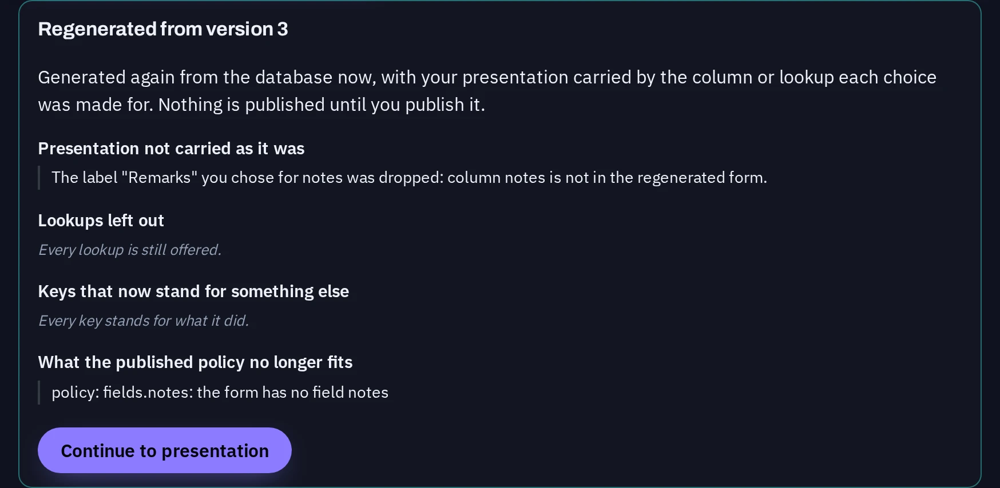

*Regenerated from the database as it is now, keeping the presentation, and saying before anything is published what it could not carry: the label chosen for `notes`, and the policy entry that names it. “Nothing is published until you publish it.”*

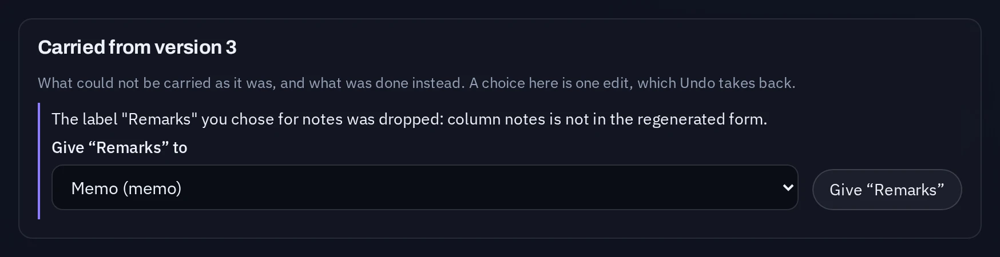

*Back in Presentation, the dropped label is offered to the new column as one edit, “which Undo takes back”; nothing carries it by guessing that `memo` is `notes`.*

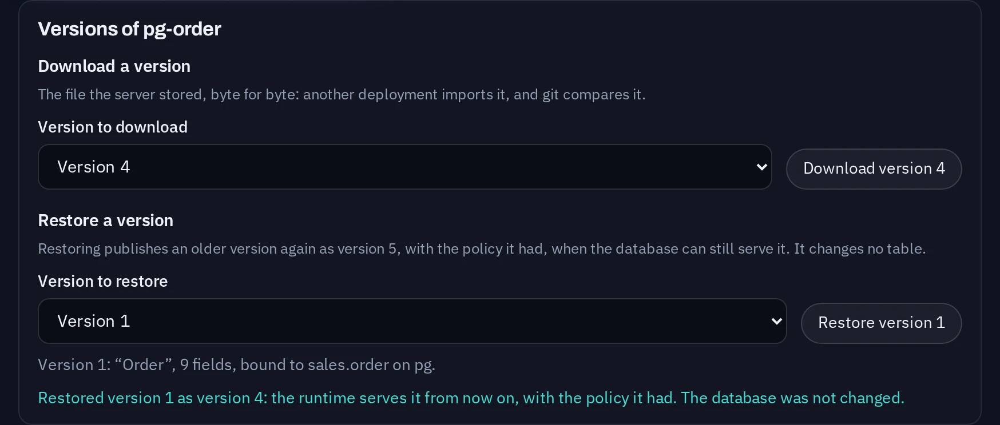

*After the capture script put the snapshot back without the rename, version 1 fits the database again and is restored as the next version, with the policy it had: “The database was not changed.”*

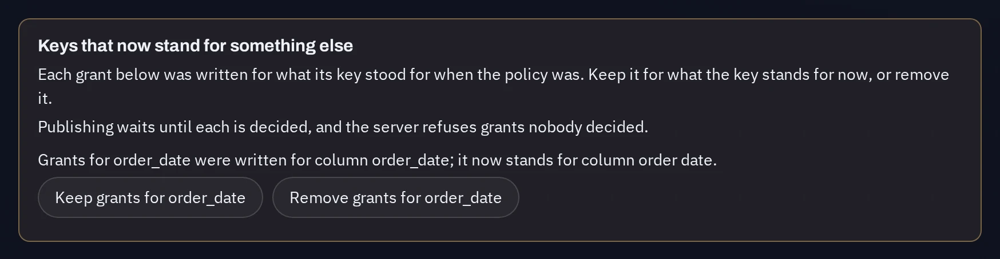

*The capture script renamed `order_date` to `order date` in the captured snapshot with the drift's function, which the adapters' suites compare with a real rename of `notes` only. Regenerated, the key `order_date` now names the column `order date`, and nothing can tell whether that is the same column, so its grants wait: “Keep grants for order_date”, or remove them. “Publishing waits until each is decided, and the server refuses grants nobody decided.” ([0039](../decisions/0039-a-publish-says-what-happens-to-the-grants-of-reassigned-keys.md)).*

</details>

<!-- end generated -->

```bash
pnpm build
FORMANCY_DATA_SERVER=http://127.0.0.1:4390 pnpm --filter @formancy/data-studio dev   # http://localhost:4392
```

The administrator's plane answers no other origin
([0060](../decisions/0060-the-runtime-plane-answers-the-origins-an-operator-lists-and-the-administrators-plane-none.md)), so the studio is served from the server's
origin: in development Vite proxies `/v1` to `FORMANCY_DATA_SERVER`, and in a
deployment one reverse proxy serves `apps/studio/dist` and `/v1` together, as
[*Deploying*](deploying.md) says. The token is held in the tab's memory only;
reloading the page signs out. The server needs its administrator plane turned
on — a store, an allowlist and `FORMANCY_DATA_ADMIN_ROLES`, as
[its README](../../packages/data-server/README.md) says; against a server without
one, the studio says so at sign-in. Against a server that reviews
publication, it submits a draft where it would publish or import, and a
Review step lists the drafts for a publisher to approve or reject
([0065](../decisions/0065-with-publisher-roles-set-a-draft-is-published-only-when-a-publisher-who-did-not-submit-it-approves-it.md)). Its last step, Browse, pages through the rows of
a discovered connection's tables and views for a holder of a browse role,
and waits for one otherwise
([0099](../decisions/0099-a-browse-role-reads-any-table-or-views-rows-as-the-connections-account-does.md));
a row's Related button lists the foreign keys it can be followed through,
either way, from the discovery the studio holds, and a follow pages the
other end narrowed to the row's values, with Back to the page it left
([0103](../decisions/0103-a-browsed-row-follows-its-foreign-keys-either-way.md)).
A page is filtered by conditions on its columns, each offered what its
type and the discovery's nullability allow
([0104](../decisions/0104-a-list-and-a-browse-are-filtered-by-conditions-on-their-columns.md)),
and seen three ways that never disagree: typed as a line above the table,
`country_code = CH and credit_limit > 125.50`, which completes a column,
an operator and a boolean's value as it is typed, and marks and keeps a
line it cannot read; each condition a chip with its own Remove, Clear the
filter after them and Undo for what a removal took; and a box under each
column's header holding that column's condition, a boolean's a select. A
column is named by its name lower-cased, every run of anything that is not
a letter or a digit one `_`, `order_date` for `Order Date`; where two names
give one, each column is named by its own name instead, and one whose own
name is not one word has no name in the line and no box -- `Order Date`
beside `order_date` -- nor have two that differ only in case, `Code` beside
`code`. A timestamp's range is whole days; `/` puts the keyboard on the line
and Esc gives it back to the table. A press while a page is on its way is
sent once it has arrived, on the filter as it then stands. Every condition must hold, and paging
and sorting keep them; a follow starts the other end unfiltered, and Back
returns the page it left with its filter. A refusal is the step's alert,
with what was typed kept
([0147](../decisions/0147-the-studio-browses-with-the-filter-line-its-chips-and-a-box-under-each-header.md)).

On the Choose step, under a lookup whose foreign key is NOT NULL and onto
another table, "Rows of this form are saved with their order" makes the
form's rows ones a host page holds under each order and stores with the
order's own Save, in one transaction; ticked, "At least" and "At most" say
how many each order holds, starting at none and at the cap data-core
gives, one row less than a list's page. Nothing ticks it for you. Ticked,
it says that a save holds one level: a form saved with each line then
saves none, and where it requires a row, no line can be created -- which
nothing refuses when either is published. Two keys onto one table are
told apart by their foreign keys. Where the generator would refuse it
-- row security on the table, a section, a form over versions, another
lookup already ticked -- the box is not offered and says why in the
generator's words; ticked, what the generator, the bundle check and
publishing refuse of it is listed under it in theirs, and changes as the
bounds and the pins do -- "rowFilters: tenant_id is outside order's
foreign key", or on SQL Server the most rows one batch holds. On a table that
keeps a rowversion, "Rows saved with these records move the rowversion
through" names the column a save of a record's rows alone sets to itself,
from the columns the generator takes and none chosen; without one, rows
are saved with such a record only as it is created. The step asks the
generator in the browser, against the snapshot it discovered; the Policy
step's check names a policy that narrows the rows by anything but their
record, and the Publish step waits on a max past one batch
([0155](../decisions/0155-a-records-rows-may-be-saved-with-it-in-one-transaction-guarded-by-its-version-and-checked-as-a-whole.md)).

Under each field's help text, the Presentation step says what a new record
starts the field with, as the generator noted it -- "Generated: Starts with
the column's default, “draft”." -- and takes another: a box for text and
numbers and, for a yes or no, its two answers. A column's default is never
taken away: a field left empty is left out of a create, and the database
stores its default without the person seeing it, so emptied the box keeps
what it had and says so, and None is offered only where the column has no
default. "Use the column’s default" gives the column's back. A value is
checked as the server checks it before it is set -- its column's codec and
its box, a line break or a tab refused in a one-line box; not the
database's CHECK constraints or a SQL Server code page, which the save
meets -- set as a record holding it reads back, `9.5000` for 9.5 in a
`numeric(18,4)`, and refused in the step's status and under its box, in
the server's words, with what was typed kept; on the state field it must be
a state a create starts a record in. A lookup,
a field the create does not write, a date, a time, an instant, a float and
a uuid take none, and the row says why: a lookup's answer is a record the
person may not be allowed to choose, and the others have no case here that
creates, stores and reads back a starting answer of their kind
([0150](../decisions/0150-an-administrator-gives-a-field-another-starting-value.md)).

Under the Presentation step's arrangement, List views names the form's
list views: each a name, conditions on the fields the form's list can be
filtered by, offered by their labels, each value typed in a box of its
own with a hint under them, an order of fields each ascending or descending, and "The grid
opens on this view" on at most one. A view is checked as the server checks
it before it is saved, and refused with the server's sentence with what
was typed kept; each saved view is said in words, and edited, removed and
moved by keyboard. Generate again and a regeneration carry the views by
the columns they name, and list one they had to drop; the Publish step
sends them in the presentation, and a reviewer sees them under the draft's
policy. "Offered to roles, empty for everyone" names the roles a view is
offered to, and the view's words end with them
([0124](../decisions/0124-a-list-view-may-be-offered-to-some-roles-and-open-their-grids.md)).
A date's condition may "Count in days from today", its bounds then whole
days, and an equality on text, a whole number or a uuid may be "Equals the
signed-in person’s attribute", its box then the attribute's name; the
view's words say "from 7 days before today to today" and "= your
employee"
([0125](../decisions/0125-a-list-view-may-count-days-from-today-and-compare-with-the-signed-in-persons-attribute.md)).
Saving, removing and moving a view are not on Undo and Redo
([0105](../decisions/0105-a-forms-list-offers-views-its-administrator-named.md)).
Where the Policy step holds a field to moves, State labels, after the
views, gives each state its moves name a label, "Label of placed", which
the host page offers it by; a label of a state the moves no longer name is
left out of the publish
([0129](../decisions/0129-an-administrator-labels-a-state-fields-states.md)).
Group, last, is the group a host's list of forms puts the form under: one
box that shows it -- the root schema's name in words, "Sales", or empty
for the engine's own default schema, until another is typed -- and No
group, which empties it and which Undo does not take back. What is typed is
kept without the spaces around it, a group past 80 characters is refused in
the box, and the publish leaves the default out; Generate again and a
regeneration keep the group, and a reviewer sees it under the draft's
policy, "(the default)" after it where the draft names none
([0143](../decisions/0143-a-form-is-listed-in-a-group.md)).

Its suite runs the real server in the test — `createDataServer` with a fake
connection registry over snapshots captured from the shared fixture, as every
account `apps/studio/scripts/capture-snapshots.mjs` captures — behind a fake
`fetch`, so a change to a response shape fails the studio's tests.
`pnpm test:browser` walks the whole journey in Chromium against the same
server, and with `FORMANCY_BROWSERS=all` in Firefox and WebKit too, as CI's
legs do. After a change to the fixture, with Docker running:

```bash
pnpm build
pnpm --filter @formancy/data-studio snapshot
```

and commit the files under `apps/studio/src/fixtures/`.
